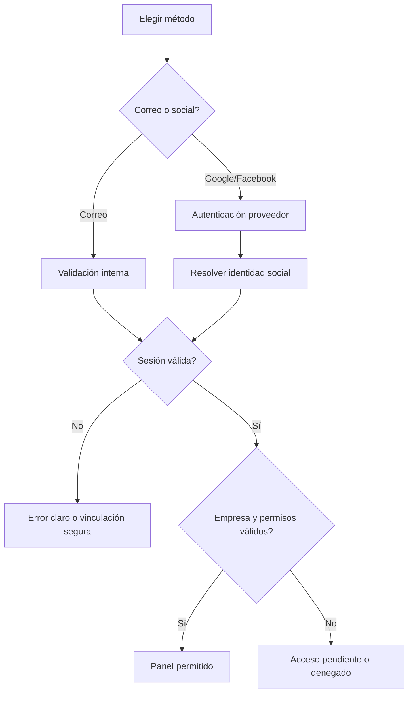

# UX-01 — Diseño de experiencia y flujos de usuario

**Proyecto:** SaaS Inversiones R&P | **Versión:** 1.0 | **Estado:** propuesta no auditada en código  
**Ámbito:** procesos originalmente planificados para Sprints 1–5 y criterios anticipados para 6–9.  
**Referencias:** Documento Maestro v1.1 (M01–M12), Backlog v1.1 (US-UX01 a US-UX07), SDD-01.

## 1. Propósito

Mejorar efectividad, eficiencia, comprensión y prevención de errores en operaciones de un negocio de manualidades, pasamanería, bisutería y textiles con tienda y almacén separados. **UX no autoriza cambios a reglas de stock o permisos.**

## 2. Usuarios y necesidades (hipótesis por validar)

| Perfil | Necesidades principales | Restricciones |
|---|---|---|
| Administrador/gerencia | Supervisar existencias, costos, auditoría y usuarios | Acceso según permisos reales |
| Cajera/almacenera | Registrar entradas, salidas, compras y ubicaciones con rapidez y exactitud | Operaciones críticas requieren confirmación |
| Vendedor | Consultar producto, variante, ubicación y disponibilidad | No mostrar márgenes ni información restringida |
| Usuario SaaS nuevo | Comprender cómo ingresar y operar | No recibe roles solo por Google/Facebook |

No asumir estos perfiles como resultado de investigación de campo; programar entrevistas y observación para confirmarlos.

## 3. Principios de interacción

1. Dar visibilidad al **producto + variante + unidad + ubicación + cantidad disponible** antes de operar.
2. Prevenir registros duplicados con bloqueo de envíos durante procesamiento y respuesta idempotente si el backend lo admite.
3. Distinguir crear/editar/confirmar/revertir; no borrar movimientos confirmados.
4. Comunicar mensajes entendibles, sin exponer datos técnicos o de otras empresas.
5. Mostrar operaciones y permisos únicamente cuando corresponden; la autorización final siempre ocurre en backend.
6. Permitir uso móvil, navegación por teclado y enfoque visible.

## 4. Inventario de flujos

| Código | Flujo | Módulo | Sprint de referencia |
|---|---|---|---|
| UX-F01 | Inicio de sesión local/Google/Facebook | M01 | S1 + cambio nuevo |
| UX-F02 | Buscar, crear y editar producto/variante | M02 | S2 |
| UX-F03 | Definir unidad, conversión y ubicación | M03–M04 | S3 |
| UX-F04 | Registrar entrada y salida | M05 | S4 |
| UX-F05 | Registrar proveedor y compra | M07 | S5 |
| UX-F06 | Solicitar/confirmar traslado | M06 | S5 |
| UX-F07 | Consultar métricas y alertas | M08–M09 | S6 previsto |
| UX-F08 | Conteo físico y conciliación | M10 | S7 previsto |
| UX-F09 | Consultar chatbot de solo lectura | M11 | S8 previsto |

## 5. UX-F01 — Inicio de sesión

**Inicio:** pantalla de acceso con correo/contraseña, Google, Facebook. **Éxito:** sesión interna autorizada y destino según rol/empresa. **Excepciones:** cancelación, falta de invitación, identidad no vinculada, error de red. **No realizar vinculación automática por correo.**

**Criterios:** no exponer existencia de correos; botones accesibles; no guardar tokens en navegador de forma insegura; recuperación local visible.

## 6. UX-F02 — Catálogo y variantes

**Ruta:** buscar → seleccionar producto o crear → completar categoría/marca/variante/códigos → validar duplicados → guardar → confirmar resultado. Debe permitir editar categoría seleccionada precargando valores **si esta historia se aprueba**. El producto debe mostrarse con variantes claramente identificadas.

**Errores:** código duplicado, campos vacíos, autorización, conflicto concurrente. **Evidencia:** tests de formulario y resultados por rol.

## 7. UX-F03 — Unidades y ubicaciones

**Ruta:** seleccionar producto → unidad de medida → equivalencia aplicable → ubicación jerárquica → revisar resultado. Mostrar valor convertido, precisión y unidad de referencia. No redondear ni consolidar equivalencias sin política aprobada. Evitar ubicaciones de otra empresa.

## 8. UX-F04 — Entradas y salidas

### Entrada
1. Elegir producto y variante.
2. Seleccionar unidad, cantidad y ubicación destino.
3. Mostrar resumen de datos, posible conversión y motivo.
4. Confirmar una sola vez; mostrar número/id del movimiento.
5. Reflejar stock actualizado **desde respuesta del backend**, no por simple supuesto UI.

### Salida
1. Localizar producto y variante.
2. Ver disponibilidad por ubicación y unidad.
3. Indicar cantidad, unidad y motivo.
4. Validar cantidad/stock en servidor y confirmar.
5. Mostrar éxito o rechazo (stock insuficiente, concurrencia, permisos).

**Invariantes:** no stock negativo; movimientos confirmados no se eliminan, se compensan bajo política de reversión aprobada. **No modificar estas reglas por comodidad UX.**

## 9. UX-F05 — Compras y proveedores

Buscar proveedor → añadir ítems/variantes → mostrar costo y cantidad según autorización → revisar total y unidades → confirmar compra → consultar historial. Los precios históricos deben conservarse; el acceso al margen depende del rol. Distinguir compra registrada de ingreso de existencias si el backend maneja etapas separadas.

## 10. UX-F06 — Traslados

Seleccionar origen → variante/unidad/cantidad → destino → validar no coincidencia origen/destino → confirmar → ver estado y, si aplica, recepción. Mostrar stock por ubicación luego de confirmación de servidor. Cualquier estado intermedio debe corresponder a un modelo de negocio **existente y documentado**.

## 11. UX-F07 a UX-F09 — Anticipación sin afirmar implementación

- **Métricas:** total de productos, detalles, agotados, stock mínimo, valoración, más salidas, sin movimiento y resumen; filtros claros y sin indicadores engañosos de carga.
- **Conteos:** capturar, revisar diferencia, autorizar ajuste y mantener evidencia de auditoría.
- **Chatbot:** consulta de datos visibles al rol, señalización de incertidumbre y solo lectura.

## 12. Estados por pantalla

| Estado | Diseño esperado |
|---|---|
| Inicial | Foco/jerarquía clara |
| Cargando | Indicador proporcional, sin bloquear innecesariamente |
| Vacío | Mensaje contextual con acción disponible |
| Error de validación | Mensaje cercano al campo, sin perder entradas |
| Error de servidor | Explicación segura, posibilidad de reintentar |
| Éxito | Confirmación inequívoca y referencia de operación |
| Sin permisos | Mensaje de acceso restringido, sin filtraciones |

## 13. Pruebas de usabilidad y criterios de aceptación

- Evaluar tareas de acceso, búsqueda, entrada, salida, compra y traslado con usuarios representativos.
- Registrar éxito, errores, retrocesos, ayuda requerida y tiempo de tarea.
- Metas **propuestas, no resultados**: éxito ≥95 % en tareas críticas; SUS ≥80; WCAG 2.2 AA donde aplique.
- No adoptar como aprobación automática las métricas propuestas sin línea base y muestra definida.
- Validar con teclado, lector de pantalla y anchos móviles/desktop.

## 14. Trazabilidad y evidencia

| Flujo | Historias | Pruebas previstas |
|---|---|---|
| UX-F01 | US-0111…0115 | UI + integración + seguridad |
| UX-F02 | US-0201…0203, US-UX02 | Catálogo y validaciones |
| UX-F03 | US-0301…0303, US-UX03 | Conversiones y ubicaciones |
| UX-F04 | US-0401…0406, US-UX04 | Stock, reversión y concurrencia |
| UX-F05/F06 | US-0501…0503, US-UX05 | Compras, traslados, permisos |
| UX-F07 | US-0601…0603, US-UX06 | Métricas y alertas |

## 15. Checklist OpenCode

- [ ] Inspeccionar pantallas reales antes de proponer cambios.
- [ ] Capturar rutas y componentes existentes.
- [ ] Documentar hallazgos como implementado/parcial/pendiente.
- [ ] Validar flujos con personal operativo.
- [ ] Priorizar correcciones sin romper stock y permisos.
- [ ] Mantener evidencias en `TESTING/`.
