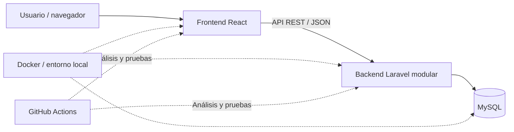

# CANVAS TÉCNICO — SPRINT 0 (ITERACIÓN 0)
## SaaS Inversiones R&P | Fundación técnica y decisiones

| Campo | Definición |
|---|---|
| Proyecto | SaaS Inversiones R&P |
| Épica | EP-00 — Fundación técnica y decisiones |
| Sprint / iteración | 0 |
| Duración sugerida | 2 semanas, ajustables a la capacidad del equipo |
| Prioridad | P0 — imprescindible para el MVP o bloqueo técnico |
| Stack previsto | React · Laravel · MySQL · API REST/JSON |
| Fuente | Backlog técnico de implementación, versión 1.0, noviembre de 2026 |

> **Alcance:** Las historias, criterios de aceptación y tareas identificadas como **del backlog** proceden del documento base. Los ejemplos de estructura, pruebas, checklist y secuencia son **propuestas de implementación** que deben validarse. El Sprint 0 prepara el proyecto; no implica que ya se haya desarrollado el producto.

## 1. Objetivo de la iteración

Establecer una base ejecutable y reproducible del SaaS, acordar la arquitectura y el modelo lógico de datos, definir la estrategia de aislamiento multiempresa y resolver o registrar formalmente las decisiones de negocio que bloquean el desarrollo.

**Resultado esperado del backlog:** proyecto ejecutable, arquitectura acordada, pipeline inicial y modelo de datos inicial. **No** construir anticipadamente todos los módulos ni todas las tablas.

## 2. Canvas de alcance

| Bloque | Incluido | Fuera de alcance |
|---|---|---|
| Arquitectura | React separado de Laravel; backend monolítico modular; API REST/JSON; MySQL | Microservicios y módulos funcionales completos |
| Repositorio | Git, estructura base, ramas, commits, revisiones, versionado API | Funcionalidades completas de inventario |
| Datos | Modelo lógico, relaciones, restricciones, `empresa_id`, claves únicas por tenant | Migrar todo el modelo físico antes de necesitarlo |
| Infraestructura | Docker, entornos, conexión Laravel–MySQL, CI GitHub Actions | Despliegue productivo definitivo |
| Decisiones | DP-01 a DP-10 y DD-01 a DD-05 documentadas | Dar por aprobadas reglas que siguen pendientes |
| Calidad | Instalación, análisis y pruebas base automatizadas | Cobertura integral de funciones aún inexistentes |

## 3. Historias de usuario y criterios de aceptación

### US-0001 — Acordar arquitectura y estructura del repositorio

**Historia del backlog:** Como equipo de desarrollo, queremos una arquitectura y estructura de repositorio acordadas para trabajar con responsabilidades claras.

**Prioridad:** P0.

**Criterios de aceptación del backlog:**
- Se documenta React separado de Laravel y comunicación mediante API REST/JSON.
- Se define backend modular monolítico y MySQL como persistencia.
- Se establecen convenciones de ramas, commits, revisión de código y versionado de API.

**Tareas técnicas del backlog:**
- Crear repositorio Git y estructura de carpetas.
- Crear proyecto base Laravel y React.
- Documentar módulos, convenciones y estrategia de ramas.
- Definir configuración por ambiente sin guardar secretos en el repositorio.

### US-0002 — Definir modelo de datos y estrategia multiempresa

**Historia del backlog:** Como responsable del producto, quiero aprobar el modelo de datos y la estrategia de aislamiento para evitar rediseños y exposición de información entre empresas.

**Prioridad:** P0.

**Criterios de aceptación del backlog:**
- Se revisan entidades y relaciones del modelo lógico.
- Se decide cómo se representa `empresa_id` en tablas pertenecientes a cada tenant.
- Se documentan restricciones, claves, índices y relaciones principales.
- No se habilita desarrollo funcional dependiente de decisiones aún abiertas.

**Tareas técnicas del backlog:**
- Revisar empresa, usuario, rol, permiso, producto, variante, existencia, movimientos, compras, ventas, traslados, conteos, auditoría y alertas.
- Definir alcance de `empresa_id` y claves únicas por tenant.
- Definir estrategia de aislamiento compartido y pruebas de separación.
- Preparar diagrama entidad-relación y diccionario de datos.

### US-0003 — Preparar entorno local y pipeline inicial

**Historia del backlog:** Como desarrollador, quiero levantar el sistema de forma reproducible y validar cambios automáticamente.

**Prioridad:** P0.

**Criterios de aceptación del backlog:**
- Docker permite iniciar los servicios locales acordados.
- GitHub Actions ejecuta instalación, análisis y pruebas base.
- La configuración local, test y producción está separada.

**Tareas técnicas del backlog:**
- Crear Dockerfile/compose para los componentes necesarios.
- Configurar conexión Laravel–MySQL mediante variables de entorno.
- Configurar workflow de CI para dependencias y pruebas.
- Añadir plantilla de variables de entorno y guía de instalación.

### US-0004 — Cerrar decisiones de negocio que afectan el diseño

**Historia del backlog:** Como Product Owner, quiero resolver las decisiones abiertas para que el equipo implemente reglas coherentes.

**Prioridad:** P0.

**Criterios de aceptación del backlog:**
- Cada decisión tiene responsable, decisión, fecha y evidencia.
- Las decisiones no resueltas quedan marcadas como bloqueantes para las historias afectadas.

**Tareas técnicas del backlog:**
- Resolver o registrar DP-01 a DP-10 y sus impactos.
- Resolver decisiones de datos DD-01 a DD-05.
- Actualizar modelo, reglas y criterios de aceptación conforme a las decisiones aprobadas.

## 4. Arquitectura técnica base



**Reglas del backlog:** React no accede directamente a MySQL; Laravel centraliza las reglas de negocio y autorización; MySQL protege la integridad de los datos. La estrategia de tenant debe diseñarse desde esta iteración.

## 5. Estructura inicial del repositorio (propuesta)

```text
saas-inversiones-rp/
├── frontend/                  # React
├── backend/                   # Laravel
├── infra/                     # Docker y configuración local
├── docs/
│   ├── arquitectura/
│   ├── datos/
│   ├── decisiones/             # Registro de decisiones y ADR
│   └── api/
├── .github/workflows/         # Integración continua
├── .env.example               # Plantilla, nunca credenciales reales
└── README.md
```

La estructura es orientativa y debe quedar ratificada en US-0001.

## 6. Diseño de datos inicial

**Artefactos a aprobar:** diagrama entidad-relación lógico, diccionario de datos, listado de tablas con y sin ámbito empresarial, política de claves compuestas/únicas e índices, estrategia de borrado lógico y auditoría.

**Preguntas críticas:**
1. ¿Qué tablas tienen `empresa_id` y cómo se evita acceder a datos de otra empresa?
2. ¿El correo electrónico es único globalmente o por empresa (DD-01)?
3. ¿Los roles y permisos son globales o específicos por empresa (DD-04)?
4. ¿Dónde reside el stock mínimo (DD-02)?
5. ¿Qué alcance tiene la ubicación en los movimientos (DD-03)?
6. ¿Cómo se manejan borrado lógico y auditoría (DD-05)?

**Propuesta de verificación:** revisar el modelo con ejemplos de dos empresas y comprobar que una misma clave de negocio pueda coexistir entre tenants cuando así se apruebe, sin permitir referencias cruzadas indebidas.

## 7. Registro de decisiones de negocio pendientes (del backlog)

| ID | Decisión a cerrar | Impacto principal |
|---|---|---|
| DP-01 | Quién registra salidas por venta | US-0403 e integración futura con ventas |
| DP-02 | Método de valorización de inventario | US-0601 y reportes de valor |
| DP-03 | Conversión y redondeo de unidades | US-0302 y US-0402 a US-0503 |
| DP-04 | Conteos durante ventas y movimientos | US-0701 y US-0702 |
| DP-05 | Autorización cuando no está el administrador | US-0405 y US-0702 |
| DP-06 | Retención y recuperación de datos | US-0903 |
| DP-07 | Disponibilidad y rendimiento esperados | US-0902 y US-0903 |
| DP-08 | Límites y reglas de planes SaaS | Fase comercial posterior |
| DP-09 | Precios y márgenes por variante | US-0601 e informes financieros |
| DP-10 | Importación de inventario histórico | Sprint 0 y carga inicial |

| ID | Decisión de datos pendiente |
|---|---|
| DD-01 | Unicidad global o por empresa del correo electrónico |
| DD-02 | Nivel de configuración del stock mínimo |
| DD-03 | Alcance de ubicación en detalle de movimiento |
| DD-04 | Roles y permisos globales o por empresa |
| DD-05 | Borrado lógico y relaciones de auditoría |

**Formato de registro propuesto:** `ID | Alternativas | Decisión | Responsable | Fecha | Evidencia | Historias afectadas | Estado (aprobada / pendiente-bloqueante)`.

> No se atribuye ninguna respuesta definitiva a DP-01–DP-10 ni DD-01–DD-05: el backlog las identifica como decisiones pendientes.

## 8. Infraestructura y CI (propuesta de implementación)

| Componente | Actividad | Evidencia de finalización |
|---|---|---|
| Docker | Construir/levantar servicios acordados | `docker compose up` sin errores bloqueantes |
| Laravel | Proyecto base, variables de entorno y conexión MySQL | Endpoint de salud o prueba equivalente |
| React | Proyecto base y cliente API inicial | Pantalla base y compilación exitosa |
| MySQL | Conexión, esquema inicial mínimo y configuración por entorno | Prueba de conexión |
| GitHub Actions | Instalar dependencias, análisis y pruebas base | Pipeline verde en pull request |
| Seguridad | `.gitignore`, `.env.example`, sin secretos versionados | Revisión de configuración |
| Documentación | README con requisitos y pasos reproducibles | Instalación verificada por otro integrante |

El backlog menciona PHPUnit/Pest, Vitest, SonarQube y OWASP Dependency-Check como herramientas previstas de calidad. Su integración progresiva debe planificarse; no se afirma que estén ya configuradas.

## 9. Secuencia de trabajo sugerida (dos semanas)

| Fase | Actividades | Historias |
|---|---|---|
| Inicio | Alinear objetivos, responsables y criterios de aceptación | Todas |
| Días 1–3 | Arquitectura, repositorio y proyectos base | US-0001 |
| Días 2–6 | Modelo lógico, aislamiento y diccionario de datos | US-0002 |
| Días 4–8 | Docker, configuración de entornos y CI | US-0003 |
| Días 1–9 | Talleres y registro de decisiones, actualización del diseño | US-0004 |
| Días 9–10 | Pruebas, revisión de evidencias, demo y retrospectiva | Todas |

**Nota:** calendario propuesto, no compromiso aprobado del equipo. Las tareas pueden realizarse en paralelo.

## 10. Matriz de pruebas y evidencias (propuesta)

| ID | Verificación | Resultado esperado |
|---|---|---|
| T0-01 | Clonar e instalar el repositorio desde README | Instalación reproducible |
| T0-02 | Levantar servicios con Docker | Servicios activos |
| T0-03 | React consume endpoint base de Laravel | Comunicación REST/JSON funcional |
| T0-04 | Laravel conecta con MySQL | Conexión correcta |
| T0-05 | Ejecutar CI tras pull request | Instalación, análisis y pruebas base exitosos |
| T0-06 | Comprobar ausencia de secretos en Git | Credenciales no versionadas |
| T0-07 | Revisar DER y diccionario de datos | Entidades, claves, índices y relaciones documentadas |
| T0-08 | Revisar modelo con dos empresas | Estrategia de aislamiento definida y casos de prueba preparados |
| T0-09 | Auditar decisiones DP/DD | Responsable, fecha, evidencia o bloqueo explícito |
| T0-10 | Revisar dependencias del Sprint 1 | Sin decisiones estructurales silenciosamente pendientes |

## 11. Definition of Done para la iteración (propuesta)

- [ ] Las cuatro historias US-0001 a US-0004 cumplen sus criterios de aceptación.
- [ ] La arquitectura y las convenciones están documentadas y aprobadas.
- [ ] React y Laravel ejecutan sus proyectos base y se comunican mediante API.
- [ ] MySQL y Docker funcionan en el entorno local acordado.
- [ ] CI ejecuta instalación, análisis y pruebas base.
- [ ] Modelo lógico, DER, diccionario y estrategia multiempresa están revisados.
- [ ] Cada DP/DD tiene decisión documentada o bloqueo formal visible.
- [ ] No se incorporan secretos al repositorio.
- [ ] README permite reproducir el entorno.
- [ ] Product Owner y equipo revisan evidencias y aceptan el alcance logrado.

## 12. Riesgos y controles

| Riesgo | Control |
|---|---|
| Desarrollar funciones antes de resolver reglas | Marcar historias dependientes como bloqueadas |
| Filtración entre empresas | Definir `empresa_id`, restricciones y aislamiento desde Sprint 0 |
| Diseñar todas las tablas prematuramente | Modelo lógico completo; migraciones físicas incrementales |
| Diferencias entre entornos | Docker y configuración separada local/test/producción |
| Cambios sin validación | Pull requests, revisión y CI automatizada |
| Decisiones tomadas sin trazabilidad | Registro de decisiones con responsables y evidencia |

## 13. Demostración y aceptación de la iteración

**Guion de demo propuesto:**
1. Mostrar estructura del repositorio y documentación de arquitectura.
2. Levantar los servicios desde Docker siguiendo el README.
3. Mostrar comunicación entre React, API Laravel y MySQL.
4. Ejecutar pruebas base y mostrar el pipeline de GitHub Actions.
5. Presentar DER, diccionario y estrategia multiempresa.
6. Presentar el registro DP/DD con decisiones aprobadas y bloqueos visibles.
7. Confirmar qué condiciones están listas para iniciar Sprint 1.

**Criterio de éxito:** la base técnica es ejecutable y reproducible, las decisiones estructurales necesarias están aprobadas y cualquier bloqueo residual queda documentado, sin fingir que está resuelto.

## 14. Entregables de Sprint 0

- Repositorio Git con React y Laravel base.
- Documento de arquitectura y convenciones de trabajo.
- Esquema de módulos y contratos API iniciales.
- DER lógico y diccionario de datos inicial.
- Estrategia documentada de `empresa_id` y aislamiento multiempresa.
- Dockerfiles / Compose y configuración de ambientes.
- Pipeline inicial de GitHub Actions.
- README y plantilla de variables de entorno.
- Registro de decisiones DP-01 a DP-10 y DD-01 a DD-05.
- Evidencia de pruebas y acta de revisión/aceptación.

---

**Documento de trabajo derivado de:** *Backlog técnico de implementación — SaaS Inversiones R&P, versión 1.0, noviembre de 2026*. Las propuestas complementarias requieren validación del equipo y del Product Owner.
