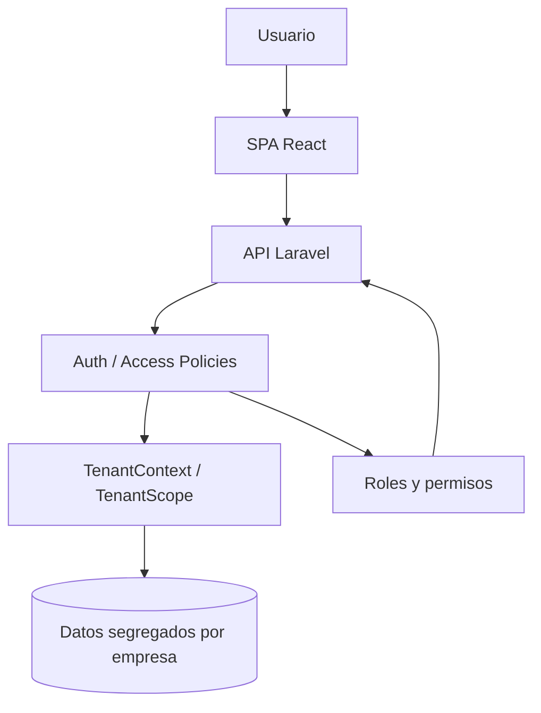

# CANVAS TÉCNICO — SPRINT 1
## SaaS Inversiones R&P | Identidad, acceso y multiempresa

| Campo | Definición |
|---|---|
| Proyecto | SaaS Inversiones R&P |
| Épica | EP-01 — Identidad, acceso y multiempresa |
| Sprint | 1 |
| Duración sugerida | 2 semanas (propuesta del plan de sprints; ajustable) |
| Prioridad | P0 — imprescindible para el MVP o bloqueo técnico |
| Stack previsto | React (frontend), Laravel (backend), base de datos relacional según arquitectura aprobada |
| Fuente | Backlog técnico de implementación, versión 1.0, noviembre de 2026 |

> **Alcance del documento:** las historias, criterios de aceptación y tareas principales se basan en el backlog. Las secciones identificadas como **propuesta de implementación** son recomendaciones operativas, no decisiones ya aprobadas.

## 1. Objetivo del sprint

Implementar un incremento demostrable de identidad y acceso: inicio y cierre de sesión, administración de usuarios, roles y permisos, y aislamiento de datos entre empresas (tenants).

**Resultado esperado:** usuarios autenticados que acceden únicamente a funciones y datos autorizados dentro de su ámbito empresarial.

**Dependencia crítica:** la estrategia de tenant/`empresa_id` debe quedar definida desde el Sprint 0.

## 2. Canvas de alcance

| Bloque | Incluido en Sprint 1 | Fuera del alcance de este sprint |
|---|---|---|
| Autenticación | Login, logout, protección de rutas y gestión segura de sesión/token | Recuperación avanzada de cuentas, SSO, MFA, salvo decisión adicional |
| Usuarios | Registrar, editar, activar, desactivar y asignar roles | Nómina y gestión de recursos humanos |
| Autorización | Permisos por módulo y acción, validación en backend y controles de interfaz | Reglas de permisos específicas de módulos todavía no implementados |
| Multiempresa | Resolver empresa activa y aislar lecturas/escrituras | Facturación y comercialización de planes SaaS |
| Calidad | Pruebas de autenticación, permisos y aislamiento | Pruebas finales de producción de todo el sistema |

## 3. Historias de usuario y criterios de aceptación

### US-0101 — Iniciar sesión y cerrar sesión

**Historia:** Como usuario, quiero autenticarme para acceder únicamente a las funciones autorizadas.

**Prioridad:** P0.

**Criterios de aceptación del backlog:**
- El usuario puede iniciar y cerrar sesión.
- Las credenciales inválidas no permiten el acceso.
- Las rutas protegidas rechazan solicitudes no autenticadas.
- La sesión/token se gestiona de forma segura para la arquitectura SPA.

**Tareas técnicas del backlog:**
- Crear migraciones y modelos de usuario/empresa.
- Implementar autenticación Laravel; evaluar Laravel Sanctum para SPA.
- Definir flujo CSRF/cookies o token según despliegue.
- Crear endpoints y pantallas React de acceso.
- Agregar pruebas de autenticación y expiración.

### US-0102 — Administrar usuarios y asignar roles

**Historia:** Como administrador, quiero crear y administrar usuarios para controlar quién utiliza el sistema.

**Prioridad:** P0.

**Criterios de aceptación del backlog:**
- Se puede registrar, editar, activar y desactivar usuarios según permisos.
- Cada usuario pertenece al ámbito empresarial definido.
- No se permite asignar roles fuera del ámbito autorizado.

**Tareas técnicas del backlog:**
- Crear migraciones de usuario, rol y tablas pivote.
- Implementar modelos, relaciones, validaciones y políticas.
- Crear endpoints CRUD y pantallas React.
- Probar acceso entre empresas y asignaciones no autorizadas.

### US-0103 — Aplicar permisos por módulo y acción

**Historia:** Como administrador, quiero definir permisos para que cada trabajador vea y ejecute solo lo permitido.

**Prioridad:** P0.

**Criterios de aceptación del backlog:**
- El backend verifica permisos en cada endpoint protegido.
- La interfaz oculta o deshabilita acciones no autorizadas sin sustituir la validación del servidor.
- Los trabajadores sin permiso no pueden consultar costos/márgenes restringidos.

**Tareas técnicas del backlog:**
- Crear permisos y relaciones `rol_permiso`/`usuario_permiso` si se aprueba.
- Implementar middleware, policies y gates.
- Proteger endpoints y componentes de navegación.
- Crear pruebas positivas y negativas por rol.

### US-0104 — Aislar datos por empresa

**Historia:** Como empresa cliente, quiero que mis registros no sean visibles ni modificables por otra empresa.

**Prioridad:** P0.

**Criterios de aceptación del backlog:**
- Toda consulta limitada a tenant aplica el contexto de empresa.
- Las operaciones de lectura y escritura no permiten cambiar `empresa_id` manipulando la petición.
- Las pruebas demuestran que un tenant no accede a otro.

**Tareas técnicas del backlog:**
- Implementar resolución del tenant autenticado.
- Aplicar scopes, repositorios y policies en modelos y consultas.
- Validar tenant en relaciones y operaciones compuestas.
- Crear pruebas automatizadas de aislamiento.

## 4. Arquitectura funcional del sprint

**Regla de diseño:** React presenta únicamente las opciones permitidas, pero Laravel es la autoridad para autenticación, autorización y aislamiento de datos. Los servicios `Auth / Access Policies` y `TenantContext / TenantScope` son componentes internos de Laravel, no microservicios independientes.

## 5. Canvas de datos

El backlog identifica para esta épica las entidades `empresa`, `usuario`, `rol`, `permiso`, `usuario_rol`, `rol_permiso` y, de aprobarse, `usuario_permiso`.

| Entidad / relación | Propósito | Consideración |
|---|---|---|
| `empresa` | Representar cada cliente/tenant | Identificador estable del ámbito empresarial |
| `usuario` | Identidad, estado y credenciales | Relación empresarial según modelo aprobado |
| `rol` | Agrupar capacidades | Determinar si es global o por empresa |
| `permiso` | Representar acciones autorizadas | Definir convención por módulo y acción |
| `usuario_rol` | Asignación de roles | Impedir asignaciones entre empresas |
| `rol_permiso` | Permisos concedidos a roles | Consistencia de ámbito |
| `usuario_permiso` | Excepciones directas, si se aprueba | No asumir su implementación sin decisión |

**Decisiones pendientes del backlog:** `DD-01` (unicidad global o por empresa del correo electrónico), `DD-04` (roles y permisos globales o por empresa) y la estrategia de aislamiento definida en Sprint 0. Los campos exactos, claves e índices deben derivarse del modelo de datos aprobado; no se dan aquí por definitivos.

## 6. Propuesta de implementación por capa

> Esta sección organiza el trabajo; las rutas, componentes y nombres de pruebas son **ejemplos propuestos**, no contratos API aprobados.

| Capa | Entregables sugeridos |
|---|---|
| Frontend React | Pantalla de login, gestión de usuarios, asignación de roles, navegación condicionada por permisos, estados de carga y error |
| Backend Laravel | Controladores delgados, servicios de autenticación y tenant, middleware de acceso, policies/gates, validaciones y respuestas API consistentes |
| Base de datos | Migraciones de identidad, relaciones, restricciones e índices de tenant conforme a las decisiones de diseño |
| Seguridad | Protección de rutas, gestión segura de sesión, validación de permisos del lado servidor, pruebas de manipulación de `empresa_id` |
| Pruebas | Casos positivos y negativos de autenticación, permisos y acceso entre tenants |
| Documentación | Contrato API de autenticación/usuarios, matriz de permisos y registro de decisiones técnicas |

### Flujos funcionales propuestos

**Acceso:** usuario ingresa credenciales → Laravel autentica → se establece sesión/token seguro → se determina empresa autorizada → React muestra funciones permitidas.

**Administración:** administrador autorizado registra o edita usuario → Laravel valida permisos y ámbito empresarial → guarda cambios → devuelve resultado a React.

**Aislamiento:** petición autenticada → se resuelve empresa → se aplica filtro/policy empresarial → se autoriza o deniega lectura/escritura.

## 7. Matriz inicial de pruebas

| ID | Escenario | Resultado esperado |
|---|---|---|
| T-01 | Inicio de sesión con credenciales válidas | Acceso autorizado |
| T-02 | Credenciales inválidas | Acceso rechazado |
| T-03 | Acceso a endpoint protegido sin autenticación | Solicitud rechazada |
| T-04 | Cierre de sesión y reutilización de credenciales de sesión invalidadas | Acceso protegido rechazado según mecanismo adoptado |
| T-05 | Usuario sin permiso intenta crear otro usuario | Operación rechazada por backend |
| T-06 | Usuario sin permiso intenta consultar costos/márgenes | Datos restringidos no disponibles |
| T-07 | Administrador de empresa A intenta asignar rol fuera de su ámbito | Operación rechazada |
| T-08 | Usuario de empresa A intenta consultar registro de empresa B | Acceso rechazado o registro no visible |
| T-09 | Petición modifica manualmente `empresa_id` | No permite cruzar ámbito empresarial |
| T-10 | React oculta una acción, pero se llama directamente a su API | Laravel sigue denegando la operación |

## 8. Plan de trabajo sugerido (dos semanas)

| Fase | Trabajo prioritario | Evidencia |
|---|---|---|
| Inicio | Validar decisiones del Sprint 0, contratos y modelo | Decisiones registradas y tareas listas |
| Bloque 1 | Migraciones, modelos y autenticación | Login/logout funcional y pruebas |
| Bloque 2 | Usuarios, roles y permisos | CRUD protegido y pruebas por rol |
| Bloque 3 | TenantContext/TenantScope y aislamiento | Pruebas negativas entre empresas |
| Cierre | Integración React–Laravel, revisión, documentación y demo | Incremento aceptado |

La secuencia es orientativa; la distribución exacta depende de la capacidad del equipo.

## 9. Definition of Ready (DoR)

Una historia está lista para entrar al Sprint cuando:
- Su objetivo y valor de negocio son comprensibles.
- Tiene criterios de aceptación verificables.
- Se conocen dependencias de datos, API, permisos e interfaz.
- Las decisiones necesarias están resueltas o explícitamente excluidas.
- El equipo entiende y puede estimar el alcance.
- Existen diseños o contratos necesarios.

## 10. Definition of Done (DoD)

Una historia se considera terminada únicamente cuando:
- Cumple todos los criterios de aceptación.
- Las migraciones, relaciones, índices y restricciones están implementados y revisados.
- Las reglas de negocio residen en Laravel, sin duplicar la autoridad en React.
- Las validaciones y autorizaciones de backend están activas.
- React consume la API y contempla carga, error y estado vacío.
- Las pruebas pertinentes pasan en integración continua.
- No existen vulnerabilidades críticas conocidas ni defectos bloqueantes.
- La documentación técnica y API está actualizada cuando corresponde.
- El código fue revisado y el Product Owner acepta el incremento.

## 11. Riesgos y controles

| Riesgo | Control propuesto |
|---|---|
| Exposición de información entre empresas | Diseñar `empresa_id` y TenantScope desde Sprint 0; pruebas negativas en CI |
| Permisos aplicados solo en React | Verificación obligatoria en cada endpoint protegido de Laravel |
| Asignaciones de roles fuera de ámbito | Validaciones y políticas de tenant en backend |
| Gestión insegura de sesión SPA | Definir explícitamente estrategia CSRF/cookies o token según despliegue |
| Ambigüedad de roles y correos | Resolver DD-01 y DD-04 antes de cerrar diseño |

## 12. Demostración y aceptación del sprint

**Guion de demo propuesto:**
1. Acceder correctamente y cerrar sesión.
2. Demostrar rechazo de credenciales inválidas y de rutas sin autenticación.
3. Crear, editar, activar/desactivar un usuario desde un administrador autorizado.
4. Asignar un rol válido y demostrar rechazo de asignaciones no autorizadas.
5. Demostrar una acción bloqueada por permisos en frontend y backend.
6. Usar dos empresas de prueba y verificar que ninguna consulta o modificación cruza sus límites.
7. Mostrar las pruebas automatizadas y la evidencia de CI.

**Criterio de éxito del sprint:** las cuatro historias US-0101 a US-0104 cumplen sus criterios de aceptación y la Definition of Done; el Product Owner acepta el incremento.

## 13. Entregables del Sprint 1

- Código integrado de React y Laravel para identidad y acceso.
- Migraciones y modelos de identidad/empresa aprobados.
- Autenticación y gestión de sesión seguras.
- CRUD de usuarios y asignación de roles con autorización.
- Políticas de permisos y aislamiento multiempresa.
- Pruebas automatizadas y resultados de CI.
- Contratos API, matriz de permisos y decisiones de diseño actualizadas.
- Demostración funcional y evidencia de aceptación.

---

**Documento de trabajo derivado de:** *Backlog técnico de implementación — SaaS Inversiones R&P, versión 1.0, noviembre de 2026*. Las propuestas complementarias requieren validación del equipo y del Product Owner.
