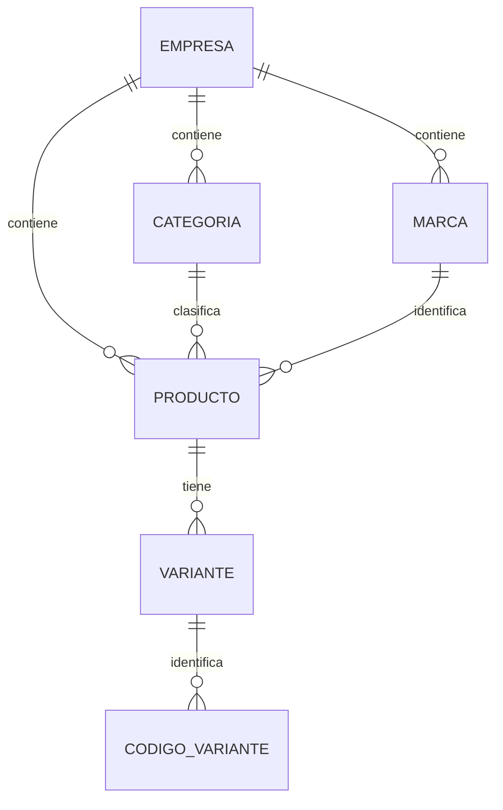
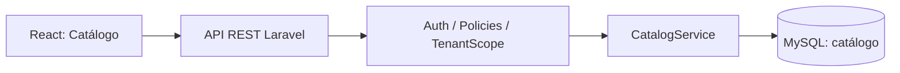

# CANVAS TÉCNICO — SPRINT 2 (ITERACIÓN 2)
## SaaS Inversiones R&P | Catálogo de productos

| Campo | Definición |
|---|---|
| Proyecto | SaaS Inversiones R&P |
| Épica | EP-02 — Catálogo de productos |
| Sprint / iteración | 2 |
| Duración sugerida | 2 semanas, ajustable |
| Prioridad | P1 para US-0201, US-0202 y US-0203 |
| Stack previsto | React · Laravel · MySQL · API REST/JSON |
| Dependencias | Sprint 0: modelo de catálogo; Sprint 1: identidad, permisos y aislamiento multiempresa |
| Fuente | Backlog técnico de implementación, versión 1.0, noviembre de 2026 |

> **Criterio de lectura:** las historias, prioridades, criterios de aceptación y tareas marcadas como **del backlog** se transcriben o sintetizan fielmente del documento fuente. Endpoints, tablas detalladas, reglas adicionales, cronograma y escenarios específicos son **propuestas de implementación**, pendientes de validación.

## 1. Objetivo de la iteración

Implementar el **catálogo administrable** de categorías, marcas, productos, variantes y códigos, con validaciones en Laravel, interfaz React, autorización por rol y aislamiento de datos entre empresas.

**Incremento demostrable:** un usuario autorizado registra categorías y marcas, crea un producto, define sus variantes/códigos, busca y consulta los registros, los edita o desactiva y comprueba que otra empresa no puede acceder a ellos.

## 2. Canvas de alcance

| Bloque | Incluido en Sprint 2 | Fuera del alcance |
|---|---|---|
| Categorías y marcas | Crear, listar, editar y desactivar; validar duplicados | Jerarquías complejas no aprobadas |
| Productos | Alta, consulta, edición, desactivación, búsqueda y detalle | Stock real, movimientos, valorización |
| Variantes y códigos | Crear y relacionar variantes; controlar unicidad de códigos | Conversiones de unidades (Sprint 3) |
| Seguridad | Policies y validación de tenant en API y relaciones | Nuevas funciones de identidad del Sprint 1 |
| Calidad | Pruebas de API, UI, unicidad, referencias y aislamiento | Pruebas integrales de producción (Sprint 9) |

## 3. Historias de usuario oficiales

### US-0201 — Gestionar categorías y marcas

**Historia del backlog:** Como administrador, quiero mantener categorías y marcas para clasificar el catálogo.

**Prioridad:** P1.

**Criterios de aceptación del backlog:**
- Se pueden crear, editar, listar y desactivar categorías/marcas.
- Se evita duplicidad según la regla de unicidad aprobada.
- Los registros están aislados por empresa cuando corresponda.

**Tareas técnicas del backlog:**
- Crear migraciones y relaciones.
- Implementar validaciones, endpoints y políticas.
- Construir formularios, tablas, filtros y estados en React.
- Agregar pruebas de API y UI.

### US-0202 — Registrar y mantener productos

**Historia del backlog:** Como encargado de almacén, quiero registrar productos con sus datos principales para controlar el catálogo.

**Prioridad:** P1.

**Criterios de aceptación del backlog:**
- Se puede crear, consultar, editar y desactivar un producto.
- Los campos obligatorios y códigos únicos se validan en backend.
- No se elimina un producto que tenga movimientos históricos; se restringe o desactiva.

**Tareas técnicas del backlog:**
- Crear tabla producto y relaciones.
- Implementar modelo, servicio de catálogo, requests y resource API.
- Crear listado, búsqueda, detalle y formulario React.
- Agregar pruebas de integridad e historial.

### US-0203 — Gestionar variantes y códigos

**Historia del backlog:** Como encargado, quiero registrar variantes y sus códigos para identificar presentaciones distintas del producto.

**Prioridad:** P1.

**Criterios de aceptación del backlog:**
- Un producto puede tener una o más variantes según reglas aprobadas.
- Los códigos de variante no se duplican dentro del ámbito definido.
- La variante se puede seleccionar en las operaciones de inventario.

**Tareas técnicas del backlog:**
- Crear variante y `codigo_variante` con claves e índices.
- Implementar relaciones y validaciones.
- Exponer endpoints y formularios de variantes.
- Probar unicidad y referencias.

**Nota de dependencia:** la selección de variantes debe quedar disponible para su integración posterior; no implica implementar movimientos de inventario en este sprint.

## 4. Diseño funcional del módulo (propuesta)

| Pantalla React | Acciones | Validación clave |
|---|---|---|
| Categorías | Listar, filtrar, crear, editar, desactivar | Nombre único en ámbito aprobado |
| Marcas | Listar, filtrar, crear, editar, desactivar | Nombre único en ámbito aprobado |
| Productos | Buscar, listar, crear, consultar detalle, editar, desactivar | Campos obligatorios y códigos |
| Variantes | Añadir/editar variantes asociadas a producto | Producto válido y del mismo tenant |
| Códigos de variante | Registrar y consultar códigos | Unicidad y relación válida |

**Estados de interfaz recomendados:** cargando, lista vacía, error de red, error de validación, operación exitosa y acceso denegado. Confirmar desactivaciones antes de ejecutarlas.

## 5. Modelo de datos (propuesta sujeta al diseño aprobado)

El backlog establece este grupo de tablas en el **tercer orden de migración**: `categoria`, `marca`, `producto`, `variante`, `codigo_variante`.

| Entidad | Campos orientativos, no definitivos | Relaciones propuestas |
|---|---|---|
| categoria | id, empresa_id, nombre, activo, timestamps | 1:N producto |
| marca | id, empresa_id, nombre, activo, timestamps | 1:N producto |
| producto | id, empresa_id, categoria_id, marca_id, nombre, descripcion, activo, timestamps | N:1 categoría/marca; 1:N variante |
| variante | id, empresa_id, producto_id, nombre, activo, timestamps | N:1 producto; 1:N codigo_variante |
| codigo_variante | id, empresa_id, variante_id, codigo, tipo, timestamps | N:1 variante |

**Reglas de integridad propuestas:**
1. Las referencias entre categoría, marca, producto y variante deben corresponder al mismo tenant cuando sean datos empresariales.
2. Definir y aprobar si la unicidad de nombres y códigos es global o por `empresa_id`; no asumirlo.
3. Aplicar índices y restricciones únicas en MySQL, además de validación Laravel.
4. Acordar cómo se aplicará **DD-05: borrado lógico y relaciones de auditoría**.
5. Preservar referencias históricas cuando existan movimientos; en este sprint preparar el comportamiento de desactivación, sin implementar movimientos.

> El diagrama es **conceptual/propuesto**; confirmar cardinalidades y campos opcionales en el modelo de datos aprobado.

## 6. Arquitectura y responsabilidades (propuesta)

- **React:** presentación, formularios, búsqueda, mensajes y estados.
- **Laravel Controllers:** contratos HTTP y delegación; evitar reglas de negocio en controladores.
- **Form Requests:** campos obligatorios, formatos, unicidad y referencias autorizadas.
- **Policies / TenantScope:** comprobar permisos y empresa activa en cada operación.
- **CatalogService:** concentrar reglas de categorías, marcas, productos y variantes, como prevé el backlog.
- **MySQL:** claves foráneas, índices y restricciones consistentes con las decisiones aprobadas.

El backlog define `CatalogService` como **componente interno del monolito Laravel**, no como microservicio independiente.

## 7. Contratos API sugeridos (no fijados por el backlog)

| Recurso | Métodos sugeridos | Uso |
|---|---|---|
| `/api/v1/categorias` | GET, POST | Listar y crear |
| `/api/v1/categorias/{id}` | GET, PATCH | Consultar y editar/desactivar |
| `/api/v1/marcas` | GET, POST | Listar y crear |
| `/api/v1/marcas/{id}` | GET, PATCH | Consultar y editar/desactivar |
| `/api/v1/productos` | GET, POST | Buscar, listar y crear |
| `/api/v1/productos/{id}` | GET, PATCH | Detalle y edición/desactivación |
| `/api/v1/productos/{id}/variantes` | GET, POST | Listar y registrar variantes |
| `/api/v1/variantes/{id}` | GET, PATCH | Consultar y modificar variante |
| `/api/v1/variantes/{id}/codigos` | GET, POST | Consultar y agregar códigos |

**Importante:** `empresa_id` se obtiene del contexto autenticado, no de un valor arbitrario confiado al frontend. Definir paginación, filtros, errores y formato de respuesta antes de implementar.

## 8. Seguridad y reglas transversales

- Reutilizar autenticación y autorización del Sprint 1.
- Verificar autorización en backend incluso si React oculta acciones.
- Impedir lecturas, escrituras y asociaciones entre tenants.
- Evitar duplicados bajo concurrencia mediante restricciones en base de datos.
- No borrar físicamente productos con historial; confirmar política de desactivación/borrado lógico.
- Registrar cambios relevantes según la estrategia de auditoría aprobada; la consolidación de auditoría corresponde a sprints posteriores.

## 9. Matriz de pruebas sugerida

| ID | Caso | Resultado esperado |
|---|---|---|
| CT-201 | Crear categoría válida | Se guarda en el tenant autorizado |
| CT-202 | Crear categoría duplicada | Se rechaza conforme a unicidad aprobada |
| CT-203 | Editar y desactivar marca | Cambios visibles y persistentes |
| CT-204 | Crear producto sin campo obligatorio | Error de validación backend |
| CT-205 | Consultar, buscar y editar producto | Resultados y detalle correctos |
| CT-206 | Desactivar producto | No aparece como activo; conserva relaciones necesarias |
| CT-207 | Crear variante para producto propio | Relación válida |
| CT-208 | Registrar código duplicado | Se rechaza en ámbito aprobado |
| CT-209 | Asociar variante a producto de otro tenant | Acceso rechazado |
| CT-210 | Consultar producto de otra empresa | No se revela información |
| CT-211 | Usuario sin permiso modifica catálogo | API deniega operación |
| CT-212 | Producto con historial no se elimina | Restricción efectiva cuando exista historial integrado |

**Pruebas a automatizar:** unitarias para reglas, feature/integración para API y base de datos, y UI para flujos principales. CT-212 requiere datos o integración que representen historial; puede verificarse definitivamente al incorporar movimientos en Sprint 4.

## 10. Plan de trabajo orientativo — 2 semanas

| Periodo | Actividades propuestas | Evidencia |
|---|---|---|
| Días 1–2 | Revisar modelo, decisiones de unicidad y DD-05; definir contratos | Acuerdos y migraciones revisadas |
| Días 3–4 | Implementar categorías y marcas en Laravel y React | CRUD y pruebas US-0201 |
| Días 5–7 | Implementar productos, validaciones, búsqueda y detalle | US-0202 demostrable |
| Días 8–9 | Implementar variantes y códigos, restricciones y pruebas | US-0203 demostrable |
| Día 10 | Pruebas de regresión, revisión, documentación y demo | Evidencia de aceptación |

La secuencia es una **estimación**, no un compromiso de calendario establecido por el backlog.

## 11. Definition of Ready (DoR)

Antes de iniciar, confirmar:
- Sprint 1 aporta autenticación, permisos y `TenantScope` funcionales.
- Existe un modelo de catálogo revisado y aprobado.
- Se resolvió la unicidad de códigos y nombres dentro de su ámbito.
- Se definieron campos obligatorios de producto y variante.
- Se aclaró DD-05 para desactivación y borrado lógico.
- Historias estimadas, criterios verificables y contratos preparados.

## 12. Definition of Done (DoD)

La iteración termina cuando:
- US-0201, US-0202 y US-0203 cumplen sus criterios de aceptación.
- Migraciones, índices, claves foráneas y restricciones están implementados y revisados.
- Laravel centraliza las reglas; React consume la API con carga, error y estado vacío.
- Validaciones y autorización de backend están activas.
- Pruebas pertinentes pasan en integración continua.
- No existen vulnerabilidades críticas conocidas ni defectos bloqueantes.
- Documentación de API y modelo actualizada; código revisado.
- Product Owner valida el incremento demostrado.

## 13. Riesgos, decisiones y entregables

| Riesgo / decisión | Tratamiento propuesto |
|---|---|
| Códigos duplicados entre variantes | Acordar ámbito de unicidad e imponer índice único |
| Asociación de entidades de distintas empresas | Validar tenant en cada relación y prueba negativa |
| Borrado que rompe historial | Aplicar política DD-05; desactivar cuando corresponda |
| Variantes ambiguas | Aprobar atributos mínimos y regla de identificación |
| Dependencia de inventario | Exponer variantes para integración posterior, sin anticipar stock |

**Entregables de Sprint 2:**
1. Migraciones y modelos de `categoria`, `marca`, `producto`, `variante` y `codigo_variante`.
2. `CatalogService`, validaciones, políticas y endpoints Laravel.
3. Pantallas React de categorías, marcas, productos y variantes.
4. Pruebas automatizadas y evidencia de aislamiento multiempresa.
5. Contratos API y documentación de decisiones actualizados.
6. Demostración de un catálogo completo listo para enlazarse con unidades/almacenes (Sprint 3) y movimientos de inventario (Sprint 4).

---

**Fuente principal:** *Backlog técnico de implementación — SaaS Inversiones R&P*, versión 1.0, noviembre 2026; épica EP-02, historias US-0201 a US-0203, plan de sprints, servicios de backend, DoR/DoD y decisiones DD-05. Las recomendaciones adicionales se identifican como propuestas.
