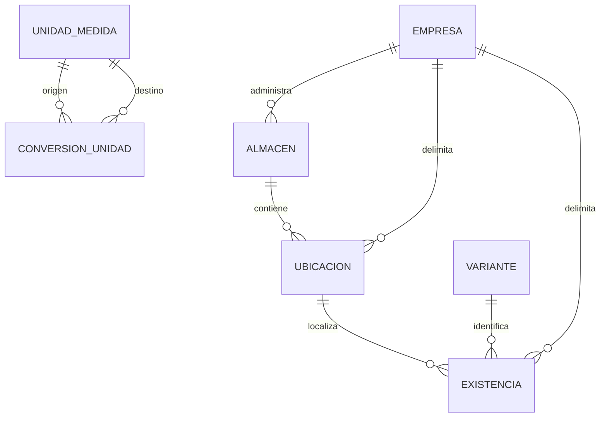
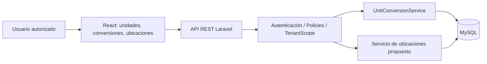

# CANVAS TÉCNICO — SPRINT 3 (ITERACIÓN 3)
## SaaS Inversiones R&P | Unidades de medida, conversiones y ubicaciones

| Campo | Definición |
|---|---|
| Proyecto | SaaS Inversiones R&P |
| Épica | EP-03 — Unidades y ubicaciones |
| Sprint / iteración | 3 |
| Duración sugerida | 2 semanas, ajustable |
| Prioridad | P1: US-0301, US-0302 y US-0303 |
| Stack previsto | React · Laravel · MySQL · API REST/JSON |
| Dependencias | Sprint 0: decisiones y arquitectura; Sprint 1: identidad y multiempresa; Sprint 2: catálogo y variantes |
| Fuente | Backlog técnico de implementación, versión 1.0, noviembre de 2026 |

> **Criterio de lectura:** historias, criterios de aceptación y tareas señaladas como «del backlog» proceden del documento fuente. Tablas, endpoints, campos, ejemplos, cronograma y escenarios concretos son **propuestas técnicas sujetas a aprobación**. No se considera cerrada la decisión DP-03 hasta su validación por negocio.

## 1. Objetivo de la iteración

Implementar el mantenimiento de unidades de medida, conversiones entre unidades compatibles y administración de almacenes/ubicaciones, respetando precisión decimal, autorización y aislamiento por empresa.

**Incremento demostrable:** un encargado autorizado registra unidades, configura una conversión aprobada, verifica una conversión válida y el rechazo de una incompatible, y crea ubicaciones de almacén sin exponer datos de otra empresa.

## 2. Canvas de alcance

| Bloque | Incluido en Sprint 3 | Fuera del alcance |
|---|---|---|
| Unidades | Mantenimiento de unidades activas, compatibilidad y precisión | Movimientos de inventario (Sprint 4) |
| Conversiones | Factores aprobados, redondeo, trazabilidad de cantidades | Valorización y costos (Sprints 5–6) |
| Almacenes y ubicaciones | Crear, editar y desactivar ubicaciones; restricciones | Traslados de stock (Sprint 5) |
| Seguridad | Policies Laravel, TenantScope y validación de referencias | Nuevas funciones de autenticación |
| Calidad | Pruebas de decimales, límites, conversiones inversas, restricciones | Endurecimiento final de producción (Sprint 9) |

## 3. Historias de usuario oficiales

### US-0301 — Configurar unidades de medida

**Historia del backlog:** Como encargado, quiero definir unidades para registrar cantidades de manera consistente.

**Prioridad:** P1. **Sprint sugerido:** 3.

**Criterios de aceptación del backlog:**
- Se pueden administrar unidades activas.
- Las cantidades aceptan decimales según precisión acordada.
- No se permiten unidades incompatibles.

**Tareas técnicas del backlog:**
- Crear `unidad_medida` y relaciones necesarias.
- Definir precisión/escala decimal en conjunto con negocio.
- Crear endpoints y pantallas de mantenimiento.
- Agregar pruebas de validación.

**Propuesta de interfaz:** listado con búsqueda, formulario de alta/edición, estado activo y mensajes de validación. No permitir cambios que invaliden relaciones existentes sin política aprobada.

### US-0302 — Configurar conversiones de unidades

**Historia del backlog:** Como encargado, quiero convertir unidades compatibles para operar con distintas presentaciones.

**Prioridad:** P1. **Sprint sugerido:** 3.

**Criterios de aceptación del backlog:**
- La conversión respeta factores y redondeo aprobados.
- Se rechazan conversiones no definidas o incompatibles.
- La cantidad original y la cantidad normalizada son trazables cuando aplique.

**Tareas técnicas del backlog:**
- Crear `conversion_unidad`.
- Implementar servicio de conversión reutilizable.
- Definir tratamiento de redondeo y precisión.
- Crear pruebas de límites, decimales y conversiones inversas.

**Propuesta de interfaz:** administrar factores autorizados y ofrecer un simulador de conversión que muestre cantidad original, factor, unidad destino y resultado normalizado.

### US-0303 — Administrar ubicaciones de almacén

**Historia del backlog:** Como encargado, quiero definir almacenes y ubicaciones para separar existencias físicamente.

**Prioridad:** P1. **Sprint sugerido:** 3.

**Criterios de aceptación del backlog:**
- Se pueden crear, editar y desactivar ubicaciones.
- Cada existencia queda asociada a una ubicación.
- No se desactiva una ubicación con stock sin una operación de traslado o resolución.

**Tareas técnicas del backlog:**
- Crear `ubicacion` y restricciones.
- Implementar endpoints y pantallas de mantenimiento.
- Definir índice único de existencia por empresa/variante/ubicación.
- Agregar pruebas de restricciones.

**Nota de dependencia:** la asociación efectiva de cada existencia y los traslados se completarán al integrar el núcleo de inventario (Sprint 4) y traslados (Sprint 5). En Sprint 3 deben quedar preparados el modelo y las restricciones correspondientes.

## 4. Reglas de negocio y decisión obligatoria

| ID | Regla o decisión | Estado |
|---|---|---|
| RN-03-01 | Solo convertir unidades compatibles | Exigencia del backlog |
| RN-03-02 | Respetar factores, precisión y redondeo aprobados | Exigencia del backlog; parámetros pendientes |
| RN-03-03 | Rechazar conversiones ausentes o inválidas | Exigencia del backlog |
| RN-03-04 | Mantener trazabilidad de cantidad original y normalizada cuando aplique | Exigencia del backlog |
| RN-03-05 | No desactivar ubicación con stock sin traslado o resolución | Exigencia del backlog |
| DP-03 | Reglas de conversión y redondeo de unidades | **Debe cerrarse antes de finalizar Sprint 3** |

**Acuerdos por aprobar en DP-03:** dimensiones permitidas (masa, volumen, conteo), unidad base por dimensión o producto, número de decimales, método de redondeo, comportamiento de conversiones inversas, vigencia de factores y manejo de presentaciones comerciales. No asumir equivalencias entre unidades de dimensiones distintas.

## 5. Modelo de datos propuesto

| Tabla | Campos propuestos (no definitivos) | Consideraciones |
|---|---|---|
| `unidad_medida` | `id`, `empresa_id` (si aplica), `codigo`, `nombre`, `dimension`, `escala_decimal`, `activo` | Unicidad por ámbito aprobado; no duplicar códigos |
| `conversion_unidad` | `id`, `empresa_id` (si aplica), `unidad_origen_id`, `unidad_destino_id`, `factor`, `activo` | Factor positivo, compatibilidad, evitar pares duplicados |
| `almacen` | `id`, `empresa_id`, `codigo`, `nombre`, `activo` | Entidad propuesta para agrupar ubicaciones; validar con diseño de datos |
| `ubicacion` | `id`, `empresa_id`, `almacen_id`, `codigo`, `nombre`, `activo` | Restricción de empresa y unicidad contextual |
| `existencia` (preparación para Sprint 4) | `empresa_id`, `variante_id`, `ubicacion_id`, `cantidad` | Índice único `(empresa_id, variante_id, ubicacion_id)` requerido por backlog |

**Decisión de diseño pendiente:** el backlog pide `ubicacion` y el índice de `existencia`, pero no impone los campos ni una tabla `almacen` separada. Confirmar con el Canvas de diseño de datos antes de migrar.

## 6. Arquitectura y componentes

**Del backlog:** `UnitConversionService` es un componente interno de Laravel, no un microservicio desplegado por separado. Los controladores deben ser delgados; las reglas viven en servicios y validaciones de backend.

## 7. Contratos API propuestos

| Método | Ruta ilustrativa | Propósito |
|---|---|---|
| GET | `/api/v1/unidades` | Listar unidades autorizadas |
| POST | `/api/v1/unidades` | Registrar unidad |
| PUT | `/api/v1/unidades/{id}` | Editar unidad |
| PATCH | `/api/v1/unidades/{id}/estado` | Activar/desactivar unidad |
| GET | `/api/v1/conversiones` | Listar conversiones |
| POST | `/api/v1/conversiones` | Crear factor aprobado |
| POST | `/api/v1/conversiones/simular` | Obtener cantidad normalizada sin movimiento |
| GET | `/api/v1/almacenes` | Listar almacenes |
| POST | `/api/v1/almacenes` | Crear almacén |
| GET | `/api/v1/ubicaciones` | Listar ubicaciones filtradas |
| POST | `/api/v1/ubicaciones` | Crear ubicación |
| PUT | `/api/v1/ubicaciones/{id}` | Editar ubicación |
| PATCH | `/api/v1/ubicaciones/{id}/estado` | Desactivar con restricciones |

**Contrato de respuesta sugerido para conversión:** `cantidad_original`, `unidad_origen`, `factor_aplicado`, `cantidad_normalizada`, `unidad_destino`, `regla_redondeo`. Evitar usar tipos de punto flotante binario para cantidades de negocio cuando se requiera precisión decimal.

## 8. Plan de trabajo sugerido (2 semanas)

| Periodo | Actividad | Evidencia |
|---|---|---|
| Día 1 | Refinar historias y resolver responsables de DP-03 | Acta de decisión y criterios cerrados |
| Días 2–3 | Migraciones, índices, relaciones y validaciones | Esquema y pruebas de restricciones |
| Días 4–5 | API y pantallas de unidades | Demo US-0301 |
| Días 6–7 | `UnitConversionService`, API y UI de conversiones | Demo US-0302 y pruebas decimales |
| Días 8–9 | Almacenes/ubicaciones, restricciones y pruebas de tenant | Demo US-0303 |
| Día 10 | Integración, revisión, retrospectiva y aceptación | Evidencia de CI y aprobación del PO |

El cronograma es orientativo y debe ajustarse a capacidad real del equipo.

## 9. Matriz de pruebas de aceptación propuesta

| ID | Escenario | Resultado esperado |
|---|---|---|
| T-0301 | Crear unidad válida | Se registra y consulta |
| T-0302 | Registrar unidad duplicada en ámbito definido | Rechazo por validación/índice |
| T-0303 | Ingresar cantidad con escala no permitida | Rechazo o tratamiento según DP-03 |
| T-0304 | Convertir unidades compatibles | Resultado conforme a factor aprobado |
| T-0305 | Convertir unidades incompatibles | Rechazo explícito |
| T-0306 | Solicitar conversión no configurada | Rechazo explícito |
| T-0307 | Probar conversión inversa | Resultado conforme a política aprobada |
| T-0308 | Probar valores límite y decimales | Sin pérdida fuera de tolerancia acordada |
| T-0309 | Crear y editar ubicación | Cambios persistidos en empresa correcta |
| T-0310 | Desactivar ubicación con stock | Operación bloqueada sin resolución/traslado |
| T-0311 | Consultar ubicación de otra empresa | Acceso denegado y sin fuga de datos |
| T-0312 | Duplicar existencia para empresa/variante/ubicación | Restricción única evita duplicación (al integrar Sprint 4) |

## 10. Seguridad y control multiempresa

- Resolver empresa activa desde el contexto autenticado; no confiar en `empresa_id` enviado libremente por el cliente.
- Aplicar Policies y TenantScope en consultas, altas, cambios de estado y referencias entre tablas.
- Probar acceso cruzado entre empresas y usuarios sin permiso.
- Validar factores positivos, dimensiones compatibles, escala decimal y unicidad en Laravel y MySQL.
- Registrar cambios relevantes de configuración; definir el nivel de auditoría requerido para esta etapa.

## 11. Definition of Ready (DoR)

Una historia entra al Sprint si su objetivo, criterios verificables, dependencias de datos/API/permisos, estimación y contratos están claros. **DP-03 debe tener responsable, fecha de cierre y criterios de aceptación explícitos**; no improvisar precisión ni redondeo.

## 12. Definition of Done (DoD)

- US-0301, US-0302 y US-0303 cumplen los criterios del backlog.
- Migraciones, relaciones, índices y restricciones revisados.
- Reglas de negocio implementadas en Laravel, no duplicadas como autoridad en React.
- API protegida por autenticación, autorización y aislamiento multiempresa.
- React maneja carga, error y estado vacío.
- Pruebas unitarias/integración pertinentes superadas en CI.
- Sin vulnerabilidades críticas conocidas ni defectos bloqueantes.
- Documentación de API, decisiones y modelo actualizada; revisión de código completada.
- Product Owner acepta el incremento; **DP-03 queda aprobada**.

## 13. Riesgos y mitigaciones

| Riesgo | Mitigación |
|---|---|
| Redondeos inconsistentes | Aprobar DP-03, centralizar conversión y probar límites |
| Conversiones entre dimensiones incompatibles | Validación de dimensión en backend |
| Factores ambiguos o duplicados | Definir ámbito, dirección y unicidad de factores |
| Fuga de información entre empresas | TenantScope y pruebas negativas por endpoint |
| Desactivar ubicaciones con existencias | Restricción de negocio y operación de resolución/traslado posterior |
| Adelantar stock antes de Sprint 4 | Preparar esquema y contratos sin implementar movimientos anticipadamente |

## 14. Entregables y demostración final

1. Migraciones y modelos de unidades, conversiones y ubicaciones; entidad almacén si el diseño aprobado la contempla.
2. `UnitConversionService` con reglas aprobadas de precisión, factor y redondeo.
3. Endpoints Laravel, validaciones y Policies.
4. Pantallas React de mantenimiento y simulación de conversiones.
5. Pruebas automatizadas de compatibilidad, decimales, inversas, restricciones y aislamiento multiempresa.
6. Decisión **DP-03** registrada y aprobada, junto con contratos API actualizados.
7. Demostración integrada que permita iniciar el **Sprint 4 — Inventario central**.

---

**Fuente principal:** *Backlog técnico de implementación — SaaS Inversiones R&P*, versión 1.0, noviembre de 2026; EP-03, US-0301 a US-0303, servicios backend, plan de sprints, DoR, DoD y DP-03. Los detalles no fijados por la fuente se presentan como propuestas.
