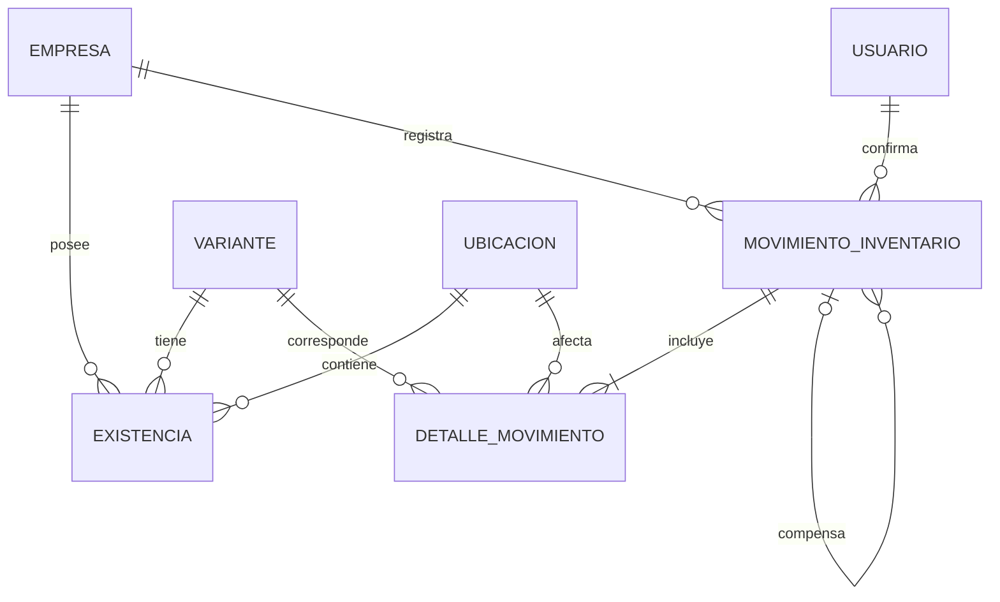
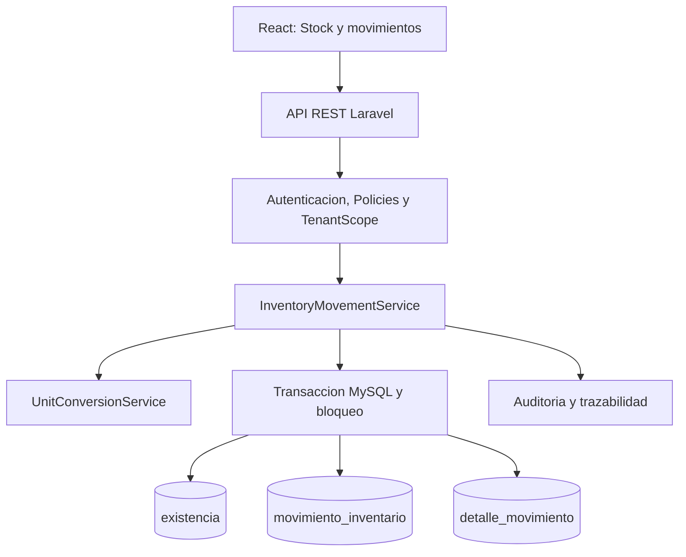
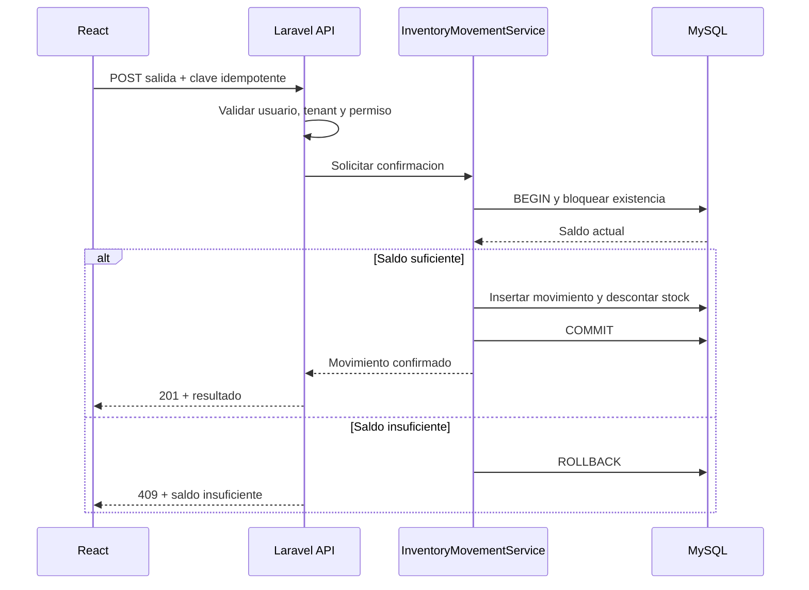

# CANVAS TÉCNICO — SPRINT 4 (ITERACIÓN 4)
## SaaS Inversiones R&P | Inventario central, movimientos y trazabilidad

| Campo | Definición |
|---|---|
| Proyecto | SaaS Inversiones R&P |
| Épica | EP-04 — Núcleo de inventario |
| Sprint / iteración | 4 |
| Duración sugerida | 2 semanas, ajustable |
| Prioridad | P0: US-0401, US-0402, US-0403, US-0405 y US-0406; P1: US-0404 |
| Stack previsto | React · Laravel · MySQL · API REST/JSON |
| Dependencias | Sprint 0: arquitectura y decisiones; Sprint 1: identidad y multiempresa; Sprint 2: catálogo; Sprint 3: unidades y ubicaciones |
| Fuente | Backlog técnico de implementación, versión 1.0, noviembre de 2026 |

> **Criterio de lectura:** las historias, prioridades, criterios de aceptación y tareas etiquetadas «del backlog» se derivan del documento de implementación. Los endpoints, campos, diagramas, reglas detalladas, casos de prueba y cronograma de este Canvas son **propuestas de diseño**, pendientes de revisión. No se consideran resueltas DP-01, DP-03, DP-05 ni DD-03 por el mero hecho de aparecer aquí.

## 1. Objetivo de la iteración

Implementar el núcleo transaccional del inventario que permita consultar existencias y registrar entradas, salidas, devoluciones, ajustes y reversiones con control de permisos, aislamiento multiempresa, prevención de stock negativo, protección contra doble envío y trazabilidad de cada operación.

**Incremento demostrable:** un usuario autorizado consulta el stock por variante y ubicación, registra una entrada, confirma una salida válida, observa el rechazo de una salida superior al disponible, registra una devolución y un ajuste autorizado, y revierte un movimiento sin borrar su historial.

## 2. Canvas de alcance

| Bloque | Incluido en Sprint 4 | Fuera del alcance |
|---|---|---|
| Existencias | Consulta por variante, producto y ubicación; filtros y paginación | Panel analítico y alertas (Sprint 6) |
| Entradas | Registro transaccional con responsable, motivo/documento y protección ante duplicados | Recepción formal de compras (Sprint 5) |
| Salidas | Descuento seguro y rechazo de stock insuficiente | Flujo completo de ventas, pendiente de definición DP-01 |
| Devoluciones | Movimiento independiente, referencia a origen cuando corresponda | Gestión comercial de notas de crédito |
| Ajustes | Justificación, permisos y trazabilidad | Conteos físicos y aprobaciones de conteo (Sprint 7) |
| Reversiones | Compensación enlazada al movimiento original, sin borrado | Eliminación física de movimientos confirmados |
| Seguridad y calidad | TenantScope, Policies, transacciones, pruebas de concurrencia e idempotencia | Endurecimiento final de producción (Sprint 9) |

## 3. Historias de usuario oficiales

### US-0401 — Consultar existencias

**Historia del backlog:** Como encargado, quiero consultar stock por producto, variante y ubicación para conocer la disponibilidad.

**Prioridad:** P0. **Sprint sugerido:** 4.

**Criterios de aceptación del backlog:**
- Se muestra cantidad disponible por variante y ubicación.
- Los resultados respetan empresa y permisos.
- Las cantidades se calculan/consultan desde registros consistentes.

**Tareas técnicas del backlog:**
- Crear tabla `existencia` y claves únicas.
- Implementar consultas paginadas y filtros.
- Crear endpoints y vistas React de stock.
- Agregar pruebas de aislamiento y consistencia.

**Propuesta de interfaz:** tabla de stock con filtros por producto, variante y ubicación; estados de carga, vacío y error; detalle de movimientos relacionados según permisos.

### US-0402 — Registrar entradas de inventario

**Historia del backlog:** Como encargado autorizado, quiero registrar entradas para incrementar las existencias.

**Prioridad:** P0. **Sprint sugerido:** 4.

**Criterios de aceptación del backlog:**
- La entrada requiere producto/variante, ubicación, cantidad y responsable.
- La operación confirmada incrementa el stock una sola vez.
- Se registra fecha, usuario y motivo/documento según corresponda.
- La operación es transaccional y trazable.

**Tareas técnicas del backlog:**
- Diseñar `movimiento_inventario` y `detalle_movimiento`.
- Implementar `InventoryMovementService` para entradas.
- Usar transacciones y protección contra doble envío.
- Crear endpoint, formulario React y pruebas de concurrencia/idempotencia.

**Propuesta de interfaz:** formulario con ubicación, variante, cantidad, unidad, motivo/documento y confirmación explícita; deshabilitar doble envío en la interfaz **sin depender de ello** para garantizar idempotencia.

### US-0403 — Registrar salidas y validar stock disponible

**Historia del backlog:** Como usuario autorizado, quiero registrar salidas para descontar existencias sin generar stock negativo.

**Prioridad:** P0. **Sprint sugerido:** 4.

**Criterios de aceptación del backlog:**
- No se confirma una salida superior al stock disponible.
- La operación requiere permiso y responsable.
- La salida genera movimiento histórico no eliminable.
- La regla se verifica en backend, no solo en interfaz.

**Tareas técnicas del backlog:**
- Implementar salida en `InventoryMovementService`.
- Aplicar bloqueo de filas/transacción para evitar carreras.
- Resolver vínculo con ventas según DP-01.
- Crear endpoint, formulario y pruebas de stock insuficiente/concurrencia.

**Propuesta de interfaz:** mostrar stock consultado como orientación, pero revalidarlo dentro de la transacción del servidor al confirmar.

### US-0404 — Registrar devoluciones

**Historia del backlog:** Como usuario autorizado, quiero registrar devoluciones como operaciones independientes para conservar trazabilidad.

**Prioridad:** P1. **Sprint sugerido:** 4.

**Criterios de aceptación del backlog:**
- La devolución referencia el origen cuando corresponda.
- La cantidad devuelta y el destino se validan.
- Se genera movimiento separado y auditable.

**Tareas técnicas del backlog:**
- Definir tipos y estados de devolución.
- Implementar servicio y validaciones.
- Crear endpoint y pantalla.
- Probar devoluciones parciales y totales.

**Propuesta de interfaz:** seleccionar tipo de devolución, documento o movimiento de origen, variante, cantidad y ubicación destino. El efecto sobre el stock debe depender del tipo de devolución aprobado.

### US-0405 — Realizar ajustes autorizados

**Historia del backlog:** Como responsable autorizado, quiero ajustar existencias con justificación para corregir diferencias justificadas.

**Prioridad:** P0. **Sprint sugerido:** 4.

**Criterios de aceptación del backlog:**
- Todo ajuste requiere motivo y usuario autorizado.
- El ajuste queda registrado como movimiento.
- No se modifica directamente la existencia desde el frontend ni desde módulos externos.

**Tareas técnicas del backlog:**
- Implementar flujo de autorización si aplica.
- Implementar ajuste en `InventoryMovementService`.
- Registrar auditoría y motivo.
- Crear pruebas de permisos y stock resultante.

**Propuesta de interfaz:** ajuste positivo o negativo con cantidad, justificación y confirmación; autorización según política aprobada en DP-05.

### US-0406 — Revertir movimientos confirmados

**Historia del backlog:** Como administrador autorizado, quiero revertir un movimiento incorrecto sin borrar el historial.

**Prioridad:** P0. **Sprint sugerido:** 4.

**Criterios de aceptación del backlog:**
- Un movimiento confirmado no se elimina físicamente.
- La reversión genera movimiento compensatorio enlazado al original.
- No se permite revertir dos veces sin regla explícita.

**Tareas técnicas del backlog:**
- Diseñar referencia al movimiento original.
- Implementar reglas de reversión por tipo.
- Registrar actor, fecha y motivo.
- Crear pruebas de trazabilidad y saldo.

**Propuesta de interfaz:** acción de reversión restringida, motivo obligatorio, visualización del movimiento original y del compensatorio, con prevención de reversión duplicada.

## 4. Reglas de negocio y decisiones pendientes

| Código | Regla / decisión | Estado |
|---|---|---|
| RN-04-01 | El stock se consulta por empresa, variante y ubicación | Exigencia del backlog |
| RN-04-02 | Las entradas confirmadas afectan el saldo una sola vez | Exigencia del backlog |
| RN-04-03 | No se confirman salidas que generen stock negativo | Exigencia del backlog |
| RN-04-04 | Todo movimiento confirmado conserva historial y responsable | Exigencia del backlog |
| RN-04-05 | Los ajustes requieren motivo y autorización | Exigencia del backlog |
| RN-04-06 | Las reversiones son compensatorias y enlazadas, no borrados | Exigencia del backlog |
| RN-04-07 | La mutación de stock se centraliza en `InventoryMovementService` | Arquitectura indicada en backlog |
| DP-01 | Quién registra las salidas por venta: vendedor, cajero o ambos | **Pendiente de decisión** |
| DP-03 | Precisión, conversiones y redondeo de unidades | **Debe estar aprobada** |
| DP-05 | Quién autoriza operaciones si falta el administrador | **Pendiente de decisión** |
| DD-03 | Alcance de ubicación en el detalle de movimiento | **Pendiente de decisión** |

**Reglas adicionales por validar:** política de inventario inicial, tratamiento de devoluciones de proveedor/cliente, ajustes negativos, reversión de salidas cuando ya hubo movimientos posteriores, numeración documental y plazo permitido para revertir.

## 5. Modelo de datos propuesto

| Tabla | Campos propuestos (no definitivos) | Consideraciones |
|---|---|---|
| `existencia` | `id`, `empresa_id`, `variante_id`, `ubicacion_id`, `cantidad`, `created_at`, `updated_at` | Índice único `(empresa_id, variante_id, ubicacion_id)`; precisión según DP-03 |
| `movimiento_inventario` | `id`, `empresa_id`, `tipo`, `estado`, `usuario_id`, `motivo`, `documento_referencia`, `movimiento_origen_id`, `idempotency_key`, `fecha_confirmacion`, `created_at` | Cabecera inmutable al confirmar; referencias y unicidad de idempotencia por ámbito aprobado |
| `detalle_movimiento` | `id`, `movimiento_id`, `variante_id`, `ubicacion_id`, `cantidad_original`, `unidad_id`, `cantidad_normalizada`, `sentido` | Definir DD-03; almacenar cantidades normalizadas según DP-03 |
| `auditoria_evento` (opcional) | `id`, `empresa_id`, `actor_id`, `entidad`, `entidad_id`, `accion`, `fecha`, `metadatos` | Complementa, pero no reemplaza, el historial de movimientos |

**Restricciones propuestas:** claves foráneas y pertenencia al mismo tenant; cantidades estrictamente positivas en el detalle y signo mediante tipo/sentido; no duplicar reversión; no permitir editar ni eliminar movimientos confirmados; validar cantidades con `DECIMAL` y no con `FLOAT`.

### Diagrama de entidades (propuesta)



## 6. Arquitectura técnica



**Responsabilidad única:** los controladores validan contratos y delegan; Laravel aplica autorización y reglas; React muestra el estado y consume la API, pero no es autoridad para calcular ni modificar existencias.

## 7. Endpoints REST propuestos

| Método | Ruta propuesta | Función | Permiso conceptual |
|---|---|---|---|
| GET | `/api/v1/inventory/stocks` | Consultar stock con filtros y paginación | `inventory.view` |
| GET | `/api/v1/inventory/movements` | Historial de movimientos | `inventory.movements.view` |
| GET | `/api/v1/inventory/movements/{id}` | Detalle de movimiento | `inventory.movements.view` |
| POST | `/api/v1/inventory/entries` | Confirmar entrada | `inventory.entries.create` |
| POST | `/api/v1/inventory/exits` | Confirmar salida | `inventory.exits.create` |
| POST | `/api/v1/inventory/returns` | Confirmar devolución | `inventory.returns.create` |
| POST | `/api/v1/inventory/adjustments` | Confirmar ajuste | `inventory.adjustments.create` |
| POST | `/api/v1/inventory/movements/{id}/reverse` | Generar compensación | `inventory.movements.reverse` |

**Nota:** nombres de rutas y permisos son ilustrativos; deben alinearse con las convenciones aprobadas en Sprint 1.

### Ejemplo de contrato para entrada (propuesto)

```json
{
  "variante_id": 125,
  "ubicacion_id": 8,
  "cantidad": "10.500",
  "unidad_id": 3,
  "motivo": "Ingreso de inventario",
  "documento_referencia": "DOC-001"
}
```

Enviar además una clave de idempotencia única por operación mediante un mecanismo acordado, por ejemplo el encabezado `Idempotency-Key`. **No confiar en `empresa_id` recibido del cliente**: resolver empresa activa desde el contexto autenticado.

## 8. Flujo transaccional e idempotencia

1. Autenticar usuario y resolver empresa activa.
2. Verificar permiso y pertenencia al tenant de variante y ubicación.
3. Validar cantidad, unidad, tipo, motivo y reglas pendientes aprobadas.
4. Detectar solicitud repetida por clave de idempotencia; devolver resultado previo si corresponde.
5. Abrir transacción de base de datos.
6. Obtener o inicializar de forma segura la fila de existencia y bloquearla para escritura; controlar carreras al crear una fila inexistente.
7. Calcular cantidad normalizada y validar saldo para operaciones de descuento.
8. Insertar cabecera y detalles del movimiento y actualizar existencia dentro de la **misma transacción**.
9. Confirmar transacción y registrar resultado asociado a la clave idempotente.
10. Responder con identificador, saldo resultante y referencia trazable.

**Ejemplo:** si hay 8 unidades y dos usuarios intentan retirar 6 simultáneamente, solo una salida debe confirmarse; la segunda debe recibir error por saldo insuficiente tras verificar el saldo actualizado.

### Secuencia de una salida (propuesta)



## 9. Diseño de frontend React

| Pantalla / componente | Funcionalidad propuesta | Estados obligatorios |
|---|---|---|
| `InventoryStockPage` | Tabla y filtros de existencias | Cargando, vacío, error, resultados |
| `InventoryMovementsPage` | Historial, tipo, fecha, usuario y detalle | Cargando, vacío, error, paginación |
| `InventoryEntryForm` | Entrada de stock | Validación, confirmación, éxito, error |
| `InventoryExitForm` | Salida con aviso de disponibilidad | Stock insuficiente, confirmación, error |
| `InventoryReturnForm` | Devolución con referencia de origen | Origen inválido, cantidades fuera de límite |
| `InventoryAdjustmentForm` | Ajuste con motivo obligatorio | Permiso insuficiente, validación |
| `InventoryReverseDialog` | Confirmar reversión y motivo | Ya revertido, no reversible, éxito |

**Usabilidad:** mostrar claramente tipo de operación, ubicación, unidad y saldo; prevenir acciones repetidas visualmente; refrescar stock después de confirmar; no permitir modificar existencias directamente desde tablas.

## 10. Matriz de pruebas

| ID | Escenario | Resultado esperado | Tipo |
|---|---|---|---|
| T-04-01 | Consultar stock de la empresa activa | Solo registros autorizados | Integración |
| T-04-02 | Consultar stock de otro tenant | Acceso denegado / no visible | Seguridad |
| T-04-03 | Registrar entrada válida | Stock aumenta una sola vez | Integración |
| T-04-04 | Reenviar la misma entrada con la misma clave | No se duplica movimiento ni saldo | Idempotencia |
| T-04-05 | Salida menor o igual al saldo | Descuento correcto y trazable | Integración |
| T-04-06 | Salida superior al saldo | Rechazo sin modificar existencias | Negocio |
| T-04-07 | Dos salidas concurrentes sobre el mismo stock | Sin stock negativo ni saldo perdido | Concurrencia |
| T-04-08 | Devolución parcial válida | Movimiento independiente enlazado si aplica | Integración |
| T-04-09 | Devolución superior al origen permitido | Rechazo según política aprobada | Negocio |
| T-04-10 | Ajuste sin motivo | Rechazo de validación | Validación |
| T-04-11 | Ajuste por usuario sin permiso | Operación denegada | Seguridad |
| T-04-12 | Reversión de movimiento confirmado | Movimiento compensatorio y vínculo | Integración |
| T-04-13 | Revertir dos veces el mismo movimiento | Segunda reversión rechazada | Negocio |
| T-04-14 | Error durante inserción de detalle | Rollback completo, sin stock parcial | Transacción |
| T-04-15 | Cantidad con decimales y conversión | Resultado según DP-03 aprobada | Precisión |
| T-04-16 | Intento de borrar movimiento confirmado | Operación prohibida | Integridad |

## 11. Plan sugerido de implementación (2 semanas)

| Periodo | Actividades | Evidencia |
|---|---|---|
| Día 1 | Refinar US-0401 a US-0406; resolver decisiones bloqueantes | Acta de decisiones y criterios aprobados |
| Días 2–3 | Migraciones, restricciones, servicio transaccional y consultas | Esquema revisado y pruebas de BD |
| Días 4–5 | Entradas, salidas, idempotencia y concurrencia | API y pruebas automatizadas |
| Días 6–7 | Devoluciones, ajustes y reversiones | Operaciones auditables |
| Día 8 | Formularios, listado y detalle React | Flujo frontend-backend integrado |
| Día 9 | Pruebas de seguridad, tenant, rollback, precisión y regresión | Pipeline CI en verde |
| Día 10 | Demo, revisión de aceptación, retrospectiva y documentación | Incremento aprobado o pendientes explícitos |

> La secuencia es orientativa. Las seis historias pueden requerir redistribución según capacidad del equipo y decisiones de negocio; proteger primero las historias P0.

## 12. Definition of Ready (DoR)

- [ ] Las seis historias tienen criterios verificables y estimación.
- [ ] Catálogo, variantes, unidades y ubicaciones del Sprint 2–3 están operativos.
- [ ] Autenticación, permisos y aislamiento por empresa están disponibles.
- [ ] DP-03 está cerrada y documentada.
- [ ] Se resuelven DP-01, DP-05 y DD-03 en el alcance necesario o se excluyen explícitamente los casos afectados.
- [ ] Están acordados los contratos API y el comportamiento de errores.
- [ ] Se conocen las restricciones de stock, concurrencia e idempotencia.

## 13. Definition of Done (DoD)

- [ ] Cada historia cumple sus criterios de aceptación.
- [ ] Migraciones, relaciones, índices únicos y restricciones revisados.
- [ ] Las reglas de negocio residen en Laravel y la modificación de stock pasa por `InventoryMovementService`.
- [ ] Las operaciones se ejecutan en transacciones con manejo de concurrencia.
- [ ] Se verifica idempotencia en entradas y demás operaciones aplicables.
- [ ] No hay salidas confirmadas con stock negativo.
- [ ] Los movimientos confirmados no se borran ni editan para alterar historial.
- [ ] Las reversiones son compensatorias y están vinculadas al original.
- [ ] Autorización y aislamiento multiempresa probados.
- [ ] React contempla estados de carga, error y vacío.
- [ ] Pruebas unitarias e integración pertinentes pasan en CI.
- [ ] Documentación de API, reglas, decisiones y evidencias actualizada.
- [ ] Revisión de código y aceptación del Product Owner.

## 14. Entregables y criterios de éxito

| Entregable | Evidencia de aceptación |
|---|---|
| Migraciones `existencia`, `movimiento_inventario`, `detalle_movimiento` | Restricciones y pruebas de integridad |
| `InventoryMovementService` | Entradas, salidas, devoluciones, ajustes y reversiones controladas |
| API de stock y movimientos | Contratos documentados y permisos probados |
| Pantallas React | Demostración funcional de las seis historias |
| Suite de pruebas | Aislamiento, concurrencia, idempotencia, reversión y rollback |
| Registro de decisiones | DP-01, DP-03, DP-05 y DD-03 resueltas o delimitadas explícitamente |
| Documentación de trazabilidad | Movimiento original, compensación, actor, fecha y motivo |

**Criterio de éxito del Sprint 4:** se demuestra un ciclo de movimientos completo, consistente y auditable, sin duplicación de entradas ni salidas que produzcan stock negativo. El núcleo queda listo para integrarse con **Sprint 5 — Compras y traslados**.

---

**Fuente principal:** *Backlog técnico de implementación — SaaS Inversiones R&P*, versión 1.0, noviembre de 2026, épica EP-04 y plan de sprints. **Nota de alcance:** los detalles identificados como propuestas no sustituyen la aprobación funcional o técnica.
