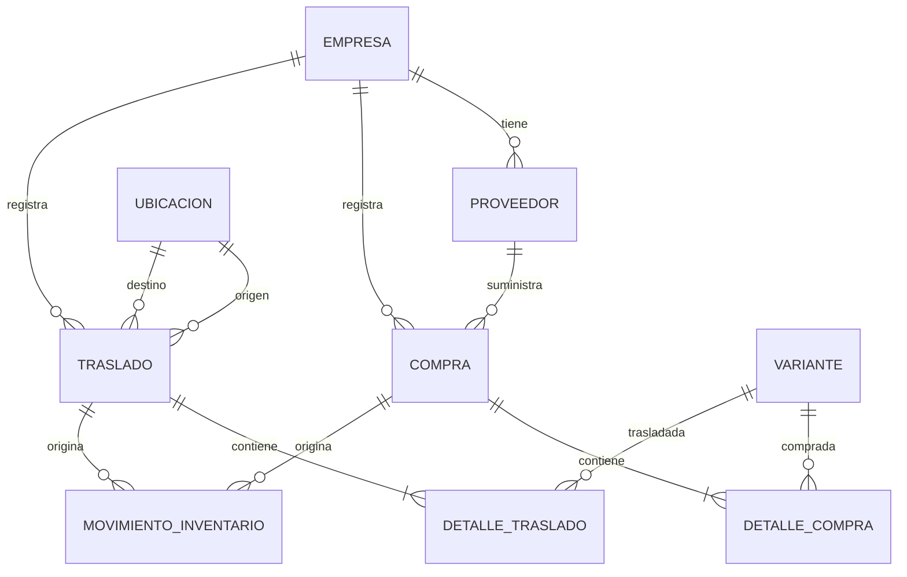
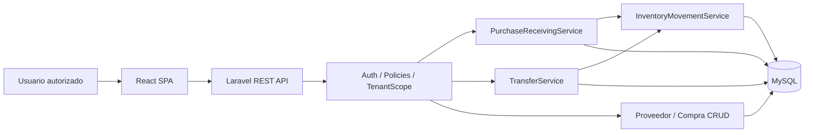
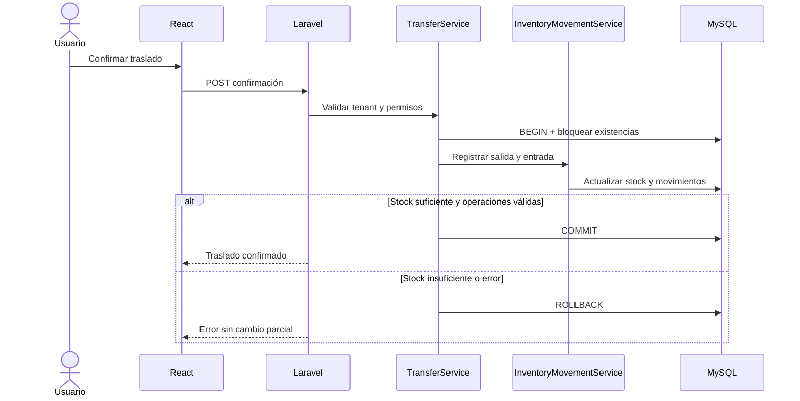

# CANVAS TÉCNICO — SPRINT 5 (ITERACIÓN 5)
## SaaS Inversiones R&P | Compras, proveedores, recepción y traslados

| Campo | Definición |
|---|---|
| Proyecto | SaaS Inversiones R&P |
| Épica | EP-05 — Compras y traslados |
| Sprint / iteración | 5 |
| Duración sugerida | 2 semanas, ajustable a la capacidad del equipo |
| Prioridad | P1: US-0501, US-0502, US-0503 |
| Stack previsto | React · Laravel · MySQL · API REST/JSON |
| Dependencias | Sprint 1: identidad y multiempresa; Sprint 2: catálogo; Sprint 3: unidades y ubicaciones; Sprint 4: InventoryMovementService |
| Fuente principal | Backlog técnico de implementación, versión 1.0, noviembre de 2026 |

> **Criterio de lectura:** las historias, prioridades y criterios identificados como «del backlog» corresponden al documento de implementación. Tablas detalladas, campos, endpoints, estados, pantallas, cronograma y pruebas adicionales son **propuestas técnicas** sujetas a validación. En particular, el método de valorización **DP-02** no se presume aprobado.

## 1. Objetivo de la iteración

Implementar la gestión de proveedores, el registro de compras con conservación de costos históricos, la recepción confirmada que incrementa inventario mediante el servicio central de movimientos y los traslados atómicos entre ubicaciones de una misma empresa.

**Incremento demostrable:** un usuario autorizado registra un proveedor y una compra, confirma su recepción una sola vez y observa el aumento de stock; después traslada una cantidad entre ubicaciones, comprueba el descuento e incremento simultáneos y verifica que el stock global no cambia.

## 2. Canvas de alcance

| Bloque | Incluido | Fuera del alcance / condicionado |
|---|---|---|
| Proveedores | Alta, consulta, edición, desactivación, validación y aislamiento por empresa | Portal externo de proveedores |
| Compras | Cabecera, detalles, cantidades, precios y costos históricos | Cuentas por pagar y facturación electrónica |
| Recepción | Confirmación y aumento de existencias por `InventoryMovementService` | Recepción parcial o multi-etapa salvo decisión explícita |
| Traslados | Origen, destino, detalles, estado, usuario, fecha y transacción atómica | Transferencias interempresa |
| Seguridad | Policies, TenantScope, autorización en servidor | Gestión de suscripciones SaaS |
| Calidad | Pruebas de concurrencia, reversión transaccional, trazabilidad e idempotencia | Valorización global definitiva sin método aprobado |

## 3. Historias de usuario oficiales

### US-0501 — Gestionar proveedores

**Historia del backlog:** Como encargado de compras, quiero mantener proveedores para asociarlos a las compras.

**Prioridad:** P1. **Sprint sugerido:** 5.

**Criterios de aceptación del backlog:**
- Se pueden registrar, consultar, editar y desactivar proveedores.
- Los datos se validan y quedan asociados a la empresa.
- No se pierde el historial de compras al desactivar.

**Tareas técnicas del backlog:**
- Crear proveedor y relaciones.
- Implementar endpoints, policies y pantallas.
- Agregar pruebas CRUD y tenant.

**Propuesta funcional:** listado con búsqueda, formulario de creación/edición, estado activo/inactivo y ficha de proveedor. No permitir borrar físicamente un proveedor con compras relacionadas.

### US-0502 — Registrar compras y costos históricos

**Historia del backlog:** Como encargado, quiero registrar compras con proveedor, fecha, cantidades y precios para conservar el costo histórico.

**Prioridad:** P1. **Sprint sugerido:** 5.

**Criterios de aceptación del backlog:**
- La compra registra proveedor, fecha, detalle, cantidad y precio.
- La recepción confirmada incrementa stock mediante `InventoryMovementService`.
- El costo histórico no se sobrescribe por compras posteriores.
- La valorización global depende del método aprobado.

**Tareas técnicas del backlog:**
- Crear compra y `detalle_compra`.
- Definir estados borrador/confirmada/recibida si el proceso lo requiere.
- Implementar servicio de recepción integrado al núcleo de inventario.
- Crear endpoints, pantallas y pruebas de costos históricos.

**Propuesta funcional:** crear compra en borrador, añadir detalles con cantidades y precios, validar proveedor y productos del tenant y confirmar recepción. Mantener el precio registrado en cada línea de compra sin reescribir compras anteriores.

### US-0503 — Trasladar existencias entre ubicaciones

**Historia del backlog:** Como encargado, quiero trasladar stock entre ubicaciones para reflejar movimientos físicos internos.

**Prioridad:** P1. **Sprint sugerido:** 5.

**Criterios de aceptación del backlog:**
- Se descuenta origen y se incrementa destino en una única transacción.
- No se permite trasladar más stock del disponible.
- El efecto neto global del traslado es cero.
- Se conserva origen, destino, usuario, fecha y estado.

**Tareas técnicas del backlog:**
- Crear traslado y `detalle_traslado`.
- Implementar flujo de salida/entrada atómico o estados controlados.
- Integrar con `InventoryMovementService`.
- Crear pruebas de reversión, concurrencia y saldo neto.

**Propuesta funcional:** formulario con almacén/ubicación origen y destino, variante y cantidad, previsualización de disponibilidad, confirmación y consulta del historial.

## 4. Reglas de negocio y decisiones pendientes

| ID | Regla / decisión | Estado |
|---|---|---|
| RN-05-01 | Toda compra, proveedor y traslado pertenece a un `empresa_id` autorizado | Obligatorio por arquitectura multiempresa |
| RN-05-02 | Desactivar proveedor no elimina compras históricas | Criterio oficial |
| RN-05-03 | Recepción confirmada aumenta stock exclusivamente mediante `InventoryMovementService` | Criterio oficial |
| RN-05-04 | Los precios históricos por detalle de compra son inmutables respecto a compras futuras | Criterio oficial |
| RN-05-05 | Traslado confirmado resta origen y suma destino atómicamente | Criterio oficial |
| RN-05-06 | Un traslado no puede superar el disponible | Criterio oficial |
| RN-05-07 | No se permite mezclar ubicaciones, productos ni usuarios de empresas distintas | Propuesta de aplicación del aislamiento |
| RN-05-08 | Origen y destino deben ser distintos | Propuesta para validación |
| RN-05-09 | Confirmaciones repetidas no deben duplicar recepción o traslado | Propuesta de idempotencia coherente con Sprint 4 |
| DP-02 | Método de valorización del inventario | **Pendiente de aprobación; no publicar valoración definitiva** |
| DP-03 | Precisión y redondeo de conversiones | Verificar decisión aprobada en Sprint 3 |
| DP-05 | Autorizaciones y niveles de aprobación | Verificar decisión aprobada antes de confirmar operaciones |
| DP-09 | Precios/márgenes por variante | Verificar alcance aprobado antes de exponer márgenes |

**Decisiones adicionales por cerrar antes de programar:** recepción total frente a parcial; posibilidad de editar compras confirmadas; tratamiento de impuestos, moneda y descuentos; transferencias con tránsito; reglas de anulación de compras y traslados. No asumir que estas funciones están aprobadas.

## 5. Modelo de datos propuesto

| Entidad | Campos principales propuestos | Restricciones relevantes |
|---|---|---|
| `proveedor` | `id`, `empresa_id`, `nombre`, `documento`, `contacto`, `activo`, timestamps | Índices por empresa y nombre; unicidad documental según regla aprobada |
| `compra` | `id`, `empresa_id`, `proveedor_id`, `fecha`, `estado`, `creado_por`, `recibido_en` | Proveedor del mismo tenant; control de transición de estados |
| `detalle_compra` | `id`, `compra_id`, `variante_id`, `ubicacion_destino_id`, `cantidad`, `precio_unitario` | Cantidad positiva; precio no negativo; referencias válidas |
| `traslado` | `id`, `empresa_id`, `origen_id`, `destino_id`, `estado`, `creado_por`, `confirmado_en` | Origen y destino válidos del mismo tenant |
| `detalle_traslado` | `id`, `traslado_id`, `variante_id`, `cantidad` | Cantidad positiva |
| `movimiento_inventario` | Entidad ya implementada en Sprint 4; referencia a compra o traslado | No duplicar lógica de stock ni mutar saldos directamente |
| `existencia` | Entidad ya implementada en Sprint 4 | Bloqueo/actualización transaccional |

### Diagrama entidad-relación (propuesta)



> El diagrama representa relaciones lógicas, no una migración definitiva. Ajustar nombres y claves a las tablas reales de los Sprints 0–4.

## 6. Arquitectura técnica



**Principio:** los servicios son componentes internos del monolito modular Laravel, no microservicios. Los controladores validan y delegan; el backend aplica las reglas; React no modifica directamente existencias.

## 7. Endpoints REST propuestos

| Método | Ruta propuesta | Acción |
|---|---|---|
| `GET` | `/api/v1/proveedores` | Listar y filtrar proveedores |
| `POST` | `/api/v1/proveedores` | Crear proveedor |
| `GET` | `/api/v1/proveedores/{id}` | Consultar proveedor |
| `PUT` | `/api/v1/proveedores/{id}` | Editar proveedor |
| `PATCH` | `/api/v1/proveedores/{id}/estado` | Activar o desactivar |
| `GET` | `/api/v1/compras` | Listar compras |
| `POST` | `/api/v1/compras` | Crear compra borrador |
| `GET` | `/api/v1/compras/{id}` | Ver compra y detalles |
| `PUT` | `/api/v1/compras/{id}` | Editar borrador, si se aprueba |
| `POST` | `/api/v1/compras/{id}/recepciones` | Confirmar recepción según proceso aprobado |
| `GET` | `/api/v1/traslados` | Listar traslados |
| `POST` | `/api/v1/traslados` | Crear traslado |
| `GET` | `/api/v1/traslados/{id}` | Consultar traslado |
| `POST` | `/api/v1/traslados/{id}/confirmacion` | Ejecutar traslado atómico |

Todos los endpoints requieren autenticación, permisos y alcance empresarial; las rutas y nombres finales se acordarán con el contrato API existente.

### Ejemplo de creación de compra (propuesto)

```json
{
  "proveedor_id": 21,
  "fecha": "2026-11-09",
  "detalles": [
    {
      "variante_id": 105,
      "ubicacion_destino_id": 7,
      "cantidad": "12.000",
      "precio_unitario": "24.50"
    }
  ]
}
```

### Ejemplo de traslado (propuesto)

```json
{
  "origen_id": 7,
  "destino_id": 9,
  "detalles": [
    { "variante_id": 105, "cantidad": "3.000" }
  ]
}
```

El servidor obtiene `empresa_id` y usuario desde el contexto autenticado, no confía en valores enviados por el cliente.

## 8. Flujos transaccionales y consistencia

### Recepción de compra

1. Verificar autenticación, permisos y pertenencia de proveedor, compra, variante y ubicación al tenant.
2. Validar estado de la compra y cantidades; rechazar recepción duplicada.
3. Abrir transacción de base de datos.
4. Bloquear los registros relevantes y confirmar que la operación no fue procesada.
5. Invocar `PurchaseReceivingService`, que registra los movimientos de entrada mediante `InventoryMovementService`.
6. Marcar compra como recibida según la máquina de estados aprobada y guardar usuario/fecha.
7. Confirmar la transacción; ante cualquier fallo, revertir todos los cambios.

### Traslado entre ubicaciones

1. Validar tenant, permisos, origen distinto del destino, variante y cantidad positiva.
2. Abrir transacción y adquirir bloqueos en orden determinista para reducir interbloqueos.
3. Verificar saldo suficiente en origen con datos bloqueados.
4. Mediante `InventoryMovementService`, registrar salida de origen y entrada de destino enlazadas al traslado.
5. Registrar estado, responsable y fecha; comprobar que la suma de variaciones sea cero.
6. Confirmar o revertir la transacción completa; un fallo no debe dejar solo una mitad del traslado.



**Concurrencia e idempotencia (propuesta):** utilizar claves de idempotencia o restricciones equivalentes por operación confirmada; repetir una petición no debe generar un segundo movimiento. Probar solicitudes simultáneas y fallos inyectados.

## 9. Diseño de frontend React

| Vista | Funcionalidad propuesta | Estados UX |
|---|---|---|
| Proveedores | Tabla, filtros, crear, editar, activar/desactivar | Carga, vacío, error, confirmación |
| Compras | Listado, formulario cabecera/detalles, historial | Validación, borrador, recepción, error |
| Detalle de compra | Proveedor, fecha, cantidades, costos registrados, estado | Confirmación protegida de recepción |
| Traslados | Selección origen/destino, variantes, cantidades y disponibilidad | Stock insuficiente, confirmación, error |
| Historial de traslados | Filtros, detalle, responsable, fecha y estado | Carga, vacío, error |

**Permisos UI:** ocultar o deshabilitar acciones no autorizadas mejora la experiencia, pero la autorización efectiva siempre se verifica en Laravel.

## 10. Matriz de pruebas

| ID | Escenario | Resultado esperado |
|---|---|---|
| T-0501 | Crear proveedor válido | Proveedor creado en empresa activa |
| T-0502 | Editar proveedor | Datos actualizados con validaciones |
| T-0503 | Desactivar proveedor con compras | Historial preservado |
| T-0504 | Acceder a proveedor de otro tenant | Acceso denegado / recurso no visible |
| T-0505 | Crear compra con detalles válidos | Compra persistida sin alterar stock antes de recepción |
| T-0506 | Registrar dos compras con precios distintos | Cada detalle conserva su precio original |
| T-0507 | Confirmar recepción | Aumento de stock exactamente una vez |
| T-0508 | Repetir confirmación de recepción | No duplica movimientos |
| T-0509 | Fallo a mitad de recepción | Rollback completo |
| T-0510 | Traslado con saldo suficiente | Origen disminuye y destino aumenta |
| T-0511 | Traslado superior al disponible | Rechazo sin cambiar saldos |
| T-0512 | Traslado válido | Variación global igual a cero |
| T-0513 | Error tras registrar salida | Rollback de salida y entrada |
| T-0514 | Dos traslados concurrentes sobre el mismo saldo | No se produce stock negativo |
| T-0515 | Traslado entre empresas diferentes | Operación denegada |
| T-0516 | Usuario sin permiso intenta confirmar compra/traslado | Operación denegada |
| T-0517 | Repetir petición de traslado | No genera doble descuento |
| T-0518 | Traslado confirmado | Se conserva usuario, fecha, origen, destino y estado |

**Estrategia propuesta:** pruebas unitarias de servicios, pruebas de integración HTTP + MySQL, pruebas transaccionales y al menos un recorrido E2E React. Ejecutarlas en CI.

## 11. Plan sugerido de implementación (2 semanas)

| Día | Actividad | Evidencia |
|---|---|---|
| 1 | Refinamiento US-0501–0503 y cierre de decisiones bloqueantes | Reglas y contratos acordados |
| 2 | Migraciones, índices y relaciones de proveedores/compras/traslados | Migraciones verificadas |
| 3 | CRUD de proveedores, policies y pruebas de tenant | API proveedores |
| 4 | Pantallas de proveedores y pruebas UI | CRUD integrado |
| 5 | Compras y detalles, validación de costos históricos | API y pruebas de compras |
| 6 | Servicio de recepción integrado al núcleo de inventario | Recepción transaccional |
| 7 | Interfaz de compras y recepción | Flujo completo |
| 8 | TransferService y movimientos atómicos | Pruebas de saldo y rollback |
| 9 | Pantallas de traslados; concurrencia e idempotencia | Flujo completo y pruebas |
| 10 | Regresión, documentación, demo, revisión y retrospectiva | Incremento aceptado |

> Cronograma orientativo; el equipo debe estimar el esfuerzo real. Si las decisiones sobre recepción o valorización siguen abiertas, no se debe simular que están resueltas.

## 12. Definition of Ready (DoR)

- Historias, valor de negocio y criterios de aceptación comprendidos.
- Modelo de proveedores, compras y traslados revisado.
- Políticas de permisos y tenant definidas.
- Reglas de recepción y estados acordadas o explícitamente acotadas.
- `InventoryMovementService` del Sprint 4 disponible y probado.
- Precisión de cantidades y manejo de precios definidos.
- Dependencias, contratos API y diseños listos para estimación.

## 13. Definition of Done (DoD)

- Criterios oficiales de US-0501, US-0502 y US-0503 cumplidos.
- Migraciones, relaciones, índices y restricciones implementados y revisados.
- Reglas de negocio ejecutadas en Laravel; React consume la API.
- Policies, TenantScope y validaciones de backend activas.
- Ninguna recepción ni traslado altera stock fuera de `InventoryMovementService`.
- Recepciones y traslados atómicos, con pruebas de fallos y concurrencia.
- Precios históricos preservados y trazabilidad registrada.
- Pantallas incluyen estados de carga, error y vacío.
- Pruebas relevantes pasan en CI; no hay defectos bloqueantes conocidos.
- Documentación técnica/API actualizada; revisión de código y aceptación del Product Owner.

## 14. Entregables y criterios de éxito

| Entregable | Evidencia de aceptación |
|---|---|
| Módulo de proveedores | CRUD y desactivación con historial preservado |
| Módulo de compras | Registro de cabecera/detalle y precios históricos |
| Recepción de compras | Incremento único de stock por servicio central |
| Módulo de traslados | Movimiento atómico origen → destino y saldo global constante |
| Seguridad multiempresa | Pruebas negativas de acceso cruzado |
| Calidad | Pruebas automatizadas, concurrencia, rollback e idempotencia |
| Documentación | API, modelo de datos, decisiones y manual breve de flujo |
| Demo de Sprint | Proveedor → compra → recepción → traslado → verificación de existencias |

**Criterio de éxito de la iteración:** compras y traslados operativos, sin duplicar stock, sin transferencias parciales, sin exposición entre empresas y con historial verificable.

**Siguiente iteración:** **Sprint 6 — Métricas y alertas**, con indicadores de inventario, alertas de stock mínimo e inactividad y tareas programadas, sujeto a definiciones de indicadores y umbrales.
