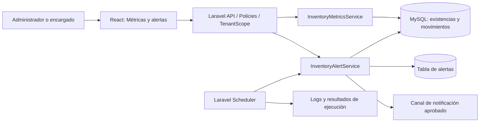

# CANVAS TÉCNICO — SPRINT 6 (ITERACIÓN 6)
## SaaS Inversiones R&P | Métricas operativas, alertas y automatización

| Campo | Definición |
|---|---|
| Proyecto | SaaS Inversiones R&P |
| Épica | EP-06 — Métricas y alertas |
| Sprint / iteración | 6 |
| Duración sugerida | 2 semanas, ajustable |
| Prioridad | P1: US-0601 y US-0602; P2: US-0603 |
| Stack previsto | React · Laravel · MySQL · API REST/JSON |
| Dependencias | Sprints 1–5: tenant, permisos, catálogo, ubicaciones, movimientos, compras y traslados |
| Fuente | Backlog técnico de implementación, versión 1.0, noviembre de 2026 |

> **Criterio de lectura:** las historias, prioridades, criterios y tareas marcados como «del backlog» provienen del documento de implementación. Esquemas, endpoints, fórmulas concretas, interfaces, cronograma y pruebas complementarias son **propuestas técnicas**, sujetas a aprobación. No se consideran aprobadas DP-02, DP-09 ni DD-02.

## 1. Objetivo de la iteración

Implementar un panel de métricas confiables del inventario, alertas configurables de stock mínimo e inactividad y verificaciones automáticas con trazabilidad y protección contra notificaciones duplicadas.

**Incremento demostrable:** un administrador autorizado visualiza indicadores consistentes con los movimientos reales; configura umbrales autorizados, observa una alerta generada automáticamente y comprueba que una nueva evaluación de la misma condición no la duplica.

## 2. Canvas de alcance

| Bloque | Incluido | Fuera del alcance / condicionado |
|---|---|---|
| Indicadores | Total de productos, detalle de stock, agotados, stock mínimo, valor total, más salidas y sin movimiento, en ese orden | Valorización oficial sin aprobar DP-02; márgenes sin DP-09 |
| Filtros | Empresa activa, ubicación, categoría, periodo, según datos y permisos | Datos cruzados entre empresas |
| Alertas | Mínimo, inactividad, motivo, fecha, entidad afectada, estado y deduplicación | Umbral por nivel no aprobado (DD-02) |
| Automatización | Scheduler, logs, control de reintentos, canal aprobado | Redis/Queue obligatorios sin necesidad técnica |
| Seguridad | TenantScope, policies, consultas filtradas en servidor | Cálculos de autoridad únicamente en frontend |
| Calidad | Pruebas de agregaciones, permisos, fechas, duplicados y errores | Auditoría integral de Sprint 7 |

## 3. Historias de usuario oficiales

### US-0601 — Visualizar indicadores de inventario

**Historia del backlog:** Como administrador, quiero visualizar métricas para supervisar el estado del almacén.

**Prioridad:** P1. **Sprint sugerido:** 6.

**Criterios de aceptación del backlog:**
- Se muestran total de productos, detalle de stock, agotados, stock mínimo, valor total, más salidas y sin movimiento según definición aprobada.
- Los indicadores respetan permisos y tenant.
- Las métricas se calculan desde datos persistidos y reglas documentadas.
- No se presenta valorización/margen como cifra oficial hasta aprobar el método de valorización.

**Tareas técnicas del backlog:**
- Definir consultas/servicio `InventoryMetricsService`.
- Optimizar agregaciones e índices.
- Crear endpoints de métricas.
- Construir panel React con estados vacíos, carga y errores.
- Validar resultados contra datos de prueba.

**Propuesta funcional:** tarjetas y secciones en el orden oficial; cada tarjeta muestra cifra y acceso al detalle. La sección **Valor total** debe indicar «Pendiente de definir método de valorización» mientras DP-02 siga abierta, sin presentar una cifra como oficial.

### US-0602 — Configurar alertas de stock mínimo e inactividad

**Historia del backlog:** Como encargado, quiero recibir alertas cuando el stock llegue al mínimo o un producto permanezca sin movimiento.

**Prioridad:** P1. **Sprint sugerido:** 6.

**Criterios de aceptación del backlog:**
- El umbral mínimo y periodo de inactividad son configurables según decisión.
- Las alertas no se duplican innecesariamente.
- La alerta identifica producto, variante/ubicación cuando aplique, fecha y motivo.
- El usuario solo ve alertas autorizadas.

**Tareas técnicas del backlog:**
- Implementar `InventoryAlertService`.
- Crear tabla alerta y estados.
- Configurar Laravel Scheduler para evaluación periódica.
- Crear listado/filtros de alertas en React.
- Probar umbrales y duplicados.

**Propuesta funcional:** pantalla de reglas/umbrales autorizados, listado filtrable por tipo, estado, producto y ubicación; ciclo de alerta abierta/resuelta con registro de cambios. La granularidad del umbral depende de DD-02.

### US-0603 — Programar tareas y notificaciones

**Historia del backlog:** Como administrador, quiero que las verificaciones periódicas se ejecuten automáticamente.

**Prioridad:** P2. **Sprint sugerido:** 6.

**Criterios de aceptación del backlog:**
- Las tareas programadas se ejecutan según calendario definido.
- Los errores quedan registrados y pueden diagnosticarse.
- Se evita enviar notificaciones repetidas por la misma condición.

**Tareas técnicas del backlog:**
- Configurar Laravel Scheduler.
- Evaluar Queue/Redis solo si hay tareas asíncronas o volumen que lo justifique.
- Configurar canal de notificación aprobado.
- Agregar pruebas y logs.

**Propuesta funcional:** ejecución programada con identificador de corrida, tiempos, resultado y conteo de alertas; notificaciones solo por el canal aprobado por negocio.

## 4. Reglas de negocio y definición de indicadores (propuesta a validar)

| Indicador | Definición candidata | Punto de validación |
|---|---|---|
| Total de productos | Cantidad de productos activos del tenant | ¿Contar productos o variantes? |
| Detalle de stock | Existencia por variante y ubicación, con filtros | Mostrar unidad base y cantidades disponibles |
| Agotados | Variantes/ubicaciones con existencia = 0 | ¿Incluir combinaciones sin registro de existencia? |
| Stock mínimo | Existencias <= umbral configurado | Resolver DD-02; definir si incluye agotados |
| Valor total | Suma de cantidades × costo según método autorizado | **DP-02 abierta: no publicar cifra oficial** |
| Más salidas | Ranking por cantidad de movimientos de salida en periodo | Definir devoluciones, unidades y periodo |
| Sin movimiento | Productos/variantes sin movimientos durante N días | Definir fecha de alta, periodo y tipos de movimiento |

**Reglas transversales propuestas:**
1. Toda consulta aplica empresa activa y permisos en Laravel, nunca únicamente en React.
2. Usar exclusivamente movimientos confirmados y existencias consistentes; excluir movimientos revertidos según la semántica de compensación aprobada.
3. Definir zona horaria, fecha de corte, redondeo y periodo de consulta antes de comparar resultados.
4. La actualización del panel no debe bloquearse por el fallo de un indicador; mostrar estado de error por sección cuando proceda.
5. No usar un spinner dentro de los valores numéricos como sustituto del resultado; mostrar estado de carga discreto o skeleton y sustituirlo por cifra o mensaje claro al finalizar.

## 5. Diseño de interfaz React (propuesta)

**Ruta propuesta:** `/metricas`.

Orden visual obligatorio del backlog:

1. Total de productos
2. Detalle de stock
3. Productos agotados
4. Stock mínimo
5. Valor total
6. Más salidas
7. Sin movimiento

**Componentes sugeridos:** `MetricsDashboardPage`, `MetricCard`, `StockDetailTable`, `LowStockTable`, `OutOfStockTable`, `TopOutflowsTable`, `InactiveProductsTable`, `AlertListPage`, `AlertRuleForm`.

**Estados:** carga sin indicadores numéricos ficticios; sin datos; error con reintento; sin permiso; datos actualizados con fecha de corte. Filtrar por empresa y ubicación autorizada. En **Detalle de stock**, evitar reutilizar una métrica agregada como si fuese el detalle: la tabla debe consultar el conjunto correcto y paginar.

## 6. Arquitectura lógica propuesta



**Responsabilidades:** controladores delgados; servicios Laravel aplican reglas; MySQL conserva el estado; React presenta resultados y errores. `InventoryMovementService` del Sprint 4 continúa siendo la única vía autorizada para modificar stock: el Sprint 6 solo consulta y evalúa condiciones.

## 7. Diseño de datos (propuesta, no migración aprobada)

| Entidad | Campos propuestos | Consideraciones |
|---|---|---|
| `alert_rule` | `id`, `empresa_id`, `tipo`, `nivel_objetivo`, `objetivo_id`, `umbral`, `dias_inactividad`, `activo`, `created_at`, `updated_at` | `nivel_objetivo` condicionado por DD-02; validar tipos y rangos |
| `alerta` | `id`, `empresa_id`, `regla_id`, `tipo`, `producto_id`, `variante_id`, `ubicacion_id`, `motivo`, `estado`, `detectada_at`, `resuelta_at`, `dedup_key` | Clave única de condición activa por tenant; trazabilidad |
| `alert_evaluation_run` | `id`, `empresa_id`, `started_at`, `finished_at`, `estado`, `evaluadas`, `generadas`, `error_resumen` | Diagnóstico y observabilidad |
| `notification_delivery` | `id`, `empresa_id`, `alerta_id`, `canal`, `estado`, `attempts`, `sent_at`, `idempotency_key` | Solo si se aprueba canal y necesidad de persistencia |

**Índices sugeridos:** `(empresa_id, estado, detectada_at)` en alertas; índices de tenant, variante y ubicación en existencias; `(empresa_id, tipo, fecha)` en movimientos; unicidad por `empresa_id` y `dedup_key` cuando aplique. Revisar nombres reales y restricciones del modelo vigente antes de generar migraciones.

## 8. API REST propuesta

| Método | Endpoint | Propósito | Permiso propuesto |
|---|---|---|---|
| GET | `/api/v1/metrics/overview` | Indicadores generales | `metrics.view` |
| GET | `/api/v1/metrics/stock-detail` | Detalle paginado de stock | `metrics.view` |
| GET | `/api/v1/metrics/out-of-stock` | Agotados | `metrics.view` |
| GET | `/api/v1/metrics/low-stock` | Mínimos | `metrics.view` |
| GET | `/api/v1/metrics/top-outflows` | Ranking de salidas | `metrics.view` |
| GET | `/api/v1/metrics/inactive` | Sin movimiento | `metrics.view` |
| GET | `/api/v1/alerts` | Listado de alertas | `alerts.view` |
| GET | `/api/v1/alert-rules` | Consultar reglas | `alerts.view` |
| POST | `/api/v1/alert-rules` | Crear regla | `alerts.manage` |
| PATCH | `/api/v1/alert-rules/{id}` | Modificar regla | `alerts.manage` |

**Contrato sugerido:** `{ data, meta, errors }`, paginación para listas, parámetros `location_id`, `from`, `to`, `page`, `per_page` según endpoint. El tenant se resuelve del contexto autenticado y no se confía en un `empresa_id` enviado libremente por el cliente.

## 9. Algoritmo de evaluación y deduplicación (propuesta)

```text
Para cada empresa autorizada y regla activa:
  1. Consultar existencias/movimientos con filtros de empresa.
  2. Calcular condición (stock <= mínimo o inactividad >= N días).
  3. Crear identificador estable de condición: empresa + regla + entidad + tipo.
  4. Si la condición está activa:
       - abrir alerta si no existe una alerta activa equivalente;
       - mantener la alerta existente si ya fue detectada.
  5. Si la condición desaparece:
       - resolver la alerta abierta según política aprobada.
  6. Registrar resultados y errores de la evaluación.
  7. Notificar únicamente eventos nuevos o cambios autorizados.
```

**Concurrencia:** índice único/estrategia de exclusión para evitar carreras entre ejecuciones; usar transacciones para la apertura y resolución de alertas. No reenviar notificaciones por cada ejecución del scheduler.

## 10. Pruebas y validación

| ID | Escenario | Resultado esperado |
|---|---|---|
| T-0601 | Producto activo en empresa A | Se cuenta solo en A |
| T-0602 | Usuario sin permiso de métricas | Respuesta 403 |
| T-0603 | Existencia cero | Aparece como agotado según definición aprobada |
| T-0604 | Existencia igual al mínimo | Se clasifica según regla de umbral aprobada |
| T-0605 | Movimientos de entrada y salida | Métricas coinciden con datos persistidos |
| T-0606 | Compra posterior con costo diferente | No se presenta valorización oficial sin DP-02 |
| T-0607 | Detalle paginado con filtros | No mezcla ubicaciones ni tenants |
| T-0608 | Ranking de salidas por periodo | Orden y cantidades consistentes |
| T-0609 | Producto sin movimiento | Cumple definición temporal aprobada |
| T-0610 | Dos ejecuciones con condición activa | Solo una alerta activa equivalente |
| T-0611 | Condición deja de cumplirse | Alerta resuelta según política |
| T-0612 | Usuario intenta consultar alerta de otra empresa | Acceso denegado |
| T-0613 | Umbral negativo o periodo inválido | Validación 422 |
| T-0614 | Scheduler falla | Error registrado con diagnóstico |
| T-0615 | Scheduler se ejecuta concurrentemente | No duplica alertas ni notificaciones |
| T-0616 | Sin datos para indicadores | Estado vacío explícito, sin cifras engañosas |
| T-0617 | API de un indicador falla | Mensaje de error y reintento apropiados |
| T-0618 | Cambia empresa activa | Se invalidan/refrescan resultados y alertas |

**Estrategia:** pruebas unitarias de reglas, integración de consultas MySQL, pruebas de API/tenant y pruebas end-to-end de panel y alertas. Datos de prueba con existencias, compras, traslados, salidas y reversiones.

## 11. Plan de implementación sugerido (dos semanas)

| Día | Actividad | Evidencia |
|---|---|---|
| 1 | Refinamiento, definir indicadores, umbrales y decisiones bloqueantes | Acta de reglas |
| 2 | Contratos API, consultas e índices | Diseño revisado |
| 3–4 | `InventoryMetricsService` y pruebas de agregaciones | Tests backend |
| 5 | Endpoints y políticas | Pruebas API |
| 6 | Dashboard React y tablas de detalle | Demo de métricas |
| 7 | Reglas de alertas, migraciones y servicio | Tests de umbrales |
| 8 | Scheduler, deduplicación, logs y notificaciones condicionadas | Ejecuciones controladas |
| 9 | Pruebas E2E, rendimiento, aislamiento y correcciones | Reporte QA |
| 10 | Review, retrospectiva, documentación y aceptación | Incremento aceptado |

**Priorización:** entregar US-0601 y US-0602 (P1) antes de ampliar US-0603 (P2). Si el canal de notificación no está aprobado, dejar documentada la dependencia y no simular una integración productiva.

## 12. Definition of Ready (DoR)

- [ ] Indicadores definidos con unidad de conteo, periodo, fecha de corte y reglas de inclusión.
- [ ] Aprobada o explícitamente excluida la valorización oficial (DP-02).
- [ ] Definido nivel de configuración del mínimo (DD-02).
- [ ] Reglas de inactividad y umbrales aprobadas.
- [ ] Contratos API, permisos, filtros e índices revisados.
- [ ] Datos de prueba representativos y criterios de aceptación disponibles.
- [ ] Canal y frecuencia de notificaciones definidos o fuera de alcance.

## 13. Definition of Done (DoD)

- [ ] Historias entregadas cumplen criterios del backlog.
- [ ] Servicios Laravel y endpoints probados con aislamiento multiempresa.
- [ ] React muestra estados de carga, vacío, error y falta de permiso.
- [ ] Los siete indicadores aparecen en el orden establecido.
- [ ] Alertas deduplicadas, fechadas, filtrables y trazables.
- [ ] Scheduler ejecuta las verificaciones con logs diagnosticables.
- [ ] Pruebas unitarias, integración y E2E relevantes pasan en CI.
- [ ] Migraciones, índices, documentación API y decisiones actualizados.
- [ ] Sin vulnerabilidades críticas conocidas ni defectos bloqueantes.
- [ ] Product Owner revisa y acepta el incremento.

## 14. Decisiones pendientes, riesgos y entregables

### Decisiones pendientes del backlog

| ID | Decisión | Impacto |
|---|---|---|
| DP-02 | Método de valorización del inventario | Bloquea «Valor total» como cifra oficial |
| DP-09 | Precios y márgenes por variante | Condiciona reportes financieros |
| DD-02 | Nivel del mínimo: producto, variante o ubicación | Cambia reglas, consultas y estructura de configuración |

**Decisiones adicionales a validar (propuesta):** periodo de inactividad; tratamiento de variantes sin movimientos; frecuencia del scheduler; canal de notificación; reglas de resolución/reapertura de alertas; zona horaria y ventana de corte.

### Riesgos y mitigaciones

| Riesgo | Mitigación |
|---|---|
| Indicadores incorrectos por definiciones ambiguas | Aprobar ejemplos con datos y resultados esperados |
| Consultas lentas por volumen de movimientos | Índices, `EXPLAIN`, paginación y pruebas de carga |
| Alertas/notificaciones duplicadas | Claves de idempotencia y transacciones |
| Fuga de información multiempresa | TenantScope y pruebas negativas de autorización |
| Valor total engañoso | No mostrar cifra oficial hasta cerrar DP-02 |
| Scheduler sin ejecución en despliegue | Verificar cron, monitoreo y logs del entorno |

### Entregables

1. Dashboard React con siete indicadores en el orden acordado.
2. `InventoryMetricsService` y endpoints de consulta autorizados.
3. `InventoryAlertService`, persistencia y listado de alertas.
4. Configuración de umbrales y periodo según decisiones aprobadas.
5. Scheduler con registro de ejecución y deduplicación.
6. Pruebas automatizadas y evidencia de validación con datos de referencia.
7. Documentación de API, fórmulas, decisiones pendientes y manual breve.

**Resultado esperado:** panel operativo confiable y alertas configurables integradas al inventario existente, preparado para el **Sprint 7 — Conteos físicos y auditoría**.

---

**Fuente principal:** *Backlog técnico de implementación — SaaS Inversiones R&P*, versión 1.0, noviembre de 2026, épica EP-06, historias US-0601 a US-0603, plan de sprints y decisiones pendientes.
