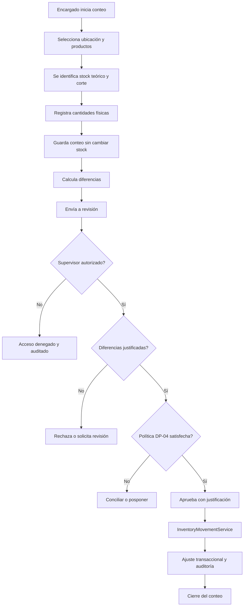
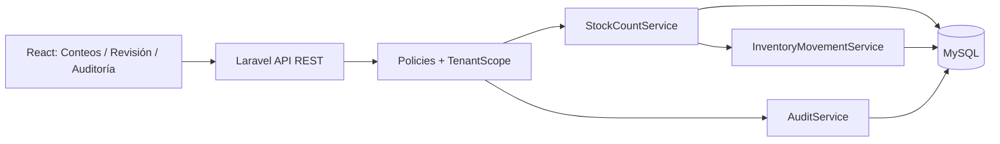
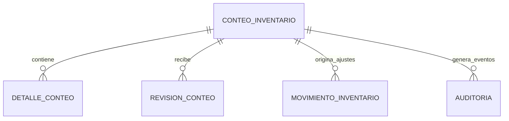

# CANVAS TÉCNICO — SPRINT 7: CONTEOS FÍSICOS Y AUDITORÍA

**Proyecto:** SaaS Inversiones R&P  
**Iteración:** Sprint 7  
**Épica:** EP-07 — Conteos físicos y auditoría  
**Duración sugerida:** 2 semanas (sujeta a capacidad del equipo)  
**Base documental:** Backlog técnico de implementación, versión 1.0, noviembre de 2026.  
**Stack de referencia:** React + Laravel + MySQL.  
**Estado:** Canvas de planificación; no implica funcionalidades implementadas ni decisiones aprobadas.

> **Convención:** Los apartados «Requisito del backlog» reproducen el alcance funcional de referencia. Las estructuras, rutas, pantallas, estimaciones y controles adicionales son **propuestas técnicas** que deben validarse antes de construir.

---

## 1. Propósito y visión del sprint

Permitir que el personal autorizado registre conteos físicos por ubicación, compare las cantidades observadas con un stock teórico identificable, revise diferencias y autorice ajustes mediante el servicio central de movimientos. Consolidar un registro de auditoría consultable que preserve quién hizo qué, cuándo y en qué contexto, sin exponer datos sensibles.

**Valor de negocio:** reducir diferencias no explicadas, prevenir correcciones arbitrarias, mejorar la responsabilidad operativa y facilitar investigaciones y conciliaciones.

## 2. Alcance y límites

### Incluido
- Registro y seguimiento de conteos físicos, con responsable y cantidades.
- Identificación del stock teórico utilizado para comparar.
- Estados de conteo: abierto, en revisión, aprobado/cerrado.
- Cálculo y visualización de diferencias.
- Revisión, decisión justificada y aprobación por rol autorizado.
- Ajustes aprobados exclusivamente a través de `InventoryMovementService`.
- Registro y consulta filtrable de auditoría para operaciones relevantes.
- Pruebas de aislamiento multiempresa, permisos, concurrencia e integridad.

### Excluido salvo aprobación expresa
- Ajustes automáticos al guardar un conteo.
- Eliminación o modificación retroactiva de movimientos confirmados.
- Integración con lectores físicos de códigos o dispositivos móviles sin historia aprobada.
- Algoritmos de conciliación de movimientos no aprobados en DP-04.
- Cambios a la política de autorización no aprobados en DP-05.

## 3. Historias de usuario y criterios de aceptación

### US-0701 — Ejecutar conteos físicos
**Prioridad del backlog:** P1.  
**Historia:** Como encargado, quiero registrar conteos físicos para comparar el stock real con el sistema.

**Criterios de aceptación del backlog:**
1. El conteo conserva cantidades registradas y responsable.
2. Se identifica el stock teórico usado como referencia.
3. Guardar el conteo no modifica automáticamente el stock.

**Tareas del backlog:** crear `conteo_inventario` y `detalle_conteo`; definir estados abierto, en revisión, aprobado/cerrado; implementar captura de cantidades y diferencias; crear pantallas y pruebas.

**Desglose propuesto:** selección de almacén/ubicación; captura por producto/variante; snapshot teórico con fecha de corte; validaciones de cantidades; pantalla de diferencias y transición a revisión.

### US-0702 — Revisar y aprobar diferencias
**Prioridad del backlog:** P0.  
**Historia:** Como supervisor, quiero revisar diferencias antes de autorizar ajustes.

**Criterios de aceptación del backlog:**
1. Las diferencias se muestran claramente.
2. Solo un rol autorizado puede aprobar ajustes.
3. La decisión y justificación quedan registradas.
4. La concurrencia con ventas y movimientos sigue la política aprobada **DP-04**.

**Tareas del backlog:** workflow de revisión/aprobación; tratamiento de movimientos durante el conteo; integración con `InventoryMovementService`; pruebas de permisos, concurrencia y auditoría.

**Desglose propuesto:** cola de revisiones, comparativa físico/teórico, decisión por conteo o línea según política acordada, motivo obligatorio, protección ante doble aprobación, ajuste transaccional y comprobante de resultado.

### US-0703 — Consultar trazabilidad y auditoría
**Prioridad del backlog:** P1.  
**Historia:** Como administrador, quiero consultar quién realizó cada operación y cuándo para investigar cambios.

**Criterios de aceptación del backlog:**
1. Registrar actor, fecha, tipo de operación, entidad y contexto permitido.
2. Los usuarios ordinarios no pueden editar registros de auditoría.
3. No exponer datos sensibles en logs.

**Tareas del backlog:** crear `auditoria` y estrategia de eventos; registrar eventos relevantes de autenticación, catálogo y movimientos; consulta filtrable; pruebas de integridad y permisos.

**Desglose propuesto:** eventos de conteo y aprobación, filtros por actor/tipo/fecha/entidad, paginación, vista de detalle y control de acceso en Laravel.

## 4. Flujo funcional del proceso

**Regla invariable:** el conteo registra observaciones; únicamente el servicio central de inventario puede modificar existencias mediante movimientos autorizados.

## 5. Arquitectura propuesta

**Backend:** controladores delgados; validación de contratos; autorización por rol y empresa; servicios de dominio; transacciones para aprobar ajustes; eventos auditables.  
**Frontend:** listados, filtros, formularios y estados de carga/error/vacío; no calcular ni persistir saldos como autoridad.  
**Datos:** toda entidad operativa debe estar acotada a la empresa activa; impedir consultas cruzadas.

## 6. Modelo de datos propuesto (sujeto a revisión)

| Entidad | Campos orientativos | Restricciones y propósito |
|---|---|---|
| `conteo_inventario` | `id`, `empresa_id`, `almacen_id`, `estado`, `responsable_id`, `fecha_corte`, `creado_en`, `cerrado_en` | Encabezado y contexto del conteo. |
| `detalle_conteo` | `id`, `conteo_id`, `producto_variante_id`, `ubicacion_id`, `stock_teorico`, `cantidad_fisica`, `diferencia` | Registro de observaciones y comparación. |
| `revision_conteo` | `id`, `conteo_id`, `revisor_id`, `decision`, `justificacion`, `fecha_decision` | Historial de decisiones y aprobaciones. |
| `auditoria` | `id`, `empresa_id`, `actor_id`, `evento`, `entidad`, `entidad_id`, `fecha_evento`, `contexto_permitido` | Trazabilidad de acciones relevantes. |
| `movimiento_inventario` (existente) | Referencia al ajuste aprobado y al conteo | Fuente única del cambio de stock. |

**Notas de diseño:**
- Usar tipos `DECIMAL` compatibles con la política de precisión DP-03.
- Definir índices por empresa, fechas, estado y entidades consultadas.
- Evitar duplicados en detalles y aprobaciones con restricciones e idempotencia.
- No registrar credenciales, tokens, datos secretos ni payloads sensibles en `auditoria`.
- Mantener referencias al movimiento de ajuste y al conteo para trazabilidad bidireccional.
- La estructura exacta, el versionado del stock teórico y la granularidad de aprobación se validan con el modelo de datos vigente.

## 7. Contratos API REST propuestos

> Rutas orientativas, no contratos aprobados. Aplicar autenticación, `TenantScope`, validación y políticas de acceso a todas.

| Método | Ruta | Uso |
|---|---|---|
| `GET` | `/api/v1/stock-counts` | Listar conteos con filtros y paginación. |
| `POST` | `/api/v1/stock-counts` | Crear conteo. |
| `GET` | `/api/v1/stock-counts/{id}` | Consultar cabecera y detalle. |
| `PUT` | `/api/v1/stock-counts/{id}/items` | Registrar/actualizar cantidades mientras esté abierto. |
| `POST` | `/api/v1/stock-counts/{id}/submit` | Enviar a revisión. |
| `POST` | `/api/v1/stock-counts/{id}/approve` | Aprobar y ejecutar ajustes autorizados. |
| `POST` | `/api/v1/stock-counts/{id}/reject` | Rechazar o solicitar corrección. |
| `GET` | `/api/v1/audit-events` | Consultar auditoría filtrada y paginada. |
| `GET` | `/api/v1/audit-events/{id}` | Consultar evento permitido. |

**Respuestas:** `401` no autenticado; `403` sin permiso; `404` entidad inexistente o fuera del tenant; `409` estado o concurrencia incompatible; `422` datos inválidos. Evitar filtración de información entre empresas mediante mensajes de error.

## 8. Interfaz React propuesta

**Vista A — Conteos:** filtros por almacén, estado, fecha y responsable; crear, consultar y continuar conteo abierto.  
**Vista B — Captura:** listado de productos/variantes, ubicación, cantidad teórica, cantidad física, diferencia, responsable y fecha de corte.  
**Vista C — Revisión:** diferencias destacadas, evidencia disponible, decisión, justificación, revisor y resultado del ajuste.  
**Vista D — Auditoría:** tabla paginada con actor, evento, entidad, fecha y filtros; detalle de contexto permitido.

**UX:** validación visible, confirmaciones antes de aprobar, prevención de doble clic, indicadores de estado, accesibilidad de formularios y mensajes claros para conflictos de concurrencia.

## 9. Reglas de negocio y seguridad

| ID | Regla | Origen |
|---|---|---|
| RN-07-01 | Guardar un conteo no modifica existencias. | Backlog US-0701. |
| RN-07-02 | Conservar responsable, cantidades y referencia teórica. | Backlog US-0701. |
| RN-07-03 | Solo rol autorizado aprueba ajustes; registrar decisión y justificación. | Backlog US-0702. |
| RN-07-04 | Aplicar política aprobada DP-04 a movimientos concurrentes. | Backlog US-0702. |
| RN-07-05 | Auditoría registra actor, fecha, operación, entidad y contexto permitido. | Backlog US-0703. |
| RN-07-06 | Registros de auditoría no editables por usuarios ordinarios; sin datos sensibles en logs. | Backlog US-0703. |
| RN-07-07 | Ajustes aprobados se realizan mediante `InventoryMovementService`. | Backlog / arquitectura. |
| RN-07-08 | Aislar toda consulta y mutación por empresa activa. | Arquitectura multiempresa del proyecto. |
| RN-07-09 | Reintentos de aprobación no generan ajustes duplicados. | Propuesta técnica de robustez. |

## 10. Decisiones pendientes y dependencias

### DP-04 — Conteos frente a ventas y movimientos (bloqueante)
El backlog exige acordar cómo operar conteos mientras continúan ventas/movimientos. **No existe una política aprobada implícita.** Evaluar formalmente alternativas como congelamiento por ubicación, corte temporal con conciliación de movimientos o recuento selectivo. Documentar efectos, responsables, pruebas y decisión antes de aprobar ajustes concurrentes.

### DP-05 — Autorización cuando el administrador no está disponible
Definir rol suplente, límites de aprobación y segregación de funciones. No asumir que el encargado del conteo puede autoaprobar.

### Dependencias previas
- Sprint 1: autenticación, roles, permisos y aislamiento multiempresa.
- Sprint 3: almacenes, ubicaciones y precisión de unidades.
- Sprint 4: `InventoryMovementService`, ajustes y trazabilidad.
- Sprint 5: movimientos por compras y traslados que deben considerarse en la política de concurrencia.

## 11. Matriz de pruebas propuesta

| ID | Escenario | Resultado esperado |
|---|---|---|
| T-01 | Crear conteo con permiso | Se guarda cabecera y responsable. |
| T-02 | Crear conteo sin permiso | Acceso denegado. |
| T-03 | Guardar cantidades físicas | Persisten cantidades válidas. |
| T-04 | Consultar stock teórico | Se identifica referencia y corte. |
| T-05 | Guardar conteo | El stock no cambia. |
| T-06 | Diferencia positiva | Se calcula y presenta correctamente. |
| T-07 | Diferencia negativa | Se calcula y presenta correctamente. |
| T-08 | Cantidad inválida | Se rechaza con validación. |
| T-09 | Enviar conteo a revisión | Cambia a estado permitido. |
| T-10 | Usuario sin rol intenta aprobar | Respuesta 403 y sin ajuste. |
| T-11 | Aprobar con justificación | Se registra decisión y ajuste autorizado. |
| T-12 | Repetir aprobación | No se duplica el ajuste. |
| T-13 | Movimiento concurrente durante conteo | Se cumple DP-04 aprobada; sin saldo inconsistente. |
| T-14 | Consultar conteo de otra empresa | No se revela información. |
| T-15 | Consultar auditoría con filtros | Resultados paginados y autorizados. |
| T-16 | Usuario ordinario edita auditoría | Operación rechazada. |
| T-17 | Eventos de autenticación/catálogo/movimientos | Actor, fecha y entidad auditables. |
| T-18 | Inspeccionar logs y auditoría | No contienen secretos ni tokens. |
| T-19 | Fallo en transacción de aprobación | No queda ajuste parcial ni conteo falsamente cerrado. |
| T-20 | Cerrar conteo y reintentar edición | No se alteran datos cerrados fuera del flujo permitido. |

## 12. Plan sugerido de dos semanas

| Periodo | Actividades | Evidencia |
|---|---|---|
| Días 1–2 | Refinamiento US-0701/02/03; cerrar DP-04 y DP-05; contratos y modelo | Acta de decisiones y migraciones revisadas. |
| Días 3–4 | Backend de conteos, snapshots y diferencias | API y pruebas unitarias. |
| Días 5–6 | Pantallas React de captura y revisión | Demostración de flujo sin ajuste automático. |
| Días 7–8 | Workflow de aprobación, integración transaccional y eventos de auditoría | Pruebas de permisos, idempotencia y concurrencia. |
| Día 9 | Auditoría filtrable, pruebas E2E, revisión de seguridad | CI verde y evidencias. |
| Día 10 | Demo, aceptación del PO, documentación y retrospectiva | Incremento aceptado y backlog actualizado. |

**Nota:** secuencia ilustrativa, no compromiso de capacidad; ajustar según estimación real del equipo.

## 13. Definition of Ready y Definition of Done

### Definition of Ready (del backlog)
- Objetivo y valor de negocio claros.
- Criterios de aceptación verificables.
- Dependencias de datos, API, permisos e interfaz identificadas.
- Decisiones necesarias resueltas o excluidas explícitamente.
- Alcance entendido y estimable.
- Diseños y contratos disponibles.

### Definition of Done (del backlog)
- Todos los criterios de aceptación cumplidos.
- Migraciones, relaciones, índices y restricciones revisados.
- Reglas de negocio en Laravel, no duplicadas como autoridad en React.
- Validaciones y autorización del backend activas.
- React consume la API y maneja carga, error y vacío.
- Pruebas pertinentes pasando en CI.
- Sin vulnerabilidades críticas conocidas ni defectos bloqueantes.
- Documentación técnica y API actualizadas.
- Código revisado y aceptación del Product Owner.

## 14. Entregables, demostración y cierre

**Entregables propuestos:**
1. Migraciones y modelos para conteos, detalles, revisiones y auditoría.
2. Servicios Laravel (`StockCountService`, integración con `InventoryMovementService`, `AuditService`).
3. Endpoints protegidos y documentados.
4. Vistas React de captura, revisión y consulta de auditoría.
5. Pruebas automatizadas y evidencias de aislamiento, permisos y concurrencia.
6. Registro de decisiones DP-04/DP-05 y documentación actualizada.

**Demostración de aceptación:** crear conteo, capturar stock físico diferente al teórico, verificar que no cambió el saldo al guardar, enviar a revisión, denegar aprobación a usuario sin permiso, aprobar con supervisor, generar ajuste único y localizar eventos en auditoría.

**Resultado esperado:** conteos físicos controlados, diferencias revisadas, ajustes autorizados y trazabilidad consultable, con preparación para el **Sprint 8 — Chatbot de lectura**.

---

**Referencia principal:** *Backlog técnico de implementación — SaaS Inversiones R&P*, v1.0, noviembre de 2026, secciones EP-07, servicios de dominio, plan de sprints, DoR/DoD y decisiones DP-04/DP-05.
