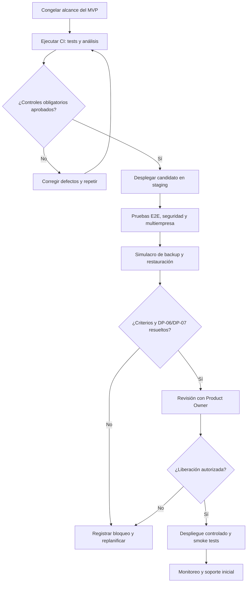
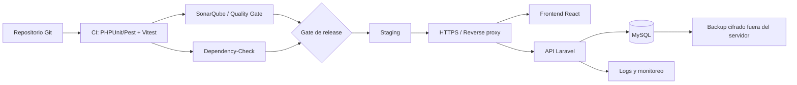

# CANVAS TÉCNICO — SPRINT 9: ESTABILIZACIÓN, SEGURIDAD Y SALIDA A PRODUCCIÓN

**Proyecto:** SaaS Inversiones R&P  
**Iteración:** Sprint 9  
**Épica:** EP-09 — Calidad y salida a producción  
**Duración sugerida:** 2 semanas (ajustable según capacidad, defectos y aprobaciones)  
**Base documental:** Backlog técnico de implementación v1.0, noviembre de 2026.  
**Stack de referencia:** React + Laravel + MySQL.  
**Estado:** Canvas de planificación. No acredita despliegue, pruebas superadas ni aceptación del Product Owner.

> **Convención documental:** Las historias y criterios marcados como «del backlog» provienen del documento base. La arquitectura, endpoints, scripts, umbrales, cronograma y matrices que se presentan como «propuesta» requieren validación; no constituyen decisiones aprobadas. **No declarar listo para producción el SaaS sin evidencias verificables.**

---

## 1. Propósito y visión del sprint

Consolidar los incrementos de los sprints 0–8 en una versión candidata a producción del MVP, demostrando calidad automatizada, seguridad, aislamiento multiempresa, despliegue repetible, respaldo y restauración de datos, y aceptación funcional.

**Valor de negocio:** reducir el riesgo de interrupciones, pérdida de datos, exposición entre empresas y fallos operativos en compras, movimientos y conteos.

**Objetivo demostrable:** ejecutar un pipeline de calidad; desplegar en un entorno aprobado con HTTPS; restaurar una copia de MySQL en un entorno aislado; completar pruebas de aceptación end-to-end y presentar al Product Owner evidencias de cumplimiento.

## 2. Alcance y límites

### Incluido según backlog
- Pruebas automatizadas de backend y frontend integradas en CI.
- SonarQube con quality gate acordado y OWASP Dependency-Check.
- Pruebas de integración de API y aislamiento multiempresa.
- Infraestructura aprobada para frontend, backend y MySQL; HTTPS y gestión externa de secretos.
- Migraciones controladas, logs, monitoreo básico y procedimiento de despliegue/reversión.
- Política de backup aprobada, copias fuera del servidor principal y restauración documentada.
- Definición previa de RPO/RTO, validación funcional del MVP, seguridad y trazabilidad.
- Documentación de operación y soporte y revisión final con Product Owner.

### Excluido salvo aprobación expresa
- Agregar funcionalidades nuevas o modificar sustancialmente el alcance del MVP.
- Dar por aprobados objetivos de disponibilidad, rendimiento, retención o recuperación sin cerrar DP-06/DP-07.
- Tratar Docker, un proveedor cloud, una herramienta de monitoreo o umbrales numéricos como obligatorios del backlog cuando son opciones técnicas.
- Ejecutar cambios destructivos en datos reales sin plan de reversión y autorización.
- Declarar conformidad formal con normas ISO sin evaluación y evidencias específicas.

## 3. Historias de usuario y criterios de aceptación

### US-0901 — Automatizar pruebas y controles de calidad
**Prioridad del backlog:** P0.  
**Historia del backlog:** Como equipo, queremos detectar defectos de forma continua para reducir riesgos antes de desplegar.

**Criterios de aceptación del backlog:**
1. Backend y frontend tienen pruebas automatizadas ejecutadas en CI.
2. SonarQube analiza el código según quality gate acordado.
3. OWASP Dependency-Check identifica dependencias vulnerables.
4. Los defectos críticos bloquean el despliegue.

**Tareas técnicas del backlog:** completar suites PHPUnit/Pest y Vitest; configurar SonarQube y quality gate; configurar OWASP Dependency-Check; añadir pruebas de integración API y aislamiento multiempresa; documentar resultados y excepciones aceptadas.

**Desglose propuesto:** definir pipeline de pull request y release, guardar reportes y evidencias, proteger rama principal y bloquear promoción cuando falle un control obligatorio.

### US-0902 — Preparar despliegue productivo
**Prioridad del backlog:** P0.  
**Historia del backlog:** Como administrador del sistema, quiero desplegar la aplicación en un entorno productivo seguro.

**Criterios de aceptación del backlog:**
1. Frontend, backend y MySQL están configurados en infraestructura aprobada.
2. HTTPS está habilitado.
3. Secretos y credenciales se gestionan fuera del código.
4. Hay procedimiento de despliegue y reversión.

**Tareas técnicas del backlog:** preparar servidor/hosting para Laravel y React; configurar dominio, TLS/HTTPS, variables y permisos; ejecutar migraciones controladas; configurar logs, monitoreo básico y manejo de errores; documentar release.

**Desglose propuesto:** usar un ambiente de staging equivalente al productivo, ejecutar smoke tests tras el despliegue, revisar integridad de migraciones y documentar responsables de aprobación.

### US-0903 — Configurar copias de seguridad y recuperación
**Prioridad del backlog:** P0.  
**Historia del backlog:** Como responsable, quiero recuperar los datos ante fallos para proteger la continuidad del negocio.

**Criterios de aceptación del backlog:**
1. Existe política aprobada de frecuencia, retención y responsables.
2. Las copias se almacenan separadas del servidor principal.
3. Se realiza una prueba documentada de restauración.
4. Los objetivos RPO/RTO se definen antes de producción.

**Tareas técnicas del backlog:** cerrar DP-06 y DP-07; configurar backup de MySQL y almacenamiento seguro; documentar cifrado, retención y acceso; ejecutar simulacro de restauración y registrar resultados.

**Desglose propuesto:** probar restauración en base aislada, verificar integridad referencial y permisos, medir tiempos reales y registrar brechas frente a RPO/RTO aprobados.

### US-0904 — Ejecutar pruebas de aceptación y estabilización
**Prioridad del backlog:** P0.  
**Historia del backlog:** Como Product Owner, quiero validar los flujos completos para aceptar el MVP.

**Criterios de aceptación del backlog:**
1. Los criterios de aceptación del MVP están verificados.
2. No quedan defectos críticos o altos sin tratamiento aprobado.
3. Se valida seguridad, permisos, multiempresa y trazabilidad.
4. Se entrega documentación de operación y soporte.

**Tareas técnicas del backlog:** preparar datos representativos; ejecutar pruebas end-to-end de catálogo, entradas, salidas, compras, traslados, alertas y conteos; validar roles; corregir defectos y registrar evidencias; revisión final con Product Owner.

**Desglose propuesto:** ejecutar regresión funcional, clasificar defectos por severidad, realizar sesión de aceptación y levantar acta con pendientes y decisión explícita de liberación.

## 4. Flujo funcional del proceso

**Nota:** la autorización del Product Owner y del responsable operativo es una propuesta de gobierno del release; los criterios del backlog exigen aceptación del MVP y preparación productiva.

## 5. Arquitectura propuesta

**Implementación sugerida:** pipelines de GitHub Actions u otra CI aprobada; despliegue por artefactos versionados; Docker/Compose si ya se adoptó en Sprint 0. El backlog no obliga a un proveedor de infraestructura ni a un producto específico de CI.

**Controles de seguridad sugeridos:** HTTPS estricto, cookies seguras cuando apliquen, validación server-side, autorización por recurso, limitación de intentos, acceso mínimo a MySQL, segregación de ambientes, protección de secretos y exclusión de datos sensibles en logs.

## 6. Modelo de datos y artefactos operativos propuestos

Este sprint **no exige crear nuevas tablas funcionales**. Su prioridad es verificar migraciones, integridad, índices, llaves foráneas, auditoría y restauración de los datos implementados en los sprints anteriores.

| Artefacto | Contenido mínimo propuesto | Responsable sugerido |
|---|---|---|
| `release_manifest` (archivo) | Versión, commit, migraciones, artefactos y fecha | Líder técnico |
| `test_evidence` (archivo/reporte) | Caso, resultado, entorno, fecha, evidencia | QA |
| `security_findings` (reporte) | Hallazgo, severidad, corrección o excepción aprobada | Seguridad / líder técnico |
| `backup_policy` (documento) | Frecuencia, retención, cifrado, custodia, RPO/RTO | Responsable operativo |
| `restore_report` (documento) | Copia usada, pasos, tiempos, validaciones y resultado | DBA / operaciones |
| `release_approval` (acta) | Criterios cumplidos, riesgos residuales y decisión | Product Owner |

**Comprobaciones de datos propuestas:** migraciones aplicadas una sola vez; no fuga de registros entre tenants; conciliación de existencias con movimientos; no stocks negativos no autorizados; trazabilidad de reversiones y ajustes; integridad de conteos aprobados.

## 7. Contratos y verificaciones API REST propuestos

No se requieren nuevos endpoints de negocio. Validar los contratos REST ya implementados para autenticación, catálogo, almacenes, movimientos, compras, traslados, métricas, conteos y chatbot.

| Verificación | Resultado esperado |
|---|---|
| `GET /health` **(solo si se aprueba implementarlo)** | Estado básico del servicio, sin secretos |
| Solicitud sin autenticación a recurso protegido | 401, sin datos de negocio |
| Solicitud autenticada sin permiso | 403, sin filtración |
| Acceso a recurso de otra empresa | Denegación o respuesta no reveladora, según contrato |
| Entrada/salida válida | Persistencia consistente y auditable |
| Salida mayor al stock disponible | Rechazo sin modificar existencias |
| Operación repetida o concurrente | Comportamiento consistente según reglas aprobadas |
| Errores internos | Respuesta controlada y registro seguro |

**Criterio:** las rutas exactas se ajustarán a los contratos API existentes; la ruta `/health` es únicamente una sugerencia técnica.

## 8. Interfaz React propuesta

- Revisar autenticación, expiración de sesión y visibilidad según roles.
- Verificar estados de carga, vacío y error sin indicadores infinitos ni mensajes engañosos.
- Validar el orden de métricas acordado: total de productos, detalles, agotados, stock mínimo, valor total, más salidas, sin movimiento y resumen, cuando corresponda al diseño aprobado.
- Probar formularios de categorías, productos, compras, traslados, ajustes y conteos con datos válidos e inválidos.
- Confirmar que el frontend no confía en permisos visuales como sustituto de autorización en Laravel.
- Revisar accesibilidad básica: foco, etiquetas, mensajes de error y navegación con teclado.
- Ejecutar pruebas en resoluciones de escritorio y móvil relevantes para los usuarios.

**Entregable propuesto:** checklist de aceptación visual y funcional con capturas o registros de ejecución.

## 9. Reglas de negocio, calidad y seguridad

1. **Aislamiento multiempresa:** ningún usuario accede a datos de otro tenant, incluso manipulando identificadores o filtros.
2. **Integridad de inventario:** entradas, salidas, compras, traslados y ajustes mantienen consistencia transaccional.
3. **Autorización real:** las restricciones se verifican en Laravel, no solo en React.
4. **Auditoría:** operaciones sensibles conservan usuario, empresa, momento y referencia.
5. **Secretos:** credenciales y tokens no aparecen en repositorio, frontend público, reportes ni logs.
6. **Calidad de liberación:** no promocionar builds con defectos críticos; los altos requieren tratamiento aprobado según backlog.
7. **Recuperación:** una copia no se considera verificada hasta restaurarla y validar sus datos.
8. **Migraciones:** aplicar cambios compatibles con la estrategia de rollback; una reversión de aplicación no garantiza reversión segura de datos.
9. **Chatbot:** permanece en modo lectura y respeta permisos y límites del Sprint 8.
10. **Evidencia:** registrar fecha, versión, entorno, resultado y responsable de cada validación.

**Buenas prácticas de referencia (propuesta, no certificación):** ISO/IEC 25010 para atributos de calidad, ISO/IEC 27001 para controles de seguridad, ISO/IEC 12207 para procesos de software y OWASP ASVS para verificaciones de seguridad de aplicaciones. El backlog exige controles concretos, no una certificación ISO.

## 10. Decisiones pendientes y dependencias

| ID | Decisión del backlog | Impacto en Sprint 9 | Condición |
|---|---|---|---|
| DP-06 | Retención de datos y política de recuperación | US-0903 | Aprobar frecuencia, retención, responsables, custodia y restauración |
| DP-07 | Objetivos de disponibilidad y rendimiento | US-0902, US-0903 | Aprobar objetivos operativos, RPO y RTO |

**Otras dependencias a verificar:** alcance del MVP aceptado, infraestructura y dominio aprobados, estrategia de secretos, política de acceso, datos de prueba, resolución o tratamiento de defectos previos, y decisiones de inventario que afecten la aceptación funcional.

**Propuestas que requieren decisión adicional:** quality gate cuantitativo, umbrales de cobertura, criticidad de vulnerabilidades, estrategia de despliegue (blue/green, rolling o mantenimiento), proveedor de backups, ventanas de mantenimiento, métricas de monitoreo y plan de respuesta a incidentes. No asignar números arbitrarios como si fueran requisitos oficiales.

## 11. Matriz de pruebas propuesta

| ID | Escenario | Resultado esperado | Historia |
|---|---|---|---|
| T-0901 | Ejecutar tests backend en CI | Reporte reproducible y estado correcto | US-0901 |
| T-0902 | Ejecutar tests frontend en CI | Reporte reproducible y estado correcto | US-0901 |
| T-0903 | Analizar código en SonarQube | Quality gate acordado aplicado | US-0901 |
| T-0904 | Escanear dependencias | Vulnerabilidades detectadas y tratadas | US-0901 |
| T-0905 | Simular defecto crítico | Pipeline bloquea release | US-0901 |
| T-0906 | Consultar tenant ajeno | No expone información | US-0901/0904 |
| T-0907 | Probar acceso sin rol suficiente | Acceso denegado | US-0904 |
| T-0908 | Verificar HTTPS | Acceso cifrado y certificado válido | US-0902 |
| T-0909 | Inspeccionar secretos | No aparecen en código ni artefactos públicos | US-0902 |
| T-0910 | Desplegar versión candidata | Artefactos y migraciones controlados | US-0902 |
| T-0911 | Simular rollback de aplicación | Procedimiento verificable | US-0902 |
| T-0912 | Generar backup MySQL | Copia válida y almacenada externamente | US-0903 |
| T-0913 | Restaurar backup aislado | Integridad de datos verificada | US-0903 |
| T-0914 | Medir tiempo de recuperación | Comparación con RTO aprobado | US-0903 |
| T-0915 | Verificar ventana de pérdida de datos | Comparación con RPO aprobado | US-0903 |
| T-0916 | E2E catálogo y productos | Flujos y permisos correctos | US-0904 |
| T-0917 | E2E entradas, salidas y devoluciones | Stock consistente y trazable | US-0904 |
| T-0918 | E2E compras y traslados | Operaciones integradas sin inconsistencias | US-0904 |
| T-0919 | E2E alertas y métricas | Indicadores correctos | US-0904 |
| T-0920 | E2E conteos y aprobación de diferencias | Ajustes autorizados y auditables | US-0904 |
| T-0921 | E2E chatbot lectura | No modifica stock ni cruza tenants | US-0904 |
| T-0922 | Revisión de defectos y acta | Sin bloqueantes no tratados; aceptación documentada | US-0904 |

**Evidencia mínima por caso:** identificador, versión, ambiente, datos usados, pasos, esperado/obtenido, fecha, ejecutor, incidencia y enlace al reporte.

## 12. Plan sugerido de dos semanas

| Día | Actividades sugeridas | Resultado |
|---|---|---|
| 1 | Revisar alcance, riesgos, defectos, DP-06/DP-07 | Plan de liberación y bloqueos identificados |
| 2 | Completar PHPUnit/Pest y Vitest | Suites de regresión |
| 3 | Integrar CI, SonarQube y Dependency-Check | Pipeline con gates |
| 4 | Pruebas API, permisos y multiempresa | Evidencias de seguridad |
| 5 | Preparar staging y despliegue controlado | Candidato desplegado |
| 6 | Validar HTTPS, secretos, logs y monitoreo | Checklist operativo |
| 7 | Configurar y ejecutar backup/restauración | Informe de recuperación |
| 8 | Pruebas E2E de inventario y procesos | Matriz de aceptación |
| 9 | Corregir defectos, repetir regresión y preparar manuales | Release candidate validado |
| 10 | Demo, revisión con Product Owner y decisión de liberación | Acta de aceptación o pendientes |

**Advertencia de capacidad:** si las pruebas detectan fallas importantes o no se aprueban DP-06/DP-07, la salida a producción se pospone. La duración de dos semanas es una planificación inicial, no una garantía de fecha.

## 13. Definition of Ready y Definition of Done

### Definition of Ready (alineada al backlog)
- Objetivo y valor de negocio comprensibles.
- Criterios de aceptación verificables.
- Dependencias de datos, API, permisos e interfaz identificadas.
- Decisiones de negocio necesarias resueltas o explícitamente excluidas.
- Ambientes, accesos, responsables y plan de evidencias disponibles (propuesta específica).

### Definition of Done (alineada al backlog)
- Criterios de aceptación satisfechos y demostrados.
- Pruebas automatizadas pertinentes aprobadas en CI.
- Aislamiento tenant y autorización backend comprobados.
- Sin defectos críticos ni altos sin tratamiento aprobado.
- Documentación técnica y operativa actualizada.
- Product Owner revisa y acepta el incremento.

**Condiciones específicas para producción:** quality gate acordado satisfecho; análisis de dependencias ejecutado; HTTPS y secretos verificados; restauración demostrada; DP-06 y DP-07 cerradas; runbook y rollback disponibles; decisión de liberación registrada.

## 14. Entregables, demostración y cierre

**Entregables propuestos:**
1. Pipeline CI con pruebas de Laravel y React, SonarQube y Dependency-Check.
2. Reportes de pruebas, calidad, vulnerabilidades y aislamiento multiempresa.
3. Infraestructura aprobada, despliegue de versión candidata y configuración HTTPS.
4. Procedimiento de release y reversión, con inventario de variables y responsables (sin secretos).
5. Política de backup/retención, RPO/RTO aprobados y reporte de restauración.
6. Matriz E2E del MVP, registro de defectos y evidencias de corrección.
7. Manual de operación, monitoreo, incidentes y soporte.
8. Acta de revisión y aceptación o rechazo del Product Owner.

**Guion de demostración:**
1. Mostrar pipeline de CI, quality gate y escaneo de dependencias.
2. Demostrar acceso HTTPS y ausencia de secretos en artefactos públicos.
3. Ejecutar flujo completo de catálogo → compra/entrada → traslado → salida → conteo → alerta.
4. Comprobar denegación de acceso entre empresas y según permisos.
5. Restaurar una copia en entorno aislado y mostrar evidencia de integridad.
6. Presentar incidencias residuales y obtener decisión documentada del Product Owner.

**Criterio de cierre:** el Sprint 9 concluye respecto del alcance aceptado solo cuando los criterios de US-0901 a US-0904 se demuestran. La liberación productiva requiere además las aprobaciones y controles operativos definidos. Si existen bloqueos, registrar los pendientes y no declarar el sistema listo para producción.

**Cierre de la hoja de ruta inicial:** Sprint 9 finaliza la planificación de los diez sprints (0–9). El mantenimiento correctivo, soporte y evolución del SaaS continúan mediante un backlog posterior, sujeto a priorización.

---

**Documento de planificación técnica — SaaS Inversiones R&P**  
**Referencia:** Backlog técnico de implementación v1.0, noviembre de 2026.  
**Control:** Toda propuesta debe revisarse con el equipo y el Product Owner antes de convertirse en un compromiso de implementación o producción.
