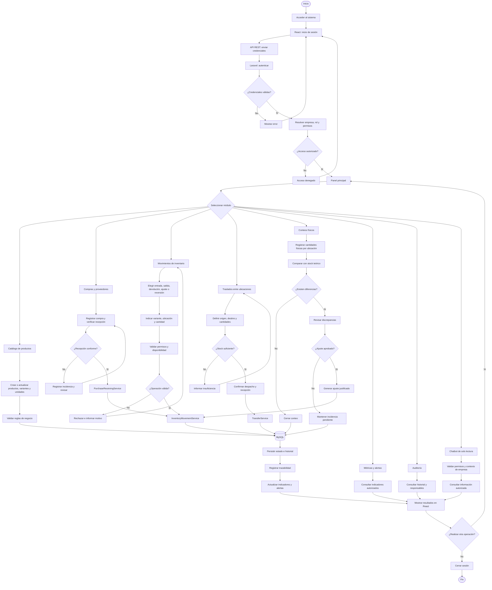
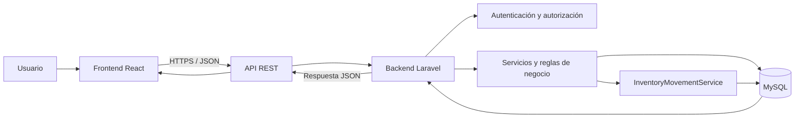

# Documento técnico: Diagrama de flujo del sistema

**Proyecto:** SaaS Inversiones R&P  
**Versión:** 1.0  
**Fecha:** Noviembre de 2026  
**Tecnologías:** React, Laravel, MySQL y API REST

## 1. Objetivo

Documentar los flujos operativos y técnicos del SaaS Inversiones R&P para la gestión de inventarios y almacenes, desde la autenticación hasta la auditoría de operaciones.

## 2. Alcance

El MVP comprende autenticación, usuarios, roles, permisos y aislamiento por empresa; productos, categorías, marcas y variantes; unidades y conversiones; compras y proveedores; entradas, salidas, devoluciones, ajustes y reversiones; traslados; conteos físicos; métricas y alertas; auditoría; y chatbot de consulta de solo lectura.

Quedan fuera del MVP el POS completo, la facturación electrónica, la contabilidad, la aplicación móvil nativa y las modificaciones de inventario desde el chatbot.

## 3. Diagrama de flujo general

> **Nota:** El diagrama representa el flujo funcional general. La persistencia y los cambios de stock se ejecutan bajo reglas, autorizaciones y transacciones del backend; las consultas no modifican existencias.

## 4. Arquitectura tecnológica

El frontend nunca se conecta directamente a MySQL. Laravel controla la autorización, validación, consistencia y modificación del inventario.

## 5. Descripción de procesos

| Proceso | Operación principal | Resultado |
|---|---|---|
| Autenticación | Validar identidad, empresa, rol y permisos | Acceso autorizado |
| Catálogo | Gestionar productos, variantes, códigos y unidades | Catálogo actualizado |
| Compras | Registrar compra y confirmar recepción | Movimiento de entrada |
| Inventario | Registrar entradas, salidas, devoluciones, ajustes y reversiones | Existencias e historial actualizados |
| Traslados | Mover existencias entre ubicaciones | Stock redistribuido |
| Conteos | Comparar stock físico con teórico y revisar diferencias | Cierre o ajuste autorizado |
| Métricas | Consultar indicadores y alertas | Información para decisiones |
| Auditoría | Consultar operaciones, responsables y motivos | Trazabilidad |
| Chatbot | Consultar datos permitidos | Respuesta sin modificar registros |

## 6. Reglas de negocio

1. **RN-01:** Todas las operaciones respetan los permisos del usuario.
2. **RN-02:** Cada empresa accede únicamente a sus propios datos.
3. **RN-03:** Laravel es la fuente de verdad para las reglas de negocio.
4. **RN-04:** Todo cambio de stock pasa por `InventoryMovementService`.
5. **RN-05:** No se permite stock negativo en operaciones ordinarias.
6. **RN-06:** Las existencias se controlan por empresa, variante y ubicación.
7. **RN-07:** Los cambios de inventario deben ser transaccionales y contemplar concurrencia.
8. **RN-08:** Los movimientos confirmados no se eliminan físicamente; se corrigen con reversiones o compensaciones.
9. **RN-09:** Guardar un conteo físico no modifica automáticamente el stock.
10. **RN-10:** Los ajustes por diferencias requieren aprobación autorizada.
11. **RN-11:** Los traslados deben mantener consistencia entre origen y destino y efecto neto global cero.
12. **RN-12:** El chatbot opera únicamente en modo lectura y con filtros de autorización.

## 7. Servicios de aplicación

### 7.1. `InventoryMovementService`

Valida y ejecuta movimientos que afectan existencias, registra trazabilidad y controla consistencia transaccional.

### 7.2. `PurchaseReceivingService`

Gestiona la confirmación de recepción de compras y delega la entrada de stock al servicio central de movimientos.

### 7.3. `TransferService`

Coordina traslados entre ubicaciones, validando disponibilidad y registrando la salida y entrada de manera consistente.

## 8. Decisiones pendientes

| Código | Decisión | Estado |
|---|---|---|
| DP-01 | Quién registra las salidas por ventas | Pendiente |
| DP-02 | Método de valoración del inventario | Pendiente |
| DP-03 | Reglas de conversión de unidades y redondeo | Pendiente |
| DP-04 | Manejo de conteos concurrentes con otros movimientos | Pendiente |
| DP-05 | Quién autoriza ajustes si el administrador no está disponible | Pendiente |

## 9. Conclusión

Este documento establece un flujo funcional para el MVP de SaaS Inversiones R&P. La arquitectura React–API REST–Laravel–MySQL separa la interfaz de las reglas de negocio y centraliza los cambios de inventario para favorecer la consistencia, seguridad, auditoría y trazabilidad. Las decisiones pendientes deberán resolverse antes de cerrar los procesos correspondientes.
