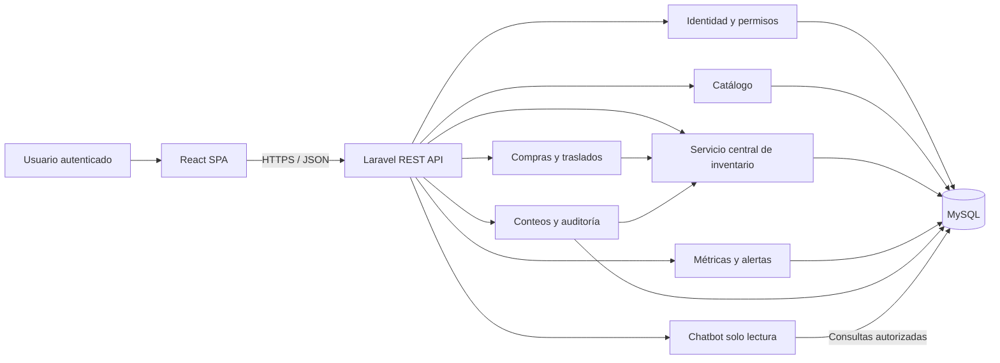
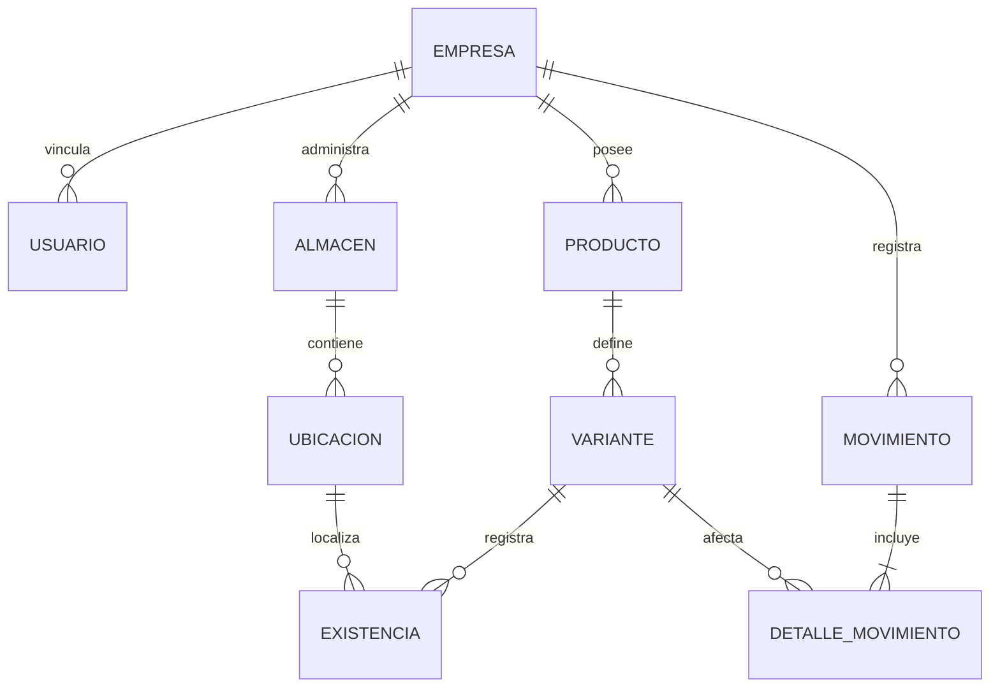
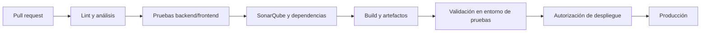

# DOCUMENTO MAESTRO DE ARQUITECTURA E IMPLEMENTACIÓN

## SaaS Inversiones R&P — Gestión de inventario y almacén

**Versión documental:** 1.0 (borrador de consolidación)  
**Fecha:** 9 de noviembre de 2026  
**Estado:** Planificación y diseño documentados; implementación y evidencias pendientes de verificación  
**Tecnologías previstas:** React · Laravel · MySQL · API REST/JSON · Docker · GitHub Actions  
**Marco de trabajo:** Scrum, 10 sprints (0–9), duración sugerida de dos semanas cada uno  
**Fuentes primarias:** Backlog técnico v1.0 (noviembre 2026), análisis de inventario, Canvas de diseño técnico, Canvas ejecutivo, Canvas de datos y Canvas de los sprints 0–9.

> **Regla de lectura:** «Definido en backlog» indica una intención o restricción documentada, no software terminado. «Propuesta» es un diseño que requiere validación. «Pendiente» no debe asumirse aprobado. Este documento no certifica cumplimiento de normas ni acredita pruebas ejecutadas.

## Índice

1. Gobierno documental y alcance  
2. Visión, actores y límites del MVP  
3. Requisitos y trazabilidad funcional  
4. Arquitectura de software  
5. Diseño de datos  
6. Reglas de negocio  
7. Identidad, autorización y seguridad  
8. Contratos API e integración  
9. Interfaz, métricas y chatbot  
10. Estrategia de calidad y pruebas  
11. Infraestructura y operación  
12. Plan de sprints y dependencias  
13. Registro de decisiones pendientes  
14. Riesgos, evidencias y criterios de liberación  
15. Documentación relacionada y mantenimiento

---

# 1. Gobierno documental y alcance

## 1.1 Objetivo

Consolidar una fuente de referencia para entender **qué** construye SaaS Inversiones R&P, **cómo** se integran sus componentes, **qué decisiones faltan**, **cómo** se probarán sus requisitos y **dónde** encontrar la documentación detallada de cada iteración. No sustituye los Canvas: los enlaza y evita duplicar especificaciones cambiantes.

## 1.2 Convenciones de estado

| Estado | Significado | Evidencia necesaria |
|---|---|---|
| Definido en backlog | Necesidad o regla expresada en documentación base | Backlog aprobado |
| Propuesto | Diseño sugerido en Canvas o este documento | Revisión técnica y funcional |
| Pendiente de decisión | Alternativas sin acuerdo registrado | ADR o acta de decisión |
| Implementado | Funcionalidad presente en repositorio | Commit, PR y despliegue verificable |
| Validado | Criterios de aceptación comprobados | Pruebas y acta de aceptación |

**Estado real de implementación:** no verificado en los archivos fuente; no se marca ninguna historia como implementada o validada.

## 1.3 Gestión de cambios

Todo cambio relevante debe registrar fecha, responsable, versión, historia afectada, impacto en datos/API y referencia al ADR o PR. Revisar este documento al cerrar cada sprint.

# 2. Visión, actores y límites del MVP

## 2.1 Propósito

Sistema SaaS para controlar productos, variantes, ubicaciones, existencias, movimientos, compras, traslados, métricas, alertas, conteos y auditoría, con aislamiento de datos por empresa.

## 2.2 Actores funcionales (propuesta de clasificación)

- **Administrador de empresa:** configura usuarios, permisos y catálogos dentro de su tenant.
- **Operador de almacén:** registra movimientos según autorizaciones.
- **Supervisor/aprobador:** revisa ajustes, diferencias y excepciones.
- **Consultor/lector:** consulta existencias, indicadores y chatbot dentro de su ámbito.
- **Operador de plataforma:** administra infraestructura; su acceso a datos de clientes requiere políticas explícitas.

Los nombres de roles definitivos y sus permisos deben acordarse en DD-04; los anteriores son ejemplos de actores, no un catálogo aprobado.

## 2.3 Incluido en MVP (backlog)

Autenticación y roles; multiempresa; productos, categorías, marcas y variantes; unidades y conversiones; almacenes y ubicaciones; existencias y movimientos; proveedores, compras y traslados; métricas y alertas; conteos y auditoría; chatbot exclusivamente de lectura; calidad, seguridad y despliegue.

## 2.4 Excluido del MVP (backlog)

POS completo y caja; facturación electrónica y contabilidad; aplicación móvil nativa; escritura por chatbot; compras automatizadas; microservicios prematuros; suscripciones y cobros comerciales SaaS completos, salvo preparación expresamente aprobada.

# 3. Requisitos y trazabilidad funcional

Las historias se identifican por el código `US-SSNN`; `SS` representa el sprint. El detalle y los criterios de aceptación están en cada Canvas y en el backlog. Esta matriz consolida su ubicación sin cambiar el alcance.

| Sprint | Épica | Historias | Canvas detallado |
|---:|---|---|---|
| 0 | EP-00 — Fundación técnica y decisiones | US-0001, US-0002, US-0003, US-0004 | [`CANVAS_SPRINT_0_FUNDACION_TECNICA_DECISIONES.md`](CANVAS_SPRINT_0_FUNDACION_TECNICA_DECISIONES.md) |
| 1 | EP-01 — Identidad, acceso y multiempresa | US-0101, US-0102, US-0103, US-0104 | [`CANVAS_SPRINT_1_IDENTIDAD_MULTIEMPRESA.md`](CANVAS_SPRINT_1_IDENTIDAD_MULTIEMPRESA.md) |
| 2 | EP-02 — Catálogo de productos | US-0201, US-0202, US-0203 | [`CANVAS_SPRINT_2_CATALOGO_PRODUCTOS.md`](CANVAS_SPRINT_2_CATALOGO_PRODUCTOS.md) |
| 3 | EP-03 — Unidades y ubicaciones | US-0301, US-0302, US-0303 | [`CANVAS_SPRINT_3_UNIDADES_ALMACENES.md`](CANVAS_SPRINT_3_UNIDADES_ALMACENES.md) |
| 4 | EP-04 — Núcleo de inventario | US-0401, US-0402, US-0403, US-0404, US-0405, US-0406 | [`CANVAS_SPRINT_4_INVENTARIO_CENTRAL.md`](CANVAS_SPRINT_4_INVENTARIO_CENTRAL.md) |
| 5 | EP-05 — Compras y traslados | US-0501, US-0502, US-0503 | [`CANVAS_SPRINT_5_COMPRAS_TRASLADOS.md`](CANVAS_SPRINT_5_COMPRAS_TRASLADOS.md) |
| 6 | EP-06 — Métricas y alertas | US-0601, US-0602, US-0603 | [`CANVAS_SPRINT_6_METRICAS_ALERTAS.md`](CANVAS_SPRINT_6_METRICAS_ALERTAS.md) |
| 7 | EP-07 — Conteos y auditoría | US-0701, US-0702, US-0703 | [`CANVAS_SPRINT_7_CONTEOS_AUDITORIA.md`](CANVAS_SPRINT_7_CONTEOS_AUDITORIA.md) |
| 8 | EP-08 — Consulta inteligente | US-0801, US-0802 | [`CANVAS_SPRINT_8_CHATBOT_LECTURA.md`](CANVAS_SPRINT_8_CHATBOT_LECTURA.md) |
| 9 | EP-09 — Calidad y salida a producción | US-0901, US-0902, US-0903, US-0904 | [`CANVAS_SPRINT_9_ESTABILIZACION_PRODUCCION.md`](CANVAS_SPRINT_9_ESTABILIZACION_PRODUCCION.md) |

## 3.1 Matriz de historias y objetivos

| Historia | Objetivo documentado | Estado |
|---|---|---|
| US-0001 | Acordar arquitectura y estructura del repositorio | Planificado; implementación no verificada |
| US-0002 | Definir modelo de datos y estrategia multiempresa | Planificado; implementación no verificada |
| US-0003 | Preparar entorno local y pipeline inicial | Planificado; implementación no verificada |
| US-0004 | Cerrar decisiones de negocio que afectan el diseño | Planificado; implementación no verificada |
| US-0101 | Iniciar sesión y cerrar sesión | Planificado; implementación no verificada |
| US-0102 | Administrar usuarios y asignar roles | Planificado; implementación no verificada |
| US-0103 | Aplicar permisos por módulo y acción | Planificado; implementación no verificada |
| US-0104 | Aislar datos por empresa | Planificado; implementación no verificada |
| US-0201 | Gestionar categorías y marcas | Planificado; implementación no verificada |
| US-0202 | Registrar y mantener productos | Planificado; implementación no verificada |
| US-0203 | Gestionar variantes y códigos | Planificado; implementación no verificada |
| US-0301 | Configurar unidades de medida | Planificado; implementación no verificada |
| US-0302 | Configurar conversiones de unidades | Planificado; implementación no verificada |
| US-0303 | Administrar ubicaciones de almacén | Planificado; implementación no verificada |
| US-0401 | Consultar existencias | Planificado; implementación no verificada |
| US-0402 | Registrar entradas de inventario | Planificado; implementación no verificada |
| US-0403 | Registrar salidas y validar stock disponible | Planificado; implementación no verificada |
| US-0404 | Registrar devoluciones | Planificado; implementación no verificada |
| US-0405 | Realizar ajustes autorizados | Planificado; implementación no verificada |
| US-0406 | Revertir movimientos confirmados | Planificado; implementación no verificada |
| US-0501 | Gestionar proveedores | Planificado; implementación no verificada |
| US-0502 | Registrar compras y costos históricos | Planificado; implementación no verificada |
| US-0503 | Trasladar existencias entre ubicaciones | Planificado; implementación no verificada |
| US-0601 | Visualizar indicadores de inventario | Planificado; implementación no verificada |
| US-0602 | Configurar alertas de stock mínimo e inactividad | Planificado; implementación no verificada |
| US-0603 | Programar tareas y notificaciones | Planificado; implementación no verificada |
| US-0701 | Ejecutar conteos físicos | Planificado; implementación no verificada |
| US-0702 | Revisar y aprobar diferencias | Planificado; implementación no verificada |
| US-0703 | Consultar trazabilidad y auditoría | Planificado; implementación no verificada |
| US-0801 | Consultar inventario mediante chatbot de solo lectura | Planificado; implementación no verificada |
| US-0802 | Consultar información de temporada | Planificado; implementación no verificada |
| US-0901 | Automatizar pruebas y controles de calidad | Planificado; implementación no verificada |
| US-0902 | Preparar despliegue productivo | Planificado; implementación no verificada |
| US-0903 | Configurar copias de seguridad y recuperación | Planificado; implementación no verificada |
| US-0904 | Ejecutar pruebas de aceptación y estabilización | Planificado; implementación no verificada |

## 3.2 Trazabilidad propuesta

La cadena mínima de trazabilidad es: **Historia → regla de negocio → componente/API → migración → prueba → evidencia → aprobación**. Registrar los identificadores reales de código y pruebas cuando existan; no inventarlos.

| Historia | Regla o control | Componentes previstos | Prueba mínima | Evidencia pendiente |
|---|---|---|---|---|
| US-0104 | Aislamiento por tenant | Middleware/policies, consultas y DB | Empresa A no puede leer datos de B | Test de integración |
| US-0403 | No confirmar salida sin stock | InventoryService, transacción DB | Salida mayor que existencia rechazada | Test transaccional |
| US-0406 | Reversión trazable | Servicio de movimientos | Reversión única y auditable | Test de idempotencia |
| US-0503 | Traslado atómico | Servicio de inventario | No queda salida sin entrada | Test de rollback |
| US-0702 | Ajustes solo tras aprobación | Workflow y permisos | Usuario no autorizado no ajusta | Test de autorización |
| US-0801 | Chatbot solo lectura | Servicio de consultas | Solicitud de escritura rechazada | Test de seguridad |
| US-0903 | Recuperación verificable | Backup/restore | Restauración ensayada | Acta y métricas |

# 4. Arquitectura de software

## 4.1 Decisiones estructurales del backlog

- **Frontend React:** presentación, navegación, formularios y consumo de API; sin acceso directo a MySQL.
- **Backend Laravel:** fuente única de reglas, validaciones, autorización y operaciones de negocio.
- **MySQL:** integridad, restricciones, índices, transacciones y persistencia.
- **REST/JSON:** contratos versionados y respuestas consistentes.
- **Monolito modular:** preferido para MVP; no introducir microservicios sin justificación.
- **Servicio central de inventario:** única ruta autorizada para operaciones que alteran existencias.
- **Multiempresa:** aislamiento desde el diseño inicial, no agregado posteriormente.

## 4.2 Diagrama lógico (propuesta de componentes)



> El diagrama expresa responsabilidades propuestas; no demuestra que estos módulos existan todavía en código.

## 4.3 Límites de módulos

| Módulo | Responsabilidad | Restricción |
|---|---|---|
| Identidad | Sesión, roles, permisos, tenant | Nunca confiar solo en controles de frontend |
| Catálogo | Productos, categorías, marcas, variantes | Respetar pertenencia empresarial |
| Unidades y almacenes | Conversiones, ubicaciones | Aplicar precisión aprobada en DP-03 |
| Inventario | Existencias, entradas, salidas, devoluciones, ajustes, reversiones | Transacciones y trazabilidad |
| Compras | Proveedores, recepciones y costos | Entradas a través de inventario central |
| Traslados | Movimiento entre ubicaciones | Operación atómica |
| Métricas | Agregados, alertas y notificaciones | No publicar valorización no aprobada |
| Conteos | Conteos, diferencias y aprobación | No ajustar automáticamente al capturar conteo |
| Chatbot | Consultas permitidas en lenguaje natural | Sin escritura ni bypass de permisos |

## 4.4 Decisiones arquitectónicas (ADR)

Registrar cada decisión con: `ID`, contexto, alternativas, decisión, motivos, consecuencias, estado, fecha y aprobador. Las decisiones abiertas de la sección 13 no son ADR aprobados.

# 5. Diseño de datos

## 5.1 Principios

Definir primero el modelo lógico y construir el esquema físico mediante **migraciones incrementales**. Todas las entidades empresariales pertinentes deben vincularse al tenant/empresa y todas las consultas deben respetar ese contexto. La estrategia concreta de claves y restricciones debe cerrarse en Sprint 0.

## 5.2 Entidades conceptuales (síntesis, sujetas al Canvas de datos)

| Dominio | Entidades conceptuales |
|---|---|
| Identidad | Empresa/tenant, usuario, rol, permiso, asignación |
| Catálogo | Categoría, marca, producto, variante, código |
| Organización física | Unidad, conversión, almacén, ubicación |
| Existencias | Saldo por empresa/variante/ubicación, movimiento, detalle, reversión |
| Compras | Proveedor, compra, detalle, costo histórico |
| Conteos | Conteo, detalle de conteo, diferencia, aprobación |
| Alertas | Regla de umbral, evento de alerta, notificación |
| Auditoría | Registro de acciones, actor, fecha, entidad, antes/después según política |

**Importante:** los nombres de tablas, columnas, claves, relaciones y tipos de datos exactos deben tomarse del `CANVAS_ 3_DE DISEÑO DE DATOS.pdf` y validarse con migraciones reales. Esta lista es conceptual, no un esquema físico aprobado.

## 5.3 Diagrama conceptual simplificado



**Nota:** cardinalidades y nombres ilustrativos; revisar con el diseño de datos antes de migrar.

## 5.4 Integridad y concurrencia

- Restricciones de claves foráneas e índices acordes a las búsquedas por empresa y ubicación.
- Transacciones para movimientos que afectan múltiples saldos.
- Bloqueo o control equivalente en operaciones concurrentes con riesgo de sobreventa.
- Reversiones compensatorias en lugar de eliminación física de movimientos confirmados.
- Política de borrado lógico y auditoría pendiente de DD-05.
- Precisión y redondeo pendientes de DP-03; no fijar un número arbitrario de decimales.

# 6. Reglas de negocio

| Código maestro propuesto | Regla derivada del backlog | Afecta |
|---|---|---|
| RN-INV-01 | Las existencias se controlan por empresa, variante y ubicación según modelo aprobado. | Sprints 3–7 |
| RN-INV-02 | Toda modificación de stock pasa por el servicio central Laravel. | Sprints 4–7 |
| RN-INV-03 | Una salida no debe dejar stock negativo por insuficiencia. | US-0403 |
| RN-INV-04 | Los movimientos confirmados se corrigen con reversión o compensación trazable. | US-0406 |
| RN-INV-05 | Los traslados deben mantener consistencia entre origen y destino. | US-0503 |
| RN-INV-06 | Un conteo físico no implica ajuste automático; requiere revisión y aprobación. | US-0701/0702 |
| RN-SEC-01 | La autorización se verifica en el servidor, no solo en la interfaz. | Todos |
| RN-SEC-02 | Los datos de un tenant no se exponen a otro. | Todos |
| RN-BOT-01 | El chatbot solo consulta datos permitidos; no crea, edita ni elimina movimientos. | Sprint 8 |

Los identificadores `RN-*` se introducen aquí como **propuesta de trazabilidad**, no como códigos originales del backlog. Los procedimientos exactos de autorización y concurrencia dependen de DP-04/DP-05.

# 7. Identidad, autorización y seguridad

## 7.1 Modelo de acceso

Autenticación, gestión de usuarios, asignación de roles y verificación de permisos por módulo y acción. La unicidad del correo (DD-01) y el alcance de roles (DD-04) requieren decisión.

## 7.2 Controles mínimos propuestos

1. Identificar el tenant en cada solicitud autenticada y comprobar su validez en backend.
2. Aplicar policies/middleware a endpoints y filtrado por tenant en consultas.
3. Verificar pertenencia empresarial de recursos recibidos por ID.
4. No confiar en identificadores de tenant enviados por el cliente sin validación.
5. Evitar exposición de credenciales y secretos en repositorio, logs o respuestas.
6. Mantener registros auditables de cambios críticos y aprobaciones.
7. Probar acceso cruzado entre tenants, elevación de privilegios y abuso de API.

## 7.3 Referencias de calidad y normas

Se pueden usar como **guías de diseño y evaluación**, no como certificaciones: ISO/IEC/IEEE 42010 (descripción arquitectónica), ISO/IEC/IEEE 1016 (diseño de software), ISO/IEC 25010 (modelo de calidad), ISO/IEC 27001 (gestión de seguridad), OWASP ASVS y OWASP Top 10. El alcance, versión y controles aplicables deberán seleccionarse y evidenciarse formalmente.

# 8. Contratos API e integración

## 8.1 Convenciones propuestas

- Ruta base versionada, por ejemplo `/api/v1` (**propuesta**, no ruta confirmada).
- JSON para solicitudes y respuestas; HTTP status coherentes.
- Autenticación y autorización en servidor.
- Paginación, filtros y ordenación controlados para listados.
- Validaciones por campos y mensajes consistentes sin exponer datos internos.
- Idempotencia para operaciones críticas cuando aplique.

## 8.2 Ejemplo conceptual de error

```json
{
  "error": {
    "code": "INSUFFICIENT_STOCK",
    "message": "Existencias insuficientes para completar la salida",
    "details": []
  }
}
```

El contrato anterior es **ilustrativo** y debe validarse con los Canvas de los módulos y la especificación OpenAPI antes de implementarse.

## 8.3 Contratos por dominio

| Dominio | Operaciones esperadas |
|---|---|
| Identidad | Iniciar/cerrar sesión, administrar usuarios, roles y permisos |
| Catálogo | CRUD controlado de categorías, marcas, productos y variantes |
| Inventario | Consultar saldos, crear movimientos, aprobar ajustes, revertir |
| Compras y traslados | Proveedores, recepciones y transferencias |
| Métricas | Indicadores, umbrales, alertas y notificaciones |
| Conteos | Apertura, captura, conciliación, aprobación y consulta |
| Chatbot | Consulta en lenguaje natural exclusivamente de lectura |

# 9. Interfaz, métricas y chatbot

## 9.1 Frontend React

Separar páginas, componentes, servicios API y controles de autorización visibles. Formularios deben reflejar estados de carga/error/éxito sin depender de valores no autorizados. Mantener pruebas de componentes para flujos críticos.

## 9.2 Orden de indicadores de inventario

Según la planificación del Sprint 6: **total de productos → detalle de stock → productos agotados → stock mínimo → valor total → más salidas → sin movimiento → resumen**. La valorización queda condicionada a DP-02 y DP-09; la configuración de umbrales depende de DD-02.

## 9.3 Chatbot de lectura

Flujo propuesto: pregunta → autenticación y contexto tenant → interpretación de intención → servicio de consulta autorizado → respuesta con datos permitidos. No dar al modelo acceso de escritura ni permitir que el texto del usuario anule permisos. Las fuentes de información de temporada requieren validación de alcance y procedencia.

# 10. Estrategia de calidad y pruebas

## 10.1 Herramientas previstas en backlog

- Backend: PHPUnit o Pest.
- Frontend: Vitest.
- Análisis estático: SonarQube.
- Dependencias: OWASP Dependency-Check.
- Integración y entrega: GitHub Actions y Docker.

## 10.2 Niveles de prueba

| Nivel | Ejemplo | Evidencia |
|---|---|---|
| Unitario | Reglas de cantidad, conversión y permisos | Resultado del runner |
| Integración | Persistencia de movimientos y rollback | Test con base de datos |
| API | Autorización y validaciones de contratos | Reporte de endpoints |
| Frontend | Formularios, estados y navegación | Reporte Vitest |
| Seguridad | Aislamiento tenant y acceso no autorizado | Casos reproducibles |
| Aceptación | Flujo completo por historia | Acta de demostración |
| Recuperación | Backup y restauración | Acta, duración y pérdida medida |

## 10.3 Criterios de salida propuestos

No liberar con fallos críticos abiertos, fugas entre tenants, inconsistencias de stock, migraciones no verificadas o restauración no probada. Los umbrales numéricos de cobertura, rendimiento, disponibilidad, RPO y RTO **no están aprobados** en las fuentes y deben definirse antes del cierre de Sprint 9.

## 10.4 DoR y DoD

**Definition of Ready (síntesis):** historia entendida, criterios verificables, dependencias y decisiones bloqueantes resueltas, alcance estimado. **Definition of Done (síntesis):** implementación completa de extremo a extremo, revisión de código, pruebas pertinentes superadas, seguridad y documentación actualizadas, demostración aceptada. Consultar los textos completos del backlog y Canvas por sprint.

# 11. Infraestructura y operación

## 11.1 Entornos

Desarrollo local reproducible mediante Docker; integración/validación mediante CI; entorno productivo con HTTPS, secretos administrados, observabilidad y respaldo. Topología y proveedor de hosting no se consideran definidos.

## 11.2 Pipeline propuesto



## 11.3 Continuidad operativa

Documentar procedimiento de backup, cifrado y retención; realizar restauraciones ensayadas; definir RPO/RTO (DP-06), disponibilidad y rendimiento (DP-07), y plan de rollback. No afirmar recuperación garantizada sin evidencia de prueba.

# 12. Plan de sprints y dependencias

**Duración sugerida:** 2 semanas por sprint, total referencial 20 semanas. Es una estimación de planificación, no un compromiso contractual ni evidencia de ejecución.

| Sprint | Resultado incremental | Dependencia principal |
|---:|---|---|
| 0 | Entorno, arquitectura y decisiones estructurales | Definición inicial |
| 1 | Acceso controlado y aislamiento de empresas | Sprint 0 y decisiones aplicables |
| 2 | Catálogo de productos y variantes | Sprint 1 y decisiones aplicables |
| 3 | Unidades, conversiones y ubicaciones | Sprint 2 y decisiones aplicables |
| 4 | Existencias y movimientos seguros | Sprint 3 y decisiones aplicables |
| 5 | Compras y traslados integrados | Sprint 4 y decisiones aplicables |
| 6 | Indicadores, umbrales y alertas | Sprint 5 y decisiones aplicables |
| 7 | Conteos y auditoría | Sprint 6 y decisiones aplicables |
| 8 | Chatbot de consulta de solo lectura | Sprint 7 y decisiones aplicables |
| 9 | Validación, seguridad y preparación productiva | Sprint 8 y decisiones aplicables |

## 12.1 Flujo de entregas verticales

Para cada historia: **migración necesaria → lógica Laravel → contrato REST → interfaz React → pruebas → revisión → demo**. No desarrollar todos los esquemas y módulos simultáneamente si no aportan a un incremento comprobable.

# 13. Registro de decisiones pendientes

El backlog exige tratar estas cuestiones como bloqueos explícitos, no resolverlas silenciosamente.

| ID | Decisión por cerrar | Impacto |
|---|---|---|
| DP-01 | Quién registra salidas por venta: vendedor, cajero o ambos | US-0403 |
| DP-02 | Método de valorización del inventario | US-0601 |
| DP-03 | Conversiones y redondeo de unidades | US-0302 y movimientos |
| DP-04 | Conteos mientras continúan ventas/movimientos | US-0701/0702 |
| DP-05 | Aprobación cuando no está el administrador | Ajustes y conteos |
| DP-06 | Retención de datos y recuperación | US-0903 |
| DP-07 | Objetivos de disponibilidad y rendimiento | US-0902/0903 |
| DP-08 | Límites y reglas de planes SaaS | Fase comercial posterior |
| DP-09 | Precios y márgenes por variante | Métricas financieras |
| DP-10 | Importación de inventario histórico | Carga inicial |
| DD-01 | Correo único global o por empresa | Identidad |
| DD-02 | Stock mínimo por producto, variante o ubicación | Alertas |
| DD-03 | Ubicación en detalle de movimiento | Movimientos |
| DD-04 | Roles/permisos globales o por empresa | Seguridad |
| DD-05 | Borrado lógico y relaciones de auditoría | Catálogo y trazabilidad |

**Plantilla de cierre:** ID · alternativa elegida · alternativas descartadas · fundamento · fecha · aprobador · historias afectadas · migraciones/API afectadas · enlace ADR.

# 14. Riesgos, evidencias y criterios de liberación

| Riesgo | Consecuencia | Mitigación propuesta |
|---|---|---|
| Aislamiento multiempresa incompleto | Exposición de datos | Pruebas de acceso cruzado por cada módulo |
| Concurrencia en movimientos | Saldos incorrectos | Transacciones, bloqueo y pruebas concurrentes |
| Conversiones ambiguas | Diferencias de cantidad | Cerrar DP-03 antes de operar |
| Valorización no acordada | Métricas engañosas | Cerrar DP-02/DP-09 antes de publicar valor definitivo |
| Conteos simultáneos | Diferencias falsas | Cerrar DP-04 y documentar política |
| Cambios sin auditoría | Pérdida de trazabilidad | Registro de actor, motivo y reversión |
| Backups sin restauración | Recuperación incierta | Simulacros con evidencia |
| Crecimiento del alcance | Retraso del MVP | Respetar exclusiones y prioridades |

## 14.1 Lista de verificación para liberación

- [ ] Decisiones estructurales aprobadas y registradas.
- [ ] Historias comprometidas implementadas y aceptadas.
- [ ] Aislamiento entre tenants verificado.
- [ ] Integridad de existencias y reversiones probada.
- [ ] Permisos y auditoría comprobados.
- [ ] Pruebas automatizadas y controles de seguridad ejecutados.
- [ ] Migraciones, despliegue y rollback ensayados.
- [ ] Restauración de backup verificada frente a RPO/RTO aprobados.
- [ ] Documentación, manuales y evidencias actualizados.
- [ ] Aprobación de salida a producción registrada.

**Estado actual de esta lista:** pendiente de evidencias. La existencia de los Canvas no implica que se hayan completado estos controles.

# 15. Documentación relacionada y mantenimiento

## 15.1 Fuentes originales

- `BACKLOG_TECNICO_IMPLEMENTACION_SAAS_INVERSIONES_RP.pdf` — fuente principal de épicas, historias, principios y decisiones.
- `DOC_ANALISIS_INVEN_ALAMACEN _INVR&P_CHATGPT.pdf` — análisis funcional de inventario y almacén.
- `CANVA_1_ DISEÑO TECNICO.pdf` — diseño técnico de referencia.
- `CANVA_2_RESUMEN_EJECUTIVO.pdf` — contexto ejecutivo.
- `CANVAS_ 3_DE DISEÑO DE DATOS.pdf` — diseño de datos de referencia.

## 15.2 Canvas de implementación

- **Sprint 0:** [Fundación técnica y decisiones](CANVAS_SPRINT_0_FUNDACION_TECNICA_DECISIONES.md) — 4 historias.
- **Sprint 1:** [Identidad, acceso y multiempresa](CANVAS_SPRINT_1_IDENTIDAD_MULTIEMPRESA.md) — 4 historias.
- **Sprint 2:** [Catálogo de productos](CANVAS_SPRINT_2_CATALOGO_PRODUCTOS.md) — 3 historias.
- **Sprint 3:** [Unidades y ubicaciones](CANVAS_SPRINT_3_UNIDADES_ALMACENES.md) — 3 historias.
- **Sprint 4:** [Núcleo de inventario](CANVAS_SPRINT_4_INVENTARIO_CENTRAL.md) — 6 historias.
- **Sprint 5:** [Compras y traslados](CANVAS_SPRINT_5_COMPRAS_TRASLADOS.md) — 3 historias.
- **Sprint 6:** [Métricas y alertas](CANVAS_SPRINT_6_METRICAS_ALERTAS.md) — 3 historias.
- **Sprint 7:** [Conteos y auditoría](CANVAS_SPRINT_7_CONTEOS_AUDITORIA.md) — 3 historias.
- **Sprint 8:** [Consulta inteligente](CANVAS_SPRINT_8_CHATBOT_LECTURA.md) — 2 historias.
- **Sprint 9:** [Calidad y salida a producción](CANVAS_SPRINT_9_ESTABILIZACION_PRODUCCION.md) — 4 historias.

## 15.3 Organización sugerida en el repositorio

```text
SAAS-INVERSIONES-RP/
├── frontend/
├── backend/
├── docker/
└── docs/
    ├── DOCUMENTO_MAESTRO_SAAS_INVERSIONES_RP.md
    ├── arquitectura/
    │   ├── SDD.md
    │   └── adr/
    ├── requisitos/
    │   ├── reglas-negocio.md
    │   └── matriz-trazabilidad.md
    ├── base-datos/
    │   └── diccionario-datos.md
    ├── calidad/
    │   └── plan-pruebas.md
    └── sprints/
        ├── CANVAS_SPRINT_0_*.md
        └── ... CANVAS_SPRINT_9_*.md
```

> Al mover este documento a `docs/`, actualizar los enlaces relativos de los Canvas a `sprints/` y registrar rutas definitivas. Los archivos PDF de origen pueden almacenarse en `docs/fuentes/` con control de versiones.

## 15.4 Mantenimiento y responsables

- **Product Owner (por designar):** valida alcance, reglas de negocio y decisiones de producto.
- **Responsable técnico (por designar):** mantiene arquitectura, ADR y contratos.
- **Responsable de calidad (por designar):** vincula pruebas y evidencias.
- **Equipo de desarrollo (por designar):** actualiza componentes, migraciones y estado de historias.

## 15.5 Próximos pasos recomendados

1. Validar este documento frente a las fuentes originales y resolver discrepancias detectadas.
2. Formalizar DP-01 a DP-10 y DD-01 a DD-05 con responsables y fechas.
3. Convertir el diseño de datos conceptual en diccionario físico aprobado.
4. Establecer contratos OpenAPI y reglas de errores/versionado.
5. Vincular historias con issues, PR, pruebas y evidencias reales.
6. Actualizar el estado del Documento Maestro al final de cada sprint.

---

**Fin del Documento Maestro v1.0 — borrador de consolidación.**
