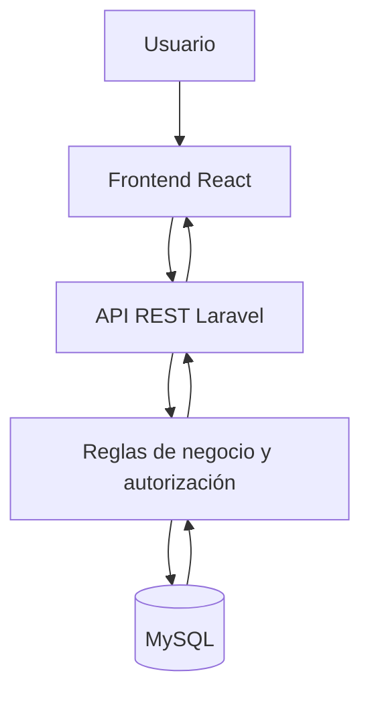
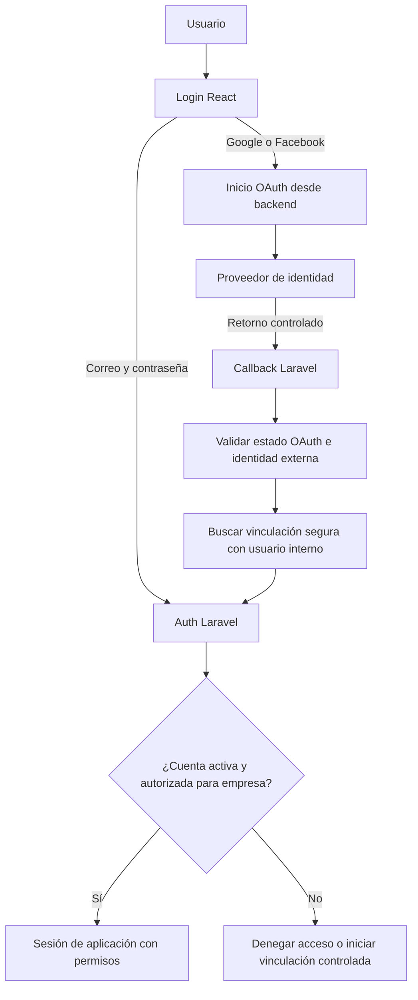

# PROJECT CANVAS — SaaS de Gestión de Inventarios Inversiones R&P

| Campo | Valor |
|---|---|
| Código | `PRJ-SAAS-INVRP-001` |
| Documento | 05 — Project Canvas / Resumen Ejecutivo |
| Versión | **1.1 — actualización documental propuesta** |
| Fecha | 15 de noviembre de 2026 |
| Fuente primaria | `CANVA_2_RESUMEN_EJECUTIVO.pdf`, versión 1.0 (noviembre de 2026) |
| Gestión | Referencia PMBOK; desarrollo Scrum |
| Tecnologías previstas | React, Laravel, MySQL, API REST; Docker y GitHub Actions |
| Estado | **Análisis y planificación actualizados; implementación no auditada** |
| Avance comunicado | Trabajo desarrollado hasta Sprint 5; requiere verificación en repositorio OpenCode |

> **Cómo leer este documento.** Las secciones conservan la organización del Project Canvas original (1–24). Las ampliaciones de **CX, UX, UI y acceso con Google/Facebook** se identifican como **[CAMBIO V1.1]**. Un requisito documentado no implica código desarrollado, probado ni aceptado. Este resumen es una capa de dirección y alcance: el detalle técnico vive en el Documento Maestro, SDD, Canvas de Datos y Backlog.

## Control de cambios

| Versión | Naturaleza | Descripción |
|---|---|---|
| 1.0 | Documento fuente | Análisis consolidado y diseño técnico propuesto; piloto empresarial y visión SaaS. |
| 1.1 | Ampliación propuesta | Agrega CX/UX/UI, login Google/Facebook, impacto en seguridad, datos, riesgos, entregables y backlog; registra avance reportado hasta Sprint 5 sin declararlo validado. |

**Fuentes internas para mantener coherencia:** `01_DOCUMENTO_MAESTRO_ANALISIS_REQUISITOS_SAAS_INVERSIONES_RP.md`, `02_SDD_01_DISENO_TECNICO_SAAS_INVERSIONES_RP.md`, `03_CANVAS_DISENO_DE_DATOS_SAAS_INVERSIONES_RP.md`, `04_BACKLOG_TECNICO_IMPLEMENTACION_SAAS_INVERSIONES_RP.md`. Sus propuestas deben conciliarse con los documentos activos de `SDD/` y con el código real.

---

## 1. Resumen general del proyecto

El proyecto propone desarrollar un sistema web **SaaS** para gestión y control de inventarios, inicialmente destinado a **Inversiones R&P**, empresa que comercializa productos de manualidades, pasamanería, bisutería y artículos textiles.

La plataforma sustituirá registros manuales en cuadernos por información centralizada de productos, variantes, unidades de medida, ubicaciones, entradas, salidas, traslados, proveedores, compras, métricas y alertas. El producto se validará primero con la empresa piloto y podrá evolucionar hacia un servicio **multiempresa** por suscripción.

**[CAMBIO V1.1]** El proyecto incorpora una perspectiva transversal de **CX** (experiencia integral del cliente), **UX** (facilidad y eficacia de las tareas) y **UI** (interfaces coherentes y accesibles). La pantalla de acceso ofrecerá **correo/contraseña, Google y Facebook**; la autorización empresarial permanece bajo control de Laravel.

## 2. Problema y necesidad del negocio

### 2.1 Situación actual identificada en el documento fuente

- Registro manual de productos y existencias.
- Falta de códigos estandarizados para productos.
- Dificultad para consultar cantidades disponibles con información actualizada.
- Poca trazabilidad de entradas y salidas.
- Dificultad para localizar productos entre tienda y almacén.
- Información histórica de compras y precios poco accesible.
- Identificación tardía de agotados y stock mínimo.
- Insuficiencia de indicadores para decisiones comerciales.

### 2.2 Necesidad identificada

Centralizar el inventario, asegurar la trazabilidad de movimientos y proporcionar información confiable para control y decisiones.

### 2.3 [CAMBIO V1.1] Necesidades de experiencia

El personal requiere localizar productos y registrar operaciones con una navegación clara, formularios comprensibles, validaciones útiles, confirmaciones de acciones críticas y una presentación adaptada a distintos tamaños de pantalla. Estas son **necesidades de diseño propuestas**, no resultados observados de pruebas con usuarios.

## 3. Propuesta de valor

La solución ofrecerá:

1. Inventario digital centralizado y menos errores de registro.
2. Consulta ágil de existencias, variantes y ubicaciones.
3. Movimientos rastreables y control de permisos.
4. Alertas para stock mínimo o agotado.
5. Métricas e información histórica para decisiones.
6. Capacidad de evolución hacia un SaaS multiempresa.

**[CAMBIO V1.1]** Valor adicional: experiencia consistente para administradores y trabajadores, menor fricción en el inicio de sesión y flujos operativos claros. La autenticación social amplía las alternativas de ingreso, **sin sustituir los controles de acceso por empresa**.

## 4. Objetivos del proyecto

### 4.1 Objetivo general

Desarrollar un sistema web SaaS para gestionar y controlar inventarios de Inversiones R&P, centralizar información, administrar movimientos, mejorar trazabilidad y respaldar decisiones mediante métricas y alertas.

### 4.2 Objetivos específicos originales

1. Implementar autenticación y administración de usuarios.
2. Gestionar productos, categorías, marcas y variantes.
3. Administrar unidades de medida y conversiones.
4. Gestionar ubicaciones físicas.
5. Registrar entradas, salidas y traslados.
6. Administrar proveedores, compras e historial de precios.
7. Proporcionar métricas de comportamiento del inventario.
8. Incorporar alertas de stock mínimo y agotamiento.
9. Gestionar auditorías y conteos físicos.
10. Incorporar un chatbot de consulta **solo lectura**.
11. Preparar evolución comercial multiempresa.

### 4.3 [CAMBIO V1.1] Objetivos adicionales

- Diseñar y evaluar recorridos de usuario para tareas críticas.
- Consolidar un sistema de diseño UI reutilizable y accesible.
- Integrar Google y Facebook como alternativas de autenticación.
- Mantener las reglas de autorización, seguridad y aislamiento existentes.
- Definir mediciones de adopción, usabilidad y satisfacción del cliente, con metas sujetas a validación.

## 5. Alcance del proyecto

### 5.1 Alcance original del MVP

| Código | Módulo | Función |
|---|---|---|
| MOD-01 | Usuarios y autenticación | Inicio de sesión, usuarios, roles y permisos. |
| MOD-02 | Productos | Productos, categorías, marcas y variantes. |
| MOD-03 | Unidades de medida | Unidades y conversiones. |
| MOD-04 | Ubicaciones | Tienda, almacén y ubicaciones internas. |
| MOD-05 | Entradas y salidas | Movimientos de inventario. |
| MOD-06 | Traslados | Transferencias entre ubicaciones. |
| MOD-07 | Proveedores y compras | Proveedores, compras e historial de precios. |
| MOD-08 | Métricas | Indicadores y valoración del inventario. |
| MOD-09 | Alertas | Stock mínimo y agotamiento. |
| MOD-10 | Auditorías y conteos | Conteos físicos y diferencias. |
| MOD-11 | Chatbot | Consultas sin capacidad de escritura. |
| MOD-12 | Temas comerciales | Temas estacionales. |

### 5.2 [CAMBIO V1.1] Ampliación de alcance propuesta

| Área | Inclusión adicional | Condición de aceptación |
|---|---|---|
| MOD-01 | Inicio con Google | Se valida identidad externa y se aplican permisos internos. |
| MOD-01 | Inicio con Facebook | Mismo criterio; manejar cancelación y datos faltantes del proveedor. |
| MOD-01 | Vinculación de identidades | No se fusionan cuentas únicamente por coincidencia de correo. |
| Transversal | CX/UX/UI | Flujos documentados, componentes reutilizables y pruebas. |
| Transversal | Accesibilidad | Referencia de diseño y pruebas: WCAG 2.2 nivel AA cuando sea aplicable. |

**La ampliación requiere planificación y aprobación del Product Owner.** No altera por sí sola el cierre histórico de sprints.

### 5.3 Exclusiones originales del MVP que se mantienen

POS completo; caja y pagos; facturación electrónica; contabilidad; aplicación móvil nativa; chatbot con escritura; compras automatizadas; integraciones avanzadas aún no definidas. Las futuras suscripciones comerciales no equivalen a implementar pagos durante el MVP.

## 6. Clientes, usuarios y actores

**Cliente piloto:** Inversiones R&P.

**Contexto operativo original:** tienda en primer piso, almacén en segundo piso, trabajador a cargo de caja y almacén y dos vendedores.

| Actor | Responsabilidad |
|---|---|
| Administrador | Usuarios, roles, permisos, catálogo, inventario, proveedores, métricas y auditorías. |
| Trabajador autorizado | Consultas y operaciones según permisos asignados. |
| Proveedor | Actor indirecto relacionado con compras. |
| Cliente externo | Sin acceso directo al sistema durante el MVP. |
| Servicio de autenticación externo | Participa en mecanismos de identidad externa aprobados. |
| Servicio de IA | Consulta de información mediante chatbot de solo lectura. |
| Administrador SaaS futuro | Administración transversal de la plataforma y empresas suscritas. |
| Empresa suscriptora futura | Uso de funcionalidades según suscripción. |

**[CAMBIO V1.1]** Google y Facebook son **proveedores externos de identidad**, no nuevos roles de negocio. Una identidad autenticada no recibe acceso a una empresa hasta que Laravel compruebe su vinculación y autorización.

## 7. Casos de uso principales

### 7.1 Casos de uso originales

| Código | Caso de uso |
|---|---|
| CU-01 | Iniciar sesión |
| CU-02 | Administrar usuarios |
| CU-03 | Gestionar roles y permisos |
| CU-04 | Registrar productos |
| CU-05 | Gestionar categorías y marcas |
| CU-06 | Gestionar variantes |
| CU-07 | Administrar unidades de medida |
| CU-08 | Registrar ubicaciones |
| CU-09 | Registrar entrada de productos |
| CU-10 | Registrar salida de productos |
| CU-11 | Trasladar productos |
| CU-12 | Registrar proveedores y compras |
| CU-13 | Consultar métricas |
| CU-14 | Consultar alertas |
| CU-15 | Realizar conteo físico |
| CU-16 | Consultar historial de movimientos |
| CU-17 | Consultar información mediante chatbot |

### 7.2 [CAMBIO V1.1] Casos de uso adicionales propuestos

| Código propuesto | Caso de uso | Resultado esperado |
|---|---|---|
| CU-AUTH-01 | Iniciar sesión con Google | Autenticación segura y autorización interna. |
| CU-AUTH-02 | Iniciar sesión con Facebook | Autenticación segura y autorización interna. |
| CU-AUTH-03 | Vincular identidad social a cuenta existente | Vinculación con control de titularidad. |
| CU-AUTH-04 | Gestionar fallo o cancelación del login externo | Mensaje seguro, sin sesiones parciales. |
| CU-UX-01 | Ejecutar operaciones con validación y retroalimentación | Flujo comprensible, consistente y verificable. |

## 8. Historias de usuario

### 8.1 Historias originales de referencia

| Código | Necesidad | Aceptación resumida |
|---|---|---|
| HU-01 | Iniciar sesión | Credenciales y permisos validados. |
| HU-02 | Registrar productos | Identificador único y campos obligatorios. |
| HU-03 | Registrar variantes | Identificación independiente. |
| HU-04 | Consultar stock | Existencias por ubicación. |
| HU-05 | Registrar entradas | Movimiento en historial. |
| HU-06 | Registrar salidas | No se excede el stock disponible. |
| HU-07 | Realizar traslados | Resta en origen y suma en destino. |
| HU-08 | Consultar métricas | Indicadores actualizados. |
| HU-09 | Consultar alertas | Identificación de condiciones configuradas. |
| HU-10 | Hacer conteos físicos | Conservación de resultados originales. |
| HU-11 | Consultar chatbot | Solo lectura. |
| HU-12 | Gestionar suscriptoras a futuro | Aislamiento de datos entre empresas. |

### 8.2 [CAMBIO V1.1] Historias propuestas

| Código nuevo | Historia | Criterios resumidos |
|---|---|---|
| HU-AUTH-GOOGLE | Como usuario autorizado quiero acceder con Google para iniciar sesión sin otra contraseña. | Flujo externo validado, errores tratados, autorización interna obligatoria. |
| HU-AUTH-FACEBOOK | Como usuario autorizado quiero acceder con Facebook para simplificar mi acceso. | Flujo externo validado; no presupone disponibilidad de correo o datos adicionales. |
| HU-AUTH-LINK | Como usuario quiero vincular una identidad externa a mi cuenta para mantener un único perfil. | Prueba de titularidad, sin mezcla automática por correo; auditoría de vinculación. |
| HU-UX-OPER | Como trabajador quiero completar movimientos con formularios claros para reducir errores. | Estados, validaciones, confirmaciones y accesibilidad verificables. |
| HU-UI-CONSISTENCIA | Como usuario quiero una interfaz coherente para aprender a operar el sistema con facilidad. | Componentes y estilos compartidos; vistas adaptables. |
| HU-CX-ONBOARD | Como nueva empresa usuaria quiero una incorporación guiada para comenzar a utilizar el sistema. | Recorrido documentado y medible; sin comprometer datos entre empresas. |

## 9. Reglas de negocio

### 9.1 Reglas originales (conservadas)

1. Cada producto debe tener un identificador único.
2. Las variantes deben identificarse de modo independiente.
3. Las existencias se controlan por producto, variante y ubicación.
4. No se permiten salidas normales superiores al stock disponible.
5. Los traslados no modifican el stock global total.
6. Los movimientos confirmados no se eliminan físicamente.
7. Las correcciones conservan trazabilidad del movimiento original.
8. Los ajustes requieren motivo y autorización.
9. Los vendedores no pueden ver márgenes de ganancia.
10. Los permisos se validan en el backend.
11. Los conteos físicos conservan los resultados originales.
12. El chatbot realiza exclusivamente consultas.
13. Los datos de una empresa no pueden ser accedidos por otra empresa del SaaS.

### 9.2 [CAMBIO V1.1] Reglas propuestas de identidad y experiencia

- RN-AUTH-01: la identidad que confirma Google/Facebook no sustituye la autorización de Laravel.
- RN-AUTH-02: el identificador estable del proveedor se vincula a un usuario interno; el correo, por sí solo, no demuestra titularidad.
- RN-AUTH-03: toda vinculación/desvinculación requiere controles de sesión y confirmación apropiados.
- RN-AUTH-04: los secretos y tokens externos deben gestionarse de forma segura; no exponerse en React o el repositorio.
- RN-AUTH-05: un usuario sin vinculación/autorización empresarial no puede leer ni operar inventarios.
- RN-UX-01: las operaciones críticas muestran resultado y recuperación ante errores sin duplicar movimientos.
- RN-UX-02: el frontend no reemplaza las validaciones de integridad y permisos del backend.

## 10. Métricas e indicadores del sistema

### 10.1 Métricas de inventario previstas

Total de productos; detalles de productos; productos agotados; stock mínimo; valor total del inventario; productos con más salidas; productos sin movimiento; rotación; entradas; salidas.

**Decisión original pendiente:** definir fórmula y método de valoración antes de implementar indicadores económicos definitivos.

### 10.2 [CAMBIO V1.1] Indicadores CX/UX/UI sugeridos

| Indicador propuesto | Forma de medición | Estado |
|---|---|---|
| Éxito de tareas críticas | Pruebas observadas de registro, búsqueda y traslados | Meta por aprobar |
| Tiempo para completar una operación | Pruebas de usabilidad con tareas representativas | Meta por aprobar |
| Errores por tarea | Pruebas, registros de error y soporte | Meta por aprobar |
| Satisfacción del usuario (CSAT) | Encuestas posteriores a uso o soporte | Meta por aprobar |
| Accesibilidad | Auditoría WCAG 2.2 AA aplicable | Pendiente de evaluación |
| Adopción de autenticación social | Uso agregado por proveedor, con respeto a privacidad | Pendiente de implementación |

Estas métricas son **nuevas propuestas**; el documento original no fija metas numéricas para ellas.

## 11. Arquitectura técnica propuesta

| Capa | Tecnología prevista | Función |
|---|---|---|
| Frontend | React | Interfaz y presentación. |
| Backend | Laravel, monolito modular | Reglas de negocio, API REST, autenticación y permisos. |
| Datos | MySQL | Persistencia transaccional. |
| Versionado | Git/GitHub | Código e historial de cambios. |
| CI | GitHub Actions | Integración y verificaciones. |
| Calidad | SonarQube | Análisis estático. |
| Contenedores | Docker | Estandarización de entornos. |
| Pruebas backend | PHPUnit/Pest | Lógica y API. |
| Pruebas frontend | Vitest | Componentes y lógica UI. |
| Dependencias | OWASP Dependency-Check | Revisión de dependencias vulnerables. |

La selección y versiones finales deben verificarse en OpenCode: **este cuadro refleja el diseño original**.

### 11.1 Flujo lógico original

### 11.2 [CAMBIO V1.1] Flujo lógico de autenticación social

**Invariante:** React no accede directamente a MySQL ni decide privilegios empresariales. El detalle del flujo, manejo de tokens y sesiones se define en `SDD/` y `SEGURIDAD/`.

## 12. Modelo de datos conceptual

| Grupo | Entidades conceptuales originales |
|---|---|
| Organización | Empresa |
| Seguridad | Usuario, Rol, Permiso, UsuarioPermiso |
| Catálogo | Producto, Variante, Categoría, Marca |
| Unidades | UnidadMedida, ConversionUnidad |
| Inventario | Ubicación, Existencia |
| Movimientos | MovimientoInventario, DetalleMovimiento |
| Compras | Proveedor, Compra, DetalleCompra |
| Ventas | Venta, DetalleVenta |
| Traslados | Traslado |
| Auditoría | Auditoría, ConteoInventario, DetalleConteo |
| Alertas | Alerta |
| SaaS | Plan, Suscripción |
| Comercial | Temporada |

**[CAMBIO V1.1]** Se propone incorporar una entidad conceptual `IdentidadSocial` vinculada al usuario interno, con proveedor (`google` o `facebook`), identificador externo único por proveedor, estado y marcas temporales. Los nombres físicos, tipos de columna, política de correo y relación con empresas requieren revisión de `SDD-04_DISENO_BASE_DATOS`, migraciones existentes y documento N.º 3. No ejecutar migraciones destructivas.

## 13. Seguridad y calidad del software

### 13.1 Medidas de seguridad originales

Autenticación, permisos y roles, validación backend, protección de datos empresariales, separación multiempresa, HTTPS, auditoría, manejo de secretos, respaldos y verificación de vulnerabilidades.

### 13.2 [CAMBIO V1.1] Controles adicionales

- Proteger los flujos OAuth contra falsificación de solicitudes y abuso de redirecciones.
- Utilizar OpenID Connect para Google cuando se requiera identidad autenticada; para Facebook, validar el flujo y los datos de identidad conforme al mecanismo oficial de Meta.
- No guardar secretos del proveedor en el cliente ni en control de versiones.
- Usar el identificador externo del proveedor para la vinculación, no solo el email.
- Revisar sesión y autorización al entrar, vincular o desvincular cuentas.
- Registrar eventos de seguridad evitando exponer credenciales o tokens en logs.
- Probar el aislamiento entre empresas también después del login social.

### 13.3 Calidad y estándares

Buenas prácticas originales: SOLID, BDD, pruebas unitarias, integradas, funcionales y de seguridad, revisión de código, SonarQube, documentación y control de versiones.

Referencias originales: **ISO 9001**, **ISO/IEC 25010**, **ISO/IEC 25001**, **ISO/IEC 27001**, **ISO/IEC/IEEE 29119**.

**[CAMBIO V1.1]** Referencias adicionales de diseño: **ISO 9241-210**, **ISO 9241-11** y **WCAG 2.2 AA**. Son referentes de requisitos y evaluación; **no constituyen certificación**.

## 14. Gestión del proyecto según PMBOK

Se mantiene la referencia a PMBOK para integración, alcance, cronograma, costos, calidad, recursos, comunicaciones, riesgos, adquisiciones e interesados.

**[CAMBIO V1.1] Control integrado de cambios:**

1. Registrar solicitud: `CR-2026-001 — CX/UX/UI y autenticación Google/Facebook` (**identificador propuesto**).
2. Determinar impacto en alcance, arquitectura, datos, seguridad, entregables, capacitación y presupuesto.
3. Verificar dependencias con Sprints 0–5 antes de planificar modificaciones.
4. Aprobar prioridad y sprint mediante el responsable del producto.
5. Conservar los originales en `DOCS_origen/`; versionar documentos vigentes y registrar trazabilidad.

## 15. Metodología de desarrollo: Scrum

### 15.1 Plan de sprints original

| Sprint | Objetivo original | Estado en esta actualización |
|---|---|---|
| 0 | Arquitectura, herramientas y entornos | Trabajado, **según reporte**; no auditado |
| 1 | Autenticación, usuarios y permisos | Trabajado, **según reporte**; no auditado |
| 2 | Catálogo y variantes | Trabajado, **según reporte**; no auditado |
| 3 | Unidades y ubicaciones | Trabajado, **según reporte**; no auditado |
| 4 | Entradas, salidas y stock | Trabajado, **según reporte**; no auditado |
| 5 | Traslados, proveedores y compras | Avance reportado hasta este sprint; no auditado |
| 6 | Métricas y alertas | Planificado; verificar estado real |
| 7 | Auditorías y conteos | Planificado; verificar estado real |
| 8 | Chatbot y complementos | Planificado; verificar estado real |
| 9 | Integración, pruebas y producción | Planificado; verificar estado real |

### 15.2 [CAMBIO V1.1] Estrategia de incorporación

No modificar actas de cierre históricas como si las nuevas historias hubieran existido desde el inicio. Crear historias nuevas vinculadas a MOD-01 y a los módulos afectados por UX/UI; clasificarlas como *pendientes de asignación* hasta decidir su sprint. Analizar el impacto antes de continuar el Sprint 6.

### 15.3 Definición de terminado

Una historia cumple requisitos y reglas, validación backend, permisos, pruebas, documentación, ausencia de defectos críticos conocidos y aceptación. **[CAMBIO V1.1]** Para nuevas pantallas: añadir criterios de accesibilidad y estados UI. Para OAuth: casos positivos, errores, cancelaciones y aislamiento empresarial.

## 16. Gestión de riesgos

### 16.1 Riesgos originales

| Código | Riesgo | Respuesta |
|---|---|---|
| RT-01 | Acceso cruzado entre empresas | Aislamiento y pruebas de autorización. |
| RT-02 | Stock inconsistente | Transacciones y control de concurrencia. |
| RT-03 | Operaciones no autorizadas | Roles, permisos y políticas backend. |
| RT-04 | Pérdida de datos | Copias y recuperación. |
| RT-05 | Errores de conversión | Validaciones y pruebas específicas. |
| RT-06 | Dependencias vulnerables | Análisis periódico. |
| RT-07 | Respuestas erróneas del chatbot | Solo lectura y respuestas basadas en datos. |
| RT-08 | Complejidad del código | SOLID, revisión y análisis estático. |
| RT-09 | Bajo rendimiento | Pruebas y monitoreo. |
| RT-10 | Resistencia a la adopción | Validación temprana y capacitación. |

### 16.2 [CAMBIO V1.1] Riesgos añadidos

| Código propuesto | Riesgo | Respuesta |
|---|---|---|
| RT-11 | Vinculación incorrecta de Google/Facebook | Identificador de proveedor, confirmación y pruebas negativas. |
| RT-12 | Exposición de credenciales OAuth | Gestión de secretos por entorno y revisión de logs. |
| RT-13 | Caída o cambios en servicios de identidad externos | Mantener login local, manejo de errores y plan de contingencia. |
| RT-14 | Regresiones al adaptar pantallas Sprints 1–5 | Pruebas automáticas y funcionales antes de desplegar. |
| RT-15 | Interfaces poco accesibles o difíciles de usar | Evaluaciones y pruebas con usuarios, revisión WCAG. |

Probabilidad, impacto, responsables y fecha de seguimiento siguen sujetos al registro formal de riesgos.

## 17. Decisiones pendientes

### 17.1 Funcionales, conservadas del documento fuente

1. Quién registra salidas por ventas (vendedor, cajero o ambos).
2. Método de valoración del inventario.
3. Conversiones y redondeo de unidades.
4. Conteos físicos con ventas simultáneas.
5. Autorizaciones cuando el administrador no esté disponible.
6. Políticas de conservación y recuperación.
7. Objetivos de disponibilidad y rendimiento.
8. Límites y funciones por plan SaaS.
9. Precios y márgenes por variante.
10. Alcance de la importación histórica del inventario.

### 17.2 Técnicas, conservadas del documento fuente

Versiones definitivas de React, Laravel y MySQL; estrategia de autenticación; aislamiento multiempresa; biblioteca visual; estado en React; documentación API; herramientas de prueba; infraestructura de producción; respaldos y monitoreo.

### 17.3 [CAMBIO V1.1] Decisiones adicionales

- Aprobar los tres métodos de inicio de sesión y su despliegue por ambientes.
- Definir si se permite autorregistro o solo invitación/provisión administrativa por empresa.
- Acordar proceso de vinculación, recuperación y desvinculación de identidades sociales.
- Determinar política para cuentas sin email verificable del proveedor.
- Elegir sistema de diseño y validar patrones UX/UI con el personal piloto.
- Definir pruebas de accesibilidad/usabilidad y responsables de aceptación.
- Aprobar sprint concreto y esfuerzo de la ampliación sin alterar el histórico Scrum.

## 18. Entregables del proyecto

### 18.1 Entregables originales

| Código | Entregable |
|---|---|
| ENT-01 | Acta de constitución |
| ENT-02 | Plan para la dirección del proyecto |
| ENT-03 | Documento de requisitos |
| ENT-04 | EDT y diccionario EDT |
| ENT-05 | Registro de interesados |
| ENT-06 | Registro de riesgos |
| ENT-07 | Diseño técnico SDD |
| ENT-08 | Modelo de datos |
| ENT-09 | Diseño de interfaces |
| ENT-10 | Sistema web |
| ENT-11 | Plan de pruebas |
| ENT-12 | Documentación DevSecOps |
| ENT-13 | Manual de usuario |
| ENT-14 | Manual técnico |
| ENT-15 | Acta de aceptación y cierre |

### 18.2 [CAMBIO V1.1] Actualizaciones propuestas

- `ENT-03`: añadir requisitos CX/UX/UI y autenticación social.
- `ENT-07`: actualizar arquitectura, flujos de login y ADR.
- `ENT-08`: incorporar concepto de identidades sociales y plan de migración.
- `ENT-09`: definir guía de diseño, flujos, estados, componentes y accesibilidad.
- `ENT-10`: cuando se apruebe e implemente, incorporar login Google/Facebook y mejoras UX/UI.
- `ENT-11`: añadir pruebas OAuth, regresión, usabilidad y accesibilidad.
- `ENT-12`: credenciales por entorno, CI y revisión de dependencias.
- `ENT-13` y `ENT-14`: actualizar instrucciones y operación de proveedores externos.

## 19. Indicadores de seguimiento del proyecto

Se mantienen los indicadores originales: porcentaje de avance, historias completadas, sprints completados, pruebas aprobadas, defectos críticos abiertos, riesgos activos, solicitudes de cambio, cumplimiento del cronograma y del presupuesto.

**[CAMBIO V1.1]** Separar en reportes los valores **declarados**, **verificados por evidencia** y **aceptados**; incluir nuevas historias y defectos vinculados a Google/Facebook y CX/UX/UI. No asignar porcentajes de cumplimiento sin resultados reales.

## 20. Fases generales del proyecto

Se conserva la secuencia original de **Inicio → Planificación → Análisis y diseño → Ejecución → Monitoreo y control → Pruebas y validación → Cierre**.

**[CAMBIO V1.1]** La ampliación actual es una solicitud de cambio dentro de la ejecución: primero conciliación documental y auditoría del repositorio, luego diseño y aprobación, implementación incremental y validación, sin reiniciar el proyecto.

## 21. Visión futura del producto SaaS

Tras validar el piloto, se contempla registro de empresas suscriptoras, administración SaaS centralizada, planes, control de funcionalidades, aislamiento, pagos y renovaciones futuros, escalabilidad y monitoreo centralizado.

**[CAMBIO V1.1]** CX debe abarcar también incorporación, ayuda, aprendizaje y soporte de futuras empresas. Google y Facebook serán opciones de identidad, **no mecanismos de aprovisionamiento automático de tenant ni asignación de privilegios**.

## 22. Criterios generales de éxito

### 22.1 Criterios originales

1. Procesos de inventario del MVP ejecutables desde el sistema.
2. Productos y variantes administrados correctamente.
3. Existencias controladas por ubicación.
4. Trazabilidad de los movimientos.
5. Cumplimiento de reglas de negocio.
6. Acceso limitado a funciones autorizadas.
7. Métricas y alertas útiles.
8. Pruebas y aceptación aprobadas.
9. Validación por empresa piloto.
10. Documentación disponible para mantenimiento.

### 22.2 [CAMBIO V1.1] Criterios complementarios propuestos

- Acceso local, Google y Facebook probado en entornos autorizados.
- La vinculación de cuentas no produce suplantación ni acceso cruzado entre empresas.
- Flujos prioritarios de tienda y almacén validados con usuarios representativos.
- Interfaces con estados de error, carga y éxito definidos y revisados.
- Evidencia de accesibilidad y regresión asociada a las nuevas funcionalidades.

Los umbrales cuantitativos de CX/UX y calidad deben acordarse antes de evaluar aceptación.

## 23. Estado actual de la documentación y del software

### 23.1 Estado documentado en el Canvas original

El documento original describe un alcance y una propuesta técnica consolidados para revisión; identifica pendientes de validación, sin acreditar implementación productiva.

### 23.2 Información de avance incorporada en v1.1

El responsable indica que está trabajando con **OpenCode** y ha avanzado **hasta el Sprint 5**. Esta información se registra como **avance reportado** y no como estado auditado.

### 23.3 Verificaciones necesarias en el repositorio

- Comparar código, migraciones y pruebas con SDD y backlog de Sprints 0–5.
- Verificar roles y permisos efectivos, especialmente con múltiples empresas.
- Identificar login actual y estrategia de sesión antes de diseñar OAuth.
- Revisar si la arquitectura, bibliotecas y nombres del SDD original coinciden con el código.
- Registrar historias terminadas, parciales, sin probar y pendientes con evidencias.
- Conciliar los documentos Markdown nuevos con `SDD/`, `SEGURIDAD/`, `TESTING/`, `DEVSECOPS/` y `MANUALES/`.

### 23.4 Política de ubicación documental

- `DOCS_origen/`: copias originales e históricas, sin reemplazo destructivo.
- `docs/01-analisis/`: Documento Maestro y Project Canvas vigente, si se adopta esta estructura.
- `SDD/`: arquitectura, modelo de datos, contratos y ADR vigentes.
- `SEGURIDAD/`, `TESTING/`, `DEVSECOPS/`, `MANUALES/`: documentación especializada.
- `CHANGELOG.md`: historial de cambios y enlaces a decisiones.

## 24. Conclusión

El proyecto SaaS Inversiones R&P plantea transformar el control manual del inventario en una plataforma centralizada, trazable y extensible. El enfoque original combina dirección mediante PMBOK, desarrollo iterativo Scrum y arquitectura web React/Laravel/MySQL, con calidad y seguridad como aspectos transversales.

La actualización **v1.1 propuesta** añade **CX, UX, UI** y autenticación con **Google y Facebook**, preservando el inicio de sesión tradicional, las reglas de inventario y la separación entre empresas. Antes de implementar nuevas funciones, corresponde **verificar el estado real del Sprint 5, resolver decisiones pendientes, aprobar el cambio y mantener la trazabilidad entre requisitos, SDD, modelo de datos, backlog y pruebas**.

---

## Anexo A. Matriz breve de impacto de la ampliación v1.1

| Cambio | Documento principal | Documentos de apoyo | Validación requerida |
|---|---|---|---|
| Google/Facebook | Documento Maestro, SDD-01 | Seguridad, API, Datos, Backlog | OAuth, sesiones, errores, identidad y permisos |
| Vinculación de cuentas | Canvas de Datos, SDD-04 | Seguridad, migraciones | Integridad, unicidad por proveedor, aislamiento |
| UX operativa | Documento Maestro, ENT-09 | Planes de Sprint, Manuales, Testing | Pruebas en escenarios reales |
| UI / sistema de diseño | SDD / ENT-09 | Componentes React, Testing | Accesibilidad, responsividad, consistencia |
| CX / incorporación | Project Canvas, Documento Maestro | Manuales, Backlog | Aceptación con cliente piloto |
| Estado Sprint 0–5 | Backlog | Actas, README de sprints, pruebas | Evidencias de código y aceptación |

## Anexo B. Lista de revisión para OpenCode

- [ ] Leer `DOCS_origen/` sin modificar los archivos fuente.
- [ ] Comparar documentos vigentes con el repositorio.
- [ ] Registrar pruebas y evidencias de los Sprints 0–5.
- [ ] Revisar la implementación actual de autenticación y autorización.
- [ ] Aprobar en el backlog las nuevas historias y su priorización.
- [ ] Alinear arquitectura, modelo de datos y API antes de migrar.
- [ ] Documentar componentes UI, flujos UX y experiencia CX.
- [ ] Preparar pruebas de seguridad y regresión.
- [ ] Actualizar `CHANGELOG` documental y decisiones ADR.

**Nota de alcance:** no se incorporan otros proveedores de identidad ni se declara implementada ninguna ampliación por el solo hecho de figurar en este documento.
