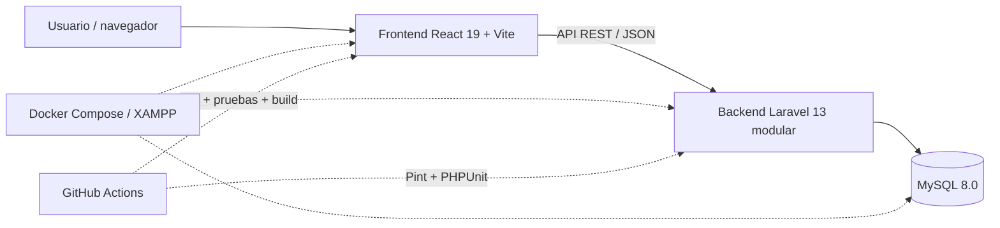

# README — Sprint 0 «Fundación técnica y decisiones»

**Proyecto:** SaaS Inversiones R&P
**Épica:** EP-00 — Fundación técnica y decisiones
**Iteración:** Sprint 0
**Versión del documento:** 1.0
**Fecha:** 2026-11-13
**Estado:** Cerrado técnicamente — decisiones de negocio pendientes de aprobación del Product Owner
**Canvas de referencia:** [`DOCS_origen/CANVAS_SPRINT_0_FUNDACION_TECNICA_DECISIONES.md`](./DOCS_origen/CANVAS_SPRINT_0_FUNDACION_TECNICA_DECISIONES.md)
**Documento maestro:** [`DOCS_origen/DOCUMENTO_MAESTRO_SAAS_INVERSIONES_RP.md`](./DOCS_origen/DOCUMENTO_MAESTRO_SAAS_INVERSIONES_RP.md)

---

## 1. Resumen ejecutivo

El Sprint 0 deja una **base técnica ejecutable, reproducible y documentada** para el
SaaS de gestión de inventario de Inversiones R&P, sin desarrollar anticipadamente
los módulos de negocio. Se completaron las cuatro historias de la épica EP-00:

| Historia | Objetivo | Resultado |
| --- | --- | --- |
| US-0001 | Arquitectura y estructura del repositorio | **Completado** |
| US-0002 | Modelo de datos y estrategia multiempresa | **Propuesta documentada** (DER + diccionario) |
| US-0003 | Entorno local y pipeline inicial | **Configurado**; Docker pendiente de validar en equipo |
| US-0004 | Decisiones de negocio DP/DD | **Documentado**; pendiente de aprobación del Product Owner |

> El Sprint 0 **no** implica que el producto esté desarrollado. Prepara el terreno:
> repositorio, proyectos base, infraestructura, contratos y decisiones registradas.

## 2. Cómo se interpretó el canvas

El canvas propone una estructura (`infra/`, `docs/`) que fue **ratificada y
sustituida** por la estructura oficial del proyecto, definida en
[`DOCS_origen/ESTRUCTURA_CARPETAS_SAAS_INVERSIONES_RP.md`](./DOCS_origen/ESTRUCTURA_CARPETAS_SAAS_INVERSIONES_RP.md)
y en [`Reglas/ESTANDAR.md`](../Reglas/ESTANDAR.md). La correspondencia es:

| Canvas (propuesta) | Estructura adoptada | Motivo |
| --- | --- | --- |
| `infra/` | `infrastructure/` | Nombre ratificado en el estándar del proyecto |
| `docs/arquitectura`, `docs/datos`, `docs/api`, `docs/decisiones` | `DOCUMENTACION/SDD/`, `database/`, `DOCUMENTACION/SDD/ADR/` | Agrupación por área oficial |
| `frontend/`, `backend/`, `.github/`, `.env.example` | Igual | Sin cambios |

Además, el canvas habla de `empresa_id`. La regla de idioma del proyecto
([`Reglas/ESTANDAR.md`](../Reglas/ESTANDAR.md), Anexo A) exige identificadores
internos en inglés, por lo que el **campo interno se llama `company_id`** y la
interfaz muestra «Empresa». El mapeo queda documentado en el DER y el diccionario.

## 3. Entregables del canvas y su evidencia

El canvas §14 lista los entregables esperados. Todos están cubiertos:

| Entregable del canvas | Artefacto | Ubicación | Estado |
| --- | --- | --- | --- |
| Repositorio Git con React y Laravel base | Proyectos base | `frontend/`, `backend/` | Completo |
| Documento de arquitectura y convenciones | SDD-01, SDD-09 | `DOCUMENTACION/SDD/` | Completo |
| Esquema de módulos y contratos API iniciales | SDD-01, SDD-05 | `DOCUMENTACION/SDD/` | Completo |
| DER lógico y diccionario de datos inicial | DER + diccionario | `database/diagrams/`, `database/dictionaries/` | Completo (propuesta) |
| Estrategia `empresa_id` y aislamiento multiempresa | SDD-04 | `DOCUMENTACION/SDD/` | Completo (propuesta) |
| Dockerfiles / Compose y configuración de ambientes | Docker + `.env.example` | `infrastructure/docker/`, raíz | Configurado |
| Pipeline inicial de GitHub Actions | Workflow CI | `.github/workflows/ci.yml` | Configurado |
| README y plantilla de variables de entorno | README + `.env.example` | raíz | Completo |
| Registro de decisiones DP-01..DP-10 y DD-01..DD-05 | Registro de decisiones | `DOCUMENTACION/SDD/ADR/` | Completo (propuesta) |
| Evidencia de pruebas y acta de revisión | Plan de pruebas + acta | `DOCUMENTACION/TESTING/`, `DOCUMENTACION/SDD/` | Completo |

## 4. Arquitectura implementada

**Reglas respetadas:** React no accede directamente a MySQL; Laravel centraliza
reglas de negocio y autorización; MySQL protege la integridad. El backend es un
**monolito modular** con dominios `Identity`, `Catalog`, `Inventory`,
`Purchasing`, `Metrics` y `Audit`.

Detalle completo en [`SDD/SDD-01_ARQUITECTURA_GENERAL.md`](./SDD/SDD-01_ARQUITECTURA_GENERAL.md).

## 5. Modelo de datos y multiempresa

Se produjeron los artefactos que el canvas §6 exige aprobar:

| Artefacto | Descripción | Ubicación |
| --- | --- | --- |
| Diagrama entidad-relación lógico | 25+ tablas con relaciones, clasificación y reglas de integridad | [`database/diagrams/DER_LOGICO.md`](../database/diagrams/DER_LOGICO.md) |
| Diccionario de datos | Columna, tipo, nulabilidad, claves, índices y descripción de cada tabla | [`database/dictionaries/DICCIONARIO_DATOS.md`](../database/dictionaries/DICCIONARIO_DATOS.md) |
| Estrategia multiempresa | Ámbito por tabla, aislamiento y pruebas de separación | [`SDD/SDD-04_DISENO_BASE_DATOS.md`](./SDD/SDD-04_DISENO_BASE_DATOS.md) |
| Contratos de API | Versionado, autenticación, tenant, error y ejemplos | [`SDD/SDD-05_DISENO_API.md`](./SDD/SDD-05_DISENO_API.md) |

**Decisiones de datos clave (DD-01..DD-05):** correo único global, stock mínimo
por variante/ubicación, ubicación obligatoria en movimientos, roles base globales
y baja lógica con auditoría. Todas están **propuestas**, no aprobadas.

**Verificación con dos empresas:** el diseño se validó conceptualmente (una misma
clave de negocio puede coexistir entre empresas, sin referencias cruzadas), pero
las **pruebas automatizadas de aislamiento** se implementarán en el Sprint 1.

## 6. Infraestructura y CI

| Componente | Artefacto | Estado |
| --- | --- | --- |
| Backend | `backend/Dockerfile` (vía `infrastructure/docker/Dockerfile.backend`) | Configurado |
| Frontend | `infrastructure/docker/Dockerfile.frontend` | Configurado |
| Orquestación | `docker-compose.yml` (backend + frontend + MySQL 8) | Configurado, no validado |
| Apache / XAMPP | `infrastructure/apache/`, `infrastructure/xampp/` | Documentado |
| Variables de entorno | `.env.example`, `backend/.env.example` | Completo |
| CI | `.github/workflows/ci.yml` (jobs backend y frontend) | Configurado |
| Scripts | `scripts/setup/`, `scripts/database/` | Completo |

## 7. Registro de decisiones DP/DD

El registro completo, con la plantilla de cierre del documento maestro
(ID · alternativa elegida · alternativas descartadas · fundamento · fecha ·
aprobador · historias afectadas · migraciones/API afectadas · enlace ADR), está en
[`SDD/ADR/REGISTRO_DECISIONES_SPRINT_0.md`](./SDD/ADR/REGISTRO_DECISIONES_SPRINT_0.md).

| Grupo | Cantidad | Estado | Aprobador |
| --- | --- | --- | --- |
| DP-01..DP-10 (negocio) | 10 | Propuesta | Product Owner |
| DD-01..DD-05 (datos) | 5 | Propuesta | Líder técnico |

Las historias bloqueadas por cada decisión están en el registro §5. **Ninguna
decisión se marcó como aprobada sin serlo.**

## 8. Evidencia de pruebas

| Verificación | Comando | Resultado |
| --- | --- | --- |
| Pruebas backend | `php artisan test` | 3 pruebas, 5 aserciones — OK |
| Estilo backend | `vendor/bin/pint --test` | Sin diferencias — OK |
| Pruebas frontend | `npm run test` | 1 prueba — OK |
| Lint frontend | `npm run lint` | Sin errores — OK |
| Build frontend | `npm run build` | Compilado — OK |
| Verificación Cypress | `npx cypress verify` | Verificado — OK |
| Smoke E2E | `npm run e2e` | 1 prueba — OK |

Matriz de pruebas T0-01..T0-10 y detalle en
[`TESTING/PLAN_PRUEBAS_SPRINT_0.md`](./TESTING/PLAN_PRUEBAS_SPRINT_0.md).

## 9. Definition of Done — estado

Checklist del canvas §11:

- [x] US-0001 a US-0004 cumplen sus criterios de aceptación (US-0004 queda en revisión del PO).
- [x] Arquitectura y convenciones documentadas (aprobación formal pendiente del PO).
- [x] React y Laravel ejecutan sus proyectos base y se comunican vía API (`/api/health`).
- [ ] MySQL y Docker funcionan en el entorno local acordado — **pendiente**: Docker/MySQL no instalados en el equipo.
- [x] CI ejecuta instalación, análisis y pruebas base (workflow configurado; verde en PR).
- [x] Modelo lógico, DER, diccionario y estrategia multiempresa revisados (propuesta).
- [x] Cada DP/DD tiene decisión documentada o bloqueo formal visible.
- [x] No se incorporan secretos al repositorio (`.gitignore` + `.env.example`).
- [x] README permite reproducir el entorno.
- [ ] Product Owner y equipo revisan evidencias y aceptan el alcance — **pendiente** de la sesión de aceptación.

## 10. Guion de demostración

Basado en el canvas §13:

1. Mostrar la estructura del repositorio y la documentación de arquitectura (`SDD-01`, `SDD-09`).
2. Levantar los servicios (`docker compose up --build` o el modo local del manual) siguiendo el README.
3. Mostrar la comunicación React → API Laravel → MySQL (`GET /api/health`).
4. Ejecutar las pruebas base y mostrar el pipeline de GitHub Actions.
5. Presentar el DER, el diccionario y la estrategia multiempresa.
6. Presentar el registro DP/DD con decisiones propuestas y bloqueos visibles.
7. Confirmar las condiciones listas para iniciar el Sprint 1.

**Criterio de éxito:** base ejecutable y reproducible, decisiones estructurales
registradas y bloqueos residuales documentados sin fingir que están resueltos.

## 11. Pendientes y bloqueos

| Pendiente | Motivo | Responsable | Próximo paso |
| --- | --- | --- | --- |
| Validar `docker compose up --build` | Docker no instalado en el equipo | Desarrollo | Instalar Docker Desktop |
| Ejecutar migraciones contra MySQL real | MySQL no instalado localmente | Desarrollo | Instalar MySQL o usar Docker |
| Aprobar DP-01..DP-10 y DD-01..DD-05 | Decisiones de negocio | Product Owner | Completar registro §6 |
| Pruebas de aislamiento multiempresa | Dependen del esquema físico | Desarrollo | Sprint 1 |
| SonarQube y OWASP Dependency-Check | Fuera del alcance del Sprint 0 | DevSecOps | Sprints 1–2 |

## 12. Documentos generados en el Sprint 0

| Documento | Contenido |
| --- | --- |
| [`SDD/SDD-01_ARQUITECTURA_GENERAL.md`](./SDD/SDD-01_ARQUITECTURA_GENERAL.md) | Arquitectura general y módulos |
| [`SDD/SDD-04_DISENO_BASE_DATOS.md`](./SDD/SDD-04_DISENO_BASE_DATOS.md) | Modelo de datos y multiempresa |
| [`SDD/SDD-05_DISENO_API.md`](./SDD/SDD-05_DISENO_API.md) | Contratos y convenciones de API |
| [`SDD/SDD-09_ESTRUCTURA_REPOSITORIO.md`](./SDD/SDD-09_ESTRUCTURA_REPOSITORIO.md) | Estructura y convenciones |
| [`SDD/ADR/REGISTRO_DECISIONES_SPRINT_0.md`](./SDD/ADR/REGISTRO_DECISIONES_SPRINT_0.md) | Decisiones DP/DD y bloqueos |
| [`SDD/ACTA_CIERRE_SPRINT_0.md`](./SDD/ACTA_CIERRE_SPRINT_0.md) | Acta de cierre del Sprint 0 |
| [`MANUALES/MANUAL_INSTALACION.md`](./MANUALES/MANUAL_INSTALACION.md) | Instalación local y con Docker |
| [`TESTING/PLAN_PRUEBAS_SPRINT_0.md`](./TESTING/PLAN_PRUEBAS_SPRINT_0.md) | Plan y evidencias de prueba |
| [`DEVSECOPS/CI_CD.md`](./DEVSECOPS/CI_CD.md) | Pipeline de integración continua |
| [`../database/diagrams/DER_LOGICO.md`](../database/diagrams/DER_LOGICO.md) | Diagrama entidad-relación lógico |
| [`../database/dictionaries/DICCIONARIO_DATOS.md`](../database/dictionaries/DICCIONARIO_DATOS.md) | Diccionario de datos |

## 13. ¿Es necesario repetir este proceso en cada iteración?

**Respuesta corta: sí, pero de forma más ligera y estandarizada.**

El Sprint 0 es especial porque **crea** la fundación. En las iteraciones
siguientes (Sprint 1 a 9) el trabajo es distinto, pero el **patrón de
planificar-documentar-evidencar-aceptar** se mantiene. Esto es lo que conviene
hacer en cada iteración:

| Momento | Qué se repite | Qué cambia |
| --- | --- | --- |
| Inicio | Revisar el canvas del sprint y sus criterios de aceptación | Los canvas ya existen en `DOCS_origen/`; no hay que redactarlos de nuevo |
| Durante | Registrar decisiones nuevas (ADR) y actualizar DER/diccionario si cambia el modelo | Solo se tocan los artefactos afectados |
| Cierre | Producir un **informe/acta de cierre** con evidencias, DoD y pendientes | Es un documento por sprint; puede ser breve |
| Cierre | Actualizar README, CHANGELOG y el índice de documentación | Es incremental |

**Qué NO hay que repetir:**

- El README general del proyecto (se actualiza, no se rehace).
- El DER y el diccionario completos (se **modifican** solo las tablas que cambian).
- El manual de instalación (se ajusta si cambian requisitos).
- Los canvas de sprint (ya están redactados en `DOCS_origen/`).

**Qué SÍ conviene repetir siempre:**

- Un **registro de decisiones** para las decisiones nuevas de cada iteración.
- Un **informe/acta de cierre** con: objetivo, entregables, cumplimiento por
  historia, evidencias de prueba, DoD, demo y pendientes.
- La **actualización del índice** de documentación, el `CHANGELOG.md` y el README.

**Recomendación para este proyecto:** mantener este `README_SPRINT_0.md` como
plantilla. Para el Sprint 1 en adelante, crear
`DOCUMENTACION/README_SPRINT_N.md` (o un `ACTA_CIERRE_SPRINT_N.md` dentro de
`SDD/`) siguiendo la misma estructura de secciones. En equipos pequeños, el acta
de cierre y el README del sprint pueden fusionarse en un único documento.

En resumen: **la ceremonia de cierre se repite en cada iteración; el volumen del
trabajo documental disminuye** porque la base ya existe y solo se actualiza lo
que cambia.

## 14. Documentos relacionados

- [`README.md`](./README.md) — índice general de la documentación.
- [`SDD/ACTA_CIERRE_SPRINT_0.md`](./SDD/ACTA_CIERRE_SPRINT_0.md) — acta formal de cierre.
- [`../README.md`](../README.md) — README raíz del repositorio.
- [`../CHANGELOG.md`](../CHANGELOG.md) — historial de cambios.
