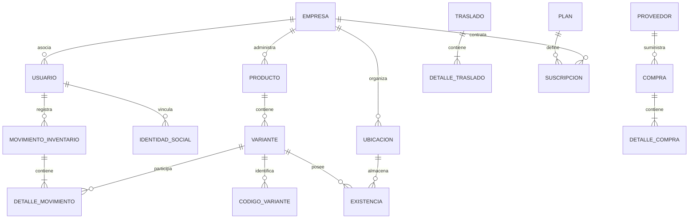

# CANVAS DE DISEÑO DE DATOS

## Plataforma SaaS de Gestión de Inventarios — Inversiones R&P

| Campo | Información |
|---|---|
| Código documental propuesto | DAT-01 |
| Versión de trabajo | **1.1 — Propuesta de actualización** |
| Fecha | 15 de noviembre de 2026 |
| Documento base | `CANVAS_ 3_DE DISEÑO DE DATOS.pdf`, v1.0 |
| Documento de alineación | `02_SDD_01_DISENO_TECNICO_SAAS_INVERSIONES_RP.md` (SDD-01 v0.2) |
| Motor de datos | MySQL |
| Backend | Laravel |
| Frontend | React |
| Estado | **Propuesta pendiente de validación contra el repositorio OpenCode** |
| Avance comunicado | Hasta Sprint 5; migraciones, relaciones y pruebas **no verificadas** |
| Incorporaciones de esta revisión | Google, Facebook y necesidades de datos de CX/UX/UI, sin alterar reglas de inventario |

> **Control de alcance.** Este documento conserva la estructura y las reglas del Canvas v1.0, que resume un diccionario de datos propuesto. **No es un modelo físico aprobado ni certifica que existan estas tablas en la base de datos.** Las extensiones se indican como **NUEVO** y deben cotejarse con el código, las migraciones Laravel y el esquema MySQL existentes antes de ejecutarse.

---

## 1. Propósito del modelo de datos

Diseñar una estructura que permita almacenar, relacionar y proteger la información de la plataforma SaaS de inventario, garantizando **integridad, trazabilidad, consistencia y escalabilidad para múltiples empresas**.

**Extensión NUEVA:** permitir que un usuario interno vincule, bajo condiciones seguras, identidades de Google o Facebook sin modificar sus roles, autorizaciones o pertenencia empresarial. Los datos de CX/UX/UI se limitan a necesidades justificadas y minimizadas; **no se presume una plataforma de analítica de comportamiento**.

## 2. Problema que resuelve

El negocio necesita superar el control manual del inventario y centralizar información para conocer:

- Productos y variantes existentes.
- Cantidades disponibles por ubicación.
- Entradas, salidas, ajustes y traslados realizados.
- Responsable de cada operación.
- Proveedores y evolución de precios de compra.
- Productos que requieren reposición.

**NUEVO:** simplificar el acceso de usuarios sin sacrificar identidad verificable, seguridad ni trazabilidad. Google/Facebook son mecanismos de **autenticación**, no fuentes de permisos de inventario.

## 3. Objetivos del modelo

1. Administrar empresas y usuarios.
2. Gestionar productos, categorías, marcas y variantes.
3. Controlar unidades de medida y conversiones.
4. Registrar existencias por ubicación.
5. Gestionar movimientos de inventario.
6. Registrar proveedores y compras.
7. Mantener el historial de operaciones y precios.
8. Generar información para métricas y alertas.
9. Administrar conteos físicos y auditorías.
10. Preparar la plataforma para evolución multiempresa.
11. **NUEVO:** asociar de forma segura las identidades Google/Facebook con cuentas internas.
12. **NUEVO:** apoyar experiencias de acceso y gestión de errores claras, accesibles y auditables, con minimización de datos.

## 4. Entidades y grupos de tablas

Las tablas siguientes corresponden a los **nombres conceptuales del Canvas original**, no necesariamente a los nombres reales del repositorio.

| Grupo | Tablas principales del documento original | Finalidad |
|---|---|---|
| Organización | `empresa` | Identificar empresas o tenants. |
| Seguridad | `usuario`, `rol`, `permiso`, `usuario_rol`, `rol_permiso`, `usuario_permiso` | Controlar acceso y autorizaciones. |
| Catálogo | `categoria`, `marca`, `producto`, `variante`, `codigo_variante` | Organizar e identificar productos. |
| Unidades | `unidad_medida`, `conversion_unidad` | Administrar medidas y equivalencias. |
| Ubicaciones | `ubicacion` | Representar tienda, almacén y espacios internos. |
| Existencias | `existencia` | Mantener saldos por variante y ubicación. |
| Inventario | `movimiento_inventario`, `detalle_movimiento` | Registrar entradas, salidas y ajustes. |
| Compras | `proveedor`, `compra`, `detalle_compra` | Registrar abastecimiento e historial de costos. |
| Ventas | `venta`, `detalle_venta` | Asociar salidas comerciales básicas. |
| Traslados | `traslado`, `detalle_traslado` | Controlar transferencias entre ubicaciones. |
| Control | `auditoria`, `conteo_inventario`, `detalle_conteo` | Trazabilidad y diferencias físicas. |
| Alertas | `alerta` | Informar situaciones relevantes. |
| SaaS | `plan`, `suscripcion` | Preparar gestión comercial de la plataforma. |
| Personalización | `temporada` | Temáticas comerciales estacionales. |
| **Seguridad — NUEVO** | `identidad_social` *(nombre conceptual; equivalente en SDD: `user_social_identities`)* | Vincular identidad externa a usuario interno. |

**Restricción de evolución:** no crear la tabla `identidad_social` si ya existe otra asociación equivalente; adoptar el nombre y convenciones reales de OpenCode. La decisión de usar una tabla independiente es **propuesta**, no una estructura ya aprobada.

## 5. Clasificación de las tablas

### 5.1 Independientes (original)

- `empresa`
- `permiso`
- `plan`
- `unidad_medida`

Pueden existir sin depender directamente de otra entidad de negocio; su ámbito global o empresarial sigue sujeto a decisión.

### 5.2 Dependientes (original)

- `usuario`, `producto`, `variante`, `codigo_variante`
- `existencia`, `movimiento_inventario`, `detalle_movimiento`
- `compra`, `detalle_compra`, `venta`, `detalle_venta`
- `traslado`, `detalle_traslado`
- `conteo_inventario`, `detalle_conteo`, `alerta`

**NUEVO:** `identidad_social` es una **tabla dependiente** del usuario interno. No representa una empresa ni reemplaza la tabla de usuarios.

### 5.3 Pivote (original)

- `usuario_rol`
- `rol_permiso`
- `usuario_permiso`

Resuelven asociaciones muchos a muchos entre usuarios, roles y permisos.

### 5.4 Asociativas (original)

`existencia` relaciona variante y ubicación, y almacena atributos propios del negocio, como el saldo. **No es un pivote puro.**

### 5.5 Relaciones polimórficas

La fuente original no confirma polimorfismo. Podría evaluarse para `auditoria`, pero **no se adopta** sin aprobación.

## 6. Relaciones principales

- Una empresa puede tener muchos usuarios, productos, proveedores, ubicaciones y movimientos **según la estrategia de asociación aprobada**.
- Un producto puede tener múltiples variantes.
- Una variante puede tener varios códigos alternativos.
- Una variante puede tener existencias en diferentes ubicaciones.
- Una ubicación puede almacenar existencias de muchas variantes.
- Un movimiento puede contener múltiples detalles.
- Una compra puede incluir varios productos o variantes.
- Un traslado vincula ubicación de origen y destino.
- Un usuario puede tener múltiples roles y permisos.
- Un rol puede contener varios permisos.
- Una empresa puede tener una suscripción asociada a un plan.
- **NUEVO:** un usuario interno puede tener cero o varias identidades externas vinculadas; cada identidad `(proveedor, identificador_externo)` corresponde como máximo a **un usuario interno**.
- **NUEVO:** una identidad de Google/Facebook **no otorga directamente** membresía empresarial, roles ni permisos.

### 6.1 Diagrama entidad-relación conceptual



> Diagrama **ilustrativo**, no modelo físico. La relación `empresa`–`usuario` puede cambiar si OpenCode implementa membresías explícitas o usuarios globales con pertenencia a varias empresas. Asimismo, deben revisarse las cardinalidades según el esquema real.

## 7. Reglas de negocio que debe garantizar la base de datos

### 7.1 Reglas conservadas del Canvas v1.0

| Código | Regla | Control esperado |
|---|---|---|
| RN-01 | Identificación única de productos | Evitar códigos internos duplicados por empresa. |
| RN-02 | Identificación de variantes | Cada variante debe tener identificación propia. |
| RN-03 | Stock por ubicación | Saldo coherente por variante y ubicación. |
| RN-04 | Conversiones válidas | Respetar equivalencias entre unidades. |
| RN-05 | Cantidades decimales | Usar `DECIMAL` cuando corresponda. |
| RN-06 | No permitir salidas sobre stock | Validación transaccional Laravel + MySQL. |
| RN-07 | Traslados sin alterar stock global | Coordinar salida y entrada. |
| RN-08 | Responsable de cada movimiento | Registrar el usuario ejecutor. |
| RN-09 | No eliminar movimientos confirmados | Revertir con movimientos compensatorios. |
| RN-10 | Ajustes autorizados | Exigir justificación y autorización. |
| RN-11 | Conteos físicos trazables | Registrar cantidades y diferencias. |
| RN-12 | Aislamiento empresarial | Impedir acceso a datos de otra empresa. |

### 7.2 Reglas nuevas de autenticación social (**PROPUESTAS**)

| Código | Regla | Criterio verificable |
|---|---|---|
| RN-AUTH-01 | Identidad externa única | `UNIQUE(provider, provider_user_id)`; una identidad no puede pertenecer a dos usuarios internos. |
| RN-AUTH-02 | Cuenta interna como fuente de autorización | Tras autenticarse, roles/empresa/permisos se resuelven únicamente en la base interna. |
| RN-AUTH-03 | Vinculación explícita y segura | No unir usuarios por mera igualdad de correo; exigir sesión válida o flujo de verificación/aprobación. |
| RN-AUTH-04 | Proveedores permitidos | Solo `google` y `facebook`, además de correo/contraseña. |
| RN-AUTH-05 | Desvinculación controlada | Evitar dejar al usuario sin método permitido de acceso; verificar identidad y registrar evento. |
| RN-AUTH-06 | Menor privilegio | Un primer acceso social no crea rol de administrador ni acceso empresarial implícito. |
| RN-AUTH-07 | Control de errores | Cancelación, cuenta no vinculada, respuesta inválida y proveedor sin correo no provocan vinculaciones inseguras. |
| RN-AUTH-08 | Datos mínimos | No guardar tokens de proveedor ni datos de perfil sin necesidad explícita aprobada. |
| RN-AUTH-09 | Protección de secretos | Credenciales de OAuth solo en servidor o gestor de secretos, nunca React ni repositorio. |

> Las RN-AUTH anteriores derivan de los requisitos nuevos y del SDD-01 actualizado, **no del Canvas v1.0**.

## 8. Estructura técnica de los datos

Convenciones **propuestas en el documento original**:

- Identificadores: `BIGINT UNSIGNED`.
- Cantidades y costos: `DECIMAL` con precisión apropiada al negocio.
- Fechas: `DATETIME` o `TIMESTAMP` según uso definido.
- Códigos y estados: `VARCHAR` con catálogos/restricciones.
- Relaciones: claves foráneas.
- Integridad: `UNIQUE`, índices y restricciones pertinentes.
- Auditoría técnica: `created_at`, `updated_at` cuando corresponda.
- Entidades maestras: preferencia por baja lógica cuando preserve trazabilidad.

**No se inventan** longitudes definitivas, precisión monetaria, zona temporal de almacenamiento, `ON DELETE`, nulabilidad o índices compuestos físicos: tales decisiones requieren inspección del diccionario, migraciones y consultas reales.

### 8.1 Propuesta mínima de tabla de identidad social — NUEVO

| Campo conceptual | Tipo sugerido | Obligatorio | Observaciones |
|---|---|---|---|
| `id` | `BIGINT UNSIGNED` | Sí | PK; seguir convención existente. |
| `user_id` | FK al usuario | Sí | Adaptar al nombre/tipo real de PK del usuario. |
| `provider` | `VARCHAR` | Sí | Valores permitidos `google`, `facebook`. |
| `provider_user_id` | `VARCHAR` | Sí | ID estable retornado por el proveedor, no su correo. |
| `provider_email` | `VARCHAR` | No | Solo si hay justificación; no utilizar como identidad única. |
| `linked_at` | `DATETIME`/`TIMESTAMP` | Sí* | Fecha de vínculo; política pendiente de definir. |
| `created_at` | `TIMESTAMP` | Según convención | Registro técnico. |
| `updated_at` | `TIMESTAMP` | Según convención | Registro técnico. |

`*` El diseño lógico exige trazabilidad de vinculación; su implementación exacta puede satisfacerla de otro modo si existe auditoría equivalente.

**Restricciones mínimas:**

1. Clave foránea desde `user_id` hacia la cuenta interna real.
2. `UNIQUE(provider, provider_user_id)`.
3. Índice para consulta de identidades por usuario.
4. Restricción de dominio de `provider` en aplicación y, si el motor/esquema lo permite, en base de datos.
5. Comprobar previamente duplicados históricos y migrar de forma compatible y reversible.
6. **Decisión pendiente:** `UNIQUE(user_id, provider)` si el negocio decide admitir una sola cuenta por proveedor y usuario; no imponerla sin aprobar esa política.

No almacenar contraseñas del proveedor, tokens de acceso/refresh ni fotografías de perfil por defecto. Cuando existan requerimientos futuros, evaluar almacenamiento cifrado, finalidad, caducidad, retención y acceso mínimo.

### 8.2 Ejemplo lógico de migración Laravel (NO ejecutar sin adaptar)

```php
// EJEMPLO DE DISEÑO, NO MIGRACIÓN LISTA PARA PRODUCCIÓN.
// Verificar nombre de tabla/PK de usuarios y tipos reales antes de aplicar.
Schema::create('user_social_identities', function (Blueprint $table) {
    $table->id();
    $table->foreignId('user_id')->constrained('users'); // ADAPTAR tabla real
    $table->string('provider', 32);
    $table->string('provider_user_id', 191);
    $table->string('provider_email')->nullable();
    $table->timestamp('linked_at')->nullable();
    $table->timestamps();

    $table->unique(['provider', 'provider_user_id']);
    $table->index('user_id');
});
```

**Precaución:** la fuente original utiliza nombres conceptuales en singular (`usuario`), mientras Laravel puede usar otro convenio. Este ejemplo **no debe copiarse y ejecutarse** sin contrastar `users`, claves foráneas, collations, longitudes y restricciones con el repositorio real.

### 8.3 Principio multiempresa

La identidad social pertenece al **usuario interno**, no directamente a un tenant. La autorización debe determinar la empresa o membresía válida y comprobarla por cada operación. Si la plataforma adopta usuarios multiempresa, evaluar una tabla explícita de membresías **solo después de inspeccionar el modelo real**; no se presupone una tabla aprobada.

## 9. Métodos y responsabilidades

Los métodos del Canvas representan operaciones de negocio en **servicios, acciones y políticas Laravel**, no columnas de base de datos.

| Entidad/servicio | Operaciones sugeridas en la fuente original |
|---|---|
| Producto | `crear()`, `actualizar()`, `desactivar()`, `consultarHistorial()` |
| Variante | `crear()`, `asignarCodigo()`, `consultarExistencias()` |
| Existencia | `consultarSaldo()`, `incrementar()`, `disminuir()` |
| Movimiento | `registrarEntrada()`, `registrarSalida()`, `revertir()` |
| Traslado | `validarDisponibilidad()`, `ejecutarTraslado()` |
| Compra | `registrarCompra()`, `calcularCosto()`, `consultarHistorial()` |
| Conteo | `iniciarConteo()`, `registrarDiferencia()`, `aprobarAjuste()` |
| Usuario | `asignarRol()`, `asignarPermiso()`, `verificarAcceso()` |
| Alerta | `generarAlerta()`, `consultarAlertas()`, `marcarAtendida()` |

**NUEVO — servicio de identidad social (nombres ilustrativos):** `resolverIdentidad(provider, providerUserId)`, `vincularIdentidad(usuario, identidadVerificada)`, `desvincularIdentidad()`, `registrarEventoAutenticacion()` y `validarAccesoEmpresa()`.

**Secuencia esperada:** validar respuesta oficial del proveedor → localizar identidad por `(provider, provider_user_id)` → resolver usuario interno o iniciar incorporación/vinculación autorizada → verificar membresía y permisos → crear sesión de aplicación. No consultar directamente MySQL desde React.

## 10. Seguridad e integridad

Controles conservados del original:

- Aislamiento por empresa y controles de rol/permisos.
- Claves foráneas y unicidad.
- Transacciones y control de concurrencia al actualizar saldos.
- Responsables y fechas para operaciones.
- Protección del historial de movimientos y limitación de datos sensibles por rol.

**Controles adicionales — NUEVO:**

- Verificar correctamente el flujo oficial de Google (OpenID Connect) y Facebook (según producto vigente), incluido `state` y las validaciones específicas que correspondan.
- No confiar en correos sin verificar, identidad enviada por el cliente ni coincidencia de nombres.
- No permitir vinculación/desvinculación sin verificación del usuario y protección antifalsificación.
- Registrar solo auditoría necesaria de vinculación, fallos relevantes y desvinculación, sin almacenar secretos ni respuestas completas del proveedor.
- Revisar permisos al entrar y en cada operación del backend, no solo al renderizar React.
- Conservar respaldo, estrategia de recuperación y despliegue de migraciones versionadas.
- Aplicar retención y minimización de datos personales según la política y el marco legal aplicable.

### 10.1 CX/UX/UI y persistencia — NUEVO

| Necesidad de experiencia | ¿Cambia base de datos? | Propuesta |
|---|---|---|
| Formularios claros, navegación y componentes visuales | Normalmente no | Resolver en React, sin nuevas tablas. |
| Estados de carga, error y confirmación | Normalmente no | Estado de interfaz y respuestas API. |
| Preferencias visuales por usuario | Solo si deben persistir entre sesiones | Evaluar atributo o tabla de preferencias; **no aprobada**. |
| Onboarding de usuarios | Solo si se requiere estado persistente | Evaluar seguimiento mínimo; **no aprobado**. |
| Medición CX (CSAT, abandono, satisfacción) | Solo con finalidad, consentimiento/base legal y alcance definidos | **No crear tablas de analítica por defecto**. |
| Auditoría de cambios y operaciones | Sí, según esquema vigente | Reutilizar `auditoria` o mecanismo equivalente. |

## 11. Tecnologías y componentes

| Componente | Tecnología | Responsabilidad |
|---|---|---|
| Interfaz | React | Formularios, navegación, diseño y visualización. |
| Backend | Laravel | Autenticación, permisos, validaciones, servicios de negocio y transacciones. |
| Base de datos | MySQL | Persistencia, relaciones, restricciones e integridad. |
| Comunicación | API REST sobre HTTP/HTTPS + JSON | Intercambio seguro entre cliente y servidor. |
| Pruebas | BDD, pruebas funcionales/integración | Verificar comportamientos y reglas. |
| **Identidad externa — NUEVO** | Google y Facebook | Proveer autenticación; autorización interna siempre en Laravel. |

**Principio arquitectónico:** React nunca conecta directamente con MySQL.

## 12. Riesgos del modelo de datos

| Riesgo | Consecuencia | Tratamiento propuesto |
|---|---|---|
| Duplicidad de productos | Inventario inconsistente | Unicidad por empresa. |
| Actualizaciones simultáneas | Saldos incorrectos | Transacciones y bloqueos de filas. |
| Relaciones incorrectas | Integridad comprometida | Claves foráneas y pruebas. |
| Acceso entre empresas | Exposición de información | Scope empresarial y autorización. |
| Eliminación de movimientos | Pérdida de trazabilidad | Reversiones y baja lógica. |
| Conversiones erróneas | Cantidades incorrectas | Validación de unidades y precisión. |
| Cambios de esquema | Incompatibilidades | Migraciones versionadas, respaldos y reversión. |
| **NUEVO: duplicación de identidades** | Dos cuentas internas asociadas indebidamente | Índice único y vinculación verificada. |
| **NUEVO: vinculación por correo** | Apropiación de cuentas | No asociar solo por email. |
| **NUEVO: filtración de datos externos** | Exposición de datos personales/tokens | Minimización, secretos seguros y auditoría limitada. |
| **NUEVO: migración sobre Sprint 1–5** | Regresiones en login o permisos | Inspección previa, pruebas y migraciones no destructivas. |

## 13. Decisiones pendientes de validación

### 13.1 Pendientes originales (se conservan)

1. Si el correo de usuario será único globalmente o por empresa.
2. Si el stock mínimo estará por producto, variante o ubicación.
3. Cómo se registrará ubicación en detalles de movimiento.
4. Método de valoración de inventario.
5. Tratamiento de ventas sin POS completo.
6. Alcance empresarial o global de roles/permisos.
7. Estrategia definitiva de aislamiento multiempresa.
8. Política de conservación, recuperación y baja lógica.
9. Necesidad de relaciones polimórficas para auditorías/documentos.

### 13.2 Nuevas decisiones de autenticación y experiencia

| ID | Decisión pendiente | Responsable sugerido | Efecto |
|---|---|---|---|
| DD-10 | Confirmar tabla y PK reales de usuario y modelo de pertenencia empresarial | Arquitectura/DB | FKs, consultas y permisos. |
| DD-11 | Identificar mecanismo de sesión actual en Laravel/React | Backend/seguridad | Vinculación y retorno OAuth. |
| DD-12 | Una o varias identidades del mismo proveedor por usuario | Producto/seguridad | Restricción `UNIQUE(user_id, provider)`. |
| DD-13 | Política de invitación, auto-registro o aprobación empresarial | Producto/seguridad | Primer acceso por Google/Facebook. |
| DD-14 | Política de vinculación/desvinculación y recuperación de acceso | Seguridad/UX | Prevención de apropiación y bloqueo. |
| DD-15 | Retención de correo de proveedor y auditoría de identidad | Privacidad/seguridad | Protección de datos. |
| DD-16 | Si se almacenarán preferencias visuales u onboarding | Producto/CX/UX | Posibles nuevas columnas/tablas. |
| DD-17 | Nombre físico de la tabla social y política de migración | DB/backend | Compatibilidad con Sprint 1–5. |

## 14. Entregables derivados

Del Canvas original:

1. Diccionario de datos detallado.
2. Modelo entidad-relación (MER).
3. Modelo relacional.
4. Modelo físico MySQL.
5. Scripts de creación y restricciones.
6. Migraciones Laravel.
7. Seeders y datos iniciales.
8. Pruebas de integridad y reglas de negocio.
9. Documentación técnica de relaciones y métodos.

**Extensiones NUEVAS:** especificación de identidades sociales, pruebas de vínculo/desvínculo, matriz de impactos sobre migraciones de Sprint 0–5 y trazabilidad entre este Canvas, SDD-01 y Documento Maestro.

## 15. Criterio de éxito

El diseño podrá considerarse validado cuando:

- Se confirme el inventario de entidades y sus cardinalidades.
- Se aprueben las decisiones pendientes que impactan el esquema.
- Laravel y MySQL garanticen integridad de existencias y transacciones.
- Los movimientos sean trazables y reversibles de forma controlada.
- La separación empresarial esté probada.
- Los modelos puedan mantenerse mediante migraciones seguras.
- **NUEVO:** una identidad social solo pueda asociarse a una cuenta interna autorizada.
- **NUEVO:** la incorporación de Google/Facebook no modifique permisos ni propiedad de inventarios.
- **NUEVO:** el diseño propuesto tenga pruebas de regresión y aprobación de migración sobre el estado real del Sprint 5.

---

## 16. Plan de verificación con OpenCode — NUEVO

**Estado confirmado solo por comunicación:** avance reportado hasta el Sprint 5. La tabla siguiente es una **lista de comprobación**, no resultados de auditoría.

| Orden | Verificación | Evidencia esperada |
|---|---|---|
| 1 | Localizar migraciones Laravel aplicadas | Lista de archivos y tablas existentes. |
| 2 | Identificar las tablas de empresas y usuarios | Definición real de PK/FK y unicidad. |
| 3 | Identificar roles/permisos y tenant scope | Policies, middleware, relaciones y pruebas. |
| 4 | Verificar catálogo, ubicaciones y existencias | Migraciones/modelos y pruebas de negocio. |
| 5 | Verificar compras y traslados de Sprint 5 | Transacciones, FK e invariantes. |
| 6 | Detectar integración social ya existente | Clases/paquetes/rutas/tablas, sin duplicación. |
| 7 | Aprobar propuesta de identidades externas | Decisiones DD-10 a DD-17 resueltas. |
| 8 | Diseñar migración incremental y reversión | Plan de despliegue y respaldo. |
| 9 | Probar cambios | Casos funcionales, seguridad, multiempresa y regresión. |
| 10 | Actualizar diccionario y MER definitivos | Documentación cotejada con código. |

### 16.1 Escenarios de prueba mínimos

- Un usuario con identidad Google previamente vinculada ingresa a **su misma cuenta**.
- Un usuario con Facebook vinculado conserva sus mismos roles y empresas.
- Dos usuarios no pueden compartir la misma identidad `(provider, provider_user_id)`.
- Un correo externo coincidente no provoca vinculación automática de cuentas.
- El proveedor no entrega correo: se informa el flujo seguro correspondiente.
- El usuario cancela la autorización: no se crea vinculación ni sesión accidental.
- Un usuario sin membresía empresarial válida no puede ver inventario.
- Usuarios de empresas distintas no pueden consultar las existencias de otros tenants.
- Tras una migración de identidad social, entradas/salidas/compras/traslados siguen funcionando y las cantidades coinciden.

## 17. Trazabilidad documental — NUEVO

| Necesidad | Origen | Artefacto técnico | Estado |
|---|---|---|---|
| Integridad y stock por ubicación | Canvas v1.0, RN-03/RN-06/RN-07 | Tablas `existencia`, movimientos y servicios transaccionales | Verificar en OpenCode |
| Trazabilidad | Canvas v1.0, RN-08/RN-09/RN-11 | Usuarios, auditoría, movimientos y conteos | Verificar en OpenCode |
| Multiempresa | Canvas v1.0, RN-12 | Empresa, relaciones y scope de autorización | Estrategia definitiva pendiente |
| Google/Facebook | Nuevo requisito + SDD-01 v0.2 | Identidad social, callbacks y reglas RN-AUTH | Propuesto |
| CX/UX/UI | Nuevo requisito transversal | Interfaces React y datos mínimos solo si hacen falta | Propuesto |
| Continuidad Sprint 5 | Avance comunicado | Inventario de migraciones y pruebas de regresión | Sin verificar |

## 18. Registro de cambios y compatibilidad

| Versión | Cambio | Estado |
|---|---|---|
| 1.0 | Canvas original de diseño de datos de inventario y SaaS | Fuente suministrada |
| 1.1 (propuesta) | Conservación de 15 secciones; adición de identidad Google/Facebook, necesidades CX/UX/UI y control de compatibilidad Sprint 5 | Pendiente de revisión/aprobación |

### Instrucción para OpenCode

> Analiza los modelos, migraciones, claves y datos reales del repositorio antes de aplicar este Canvas. Compara cada tabla conceptual con su implementación, documenta discrepancias, conserva datos y funcionalidades de Sprint 0–5, resuelve las decisiones pendientes y solo después propone migraciones incrementales y pruebas. No declares el documento como esquema físico aprobado ni los cambios como implementados sin evidencia.

**Fin del documento.**
