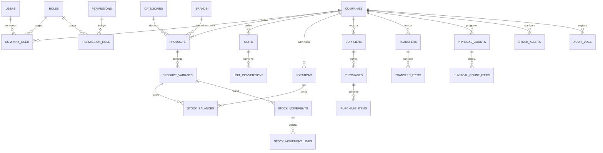

# SDD-04 — Diseño de base de datos y estrategia multiempresa

**Proyecto:** SaaS Inversiones R&P
**Versión:** 1.0 — Sprint 0 (US-0002)
**Actualización:** v1.1 — 2026-11-15 (propuesta de identidad social; no implementada)
**Fecha:** 2026-11-12
**Estado:** Modelo lógico propuesto para aprobación

---

## 1. Objetivo

Definir el modelo lógico, las restricciones y la estrategia de aislamiento entre
empresas antes de construir el esquema físico. El esquema físico se implementará
con migraciones incrementales en `backend/database/migrations/`.

## 2. Estrategia multiempresa

**Decisión propuesta:** base de datos compartida (*shared database, shared schema*)
con discriminador `company_id` en todas las tablas de dominio.

Ventajas para el MVP:

- Menor costo operativo y de infraestructura.
- Migraciones y respaldos únicos.
- Consultas transversales de administración sencillas.

Controles obligatorios:

1. `company_id` es `NOT NULL` en tablas de tenant y tiene clave foránea a
   `companies.id`.
2. Las claves únicas de negocio son compuestas e incluyen `company_id`
   (por ejemplo, `UNIQUE (company_id, sku)`).
3. Los modelos Eloquent usan un *global scope* por empresa y el `company_id`
   se resuelve desde el usuario autenticado, nunca desde el cliente.
4. Toda escritura valida que las entidades relacionadas pertenezcan a la misma
   empresa.
5. Las pruebas de integración verifican que un usuario de la empresa A no puede
   leer ni modificar datos de la empresa B (matriz de `Reglas/ESTANDAR.md`, 8.2).
6. Los índices que soportan consultas frecuentes comienzan por `company_id`.

> El identificador interno es `company_id`; la interfaz muestra «Empresa».
> Ver glosario en `Reglas/ESTANDAR.md`, Anexo A.

> **Implementación (US-0104):** `App\Modules\Shared\Tenancy\BelongsToCompany`
> aplica el `TenantScope`, asigna `company_id` desde el contexto e impide mover
> registros entre empresas. Las pruebas de aislamiento usan un modelo de fixture
> hasta que el Sprint 2 introduzca los modelos de dominio.

## 3. Entidades del modelo lógico

### 3.1 Identidad y acceso

| Entidad | Tabla | Campos principales |
| --- | --- | --- |
| Empresa | `companies` | `id`, `name`, `slug`, `tax_id`, `status`, `created_at` |
| Usuario | `users` | `id`, `name`, `email`, `password`, `status`, `created_at` |
| Pertenencia | `company_user` | `company_id`, `user_id`, `role_id`, `status` |
| Rol | `roles` | `id`, `company_id` (nullable si es global), `name`, `code` |
| Permiso | `permissions` | `id`, `code`, `name` |
| Rol-permiso | `permission_role` | `role_id`, `permission_id` |

#### 3.1.1 Identidad social (propuesta v1.1 — no implementada)

> **Estado:** diseño propuesto. No existe migración, tabla ni modelo de
> identidad social al 2026-11-15. No ejecutar esta estructura sin aprobación.

| Entidad | Tabla propuesta | Campos principales |
| --- | --- | --- |
| Identidad externa | `social_identities` | `id`, `user_id`, `provider`, `provider_user_id`, `provider_email` (opcional), `linked_at`, timestamps |

Reglas:

- `provider` limitado a `google` y `facebook`.
- `UNIQUE (provider, provider_user_id)`; índice por `user_id`.
- `user_id` referencia a `users`; **sin `company_id`**, porque la identidad es
  global. La empresa se sigue resolviendo con `company_user`.
- No imponer `UNIQUE (user_id, provider)` hasta que el producto decida si un
  usuario puede tener varias identidades del mismo proveedor.
- No guardar tokens del proveedor ni perfiles completos; `provider_email` es
  opcional y **no** se usa para vincular cuentas.
- La vinculación exige sesión válida y prueba de control del proveedor.
- Desvincular no puede dejar al usuario sin método de acceso.

Ver ADR-0005 y
[`AUTH-01_AUTENTICACION_SOCIAL.md`](../SEGURIDAD/AUTH-01_AUTENTICACION_SOCIAL.md).

### 3.2 Catálogo

| Entidad | Tabla | Campos principales |
| --- | --- | --- |
| Categoría | `categories` | `id`, `company_id`, `name`, `parent_id` |
| Marca | `brands` | `id`, `company_id`, `name` |
| Producto | `products` | `id`, `company_id`, `category_id`, `brand_id`, `name`, `description`, `status` |
| Variante | `product_variants` | `id`, `company_id`, `product_id`, `sku`, `barcode`, `attributes`, `cost`, `price`, `status` |

> **Implementado (Sprint 2, US-0201 a US-0203):** `categories`, `brands`,
> `products` y `product_variants` existen con `company_id`, estado y unicidad
> por empresa; usan `BelongsToCompany` y el `TenantScope`. El catálogo queda
> listo para enlazarse con unidades/almacenes (Sprint 3) e inventario (Sprint 4).

### 3.3 Unidades y ubicaciones

| Entidad | Tabla | Campos principales |
| --- | --- | --- |
| Unidad | `units` | `id`, `company_id`, `name`, `code`, `type` |
| Conversión | `unit_conversions` | `id`, `company_id`, `from_unit_id`, `to_unit_id`, `factor` |
| Ubicación | `locations` | `id`, `company_id`, `name`, `code`, `type`, `parent_id`, `status` |

> **Implementado (Sprint 3, US-0301 a US-0303):** `units`, `unit_conversions` y
> `locations` existen con `company_id`, estado y unicidad por empresa; usan
> `BelongsToCompany` y el `TenantScope`. La tabla `stock_balances` y la guardia
> de desactivación con stock se activan en el Sprint 4.

### 3.4 Inventario

| Entidad | Tabla | Campos principales |
| --- | --- | --- |
| Existencia | `stock_balances` | `id`, `company_id`, `variant_id`, `location_id`, `quantity`, `reserved_quantity`, `updated_at` |
| Movimiento | `stock_movements` | `id`, `company_id`, `variant_id`, `location_id`, `type`, `quantity`, `unit_cost`, `reference_type`, `reference_id`, `reason`, `created_by`, `created_at` |
| Detalle de movimiento | `stock_movement_lines` | `id`, `company_id`, `stock_movement_id`, `variant_id`, `location_id`, `quantity`, `unit_cost` |

Tipos de movimiento: `purchase_entry`, `sale_exit`, `return`, `adjustment`,
`transfer_in`, `transfer_out`, `reversal`.

> **Implementado (Sprint 4, US-0401 a US-0406):** `stock_balances`,
> `stock_movements` y `stock_movement_lines` existen con `company_id`,
> unicidad por variante/ubicación, idempotencia por empresa y reversión única
> (`reversal_of_movement_id`). Toda mutación pasa por `InventoryMovementService`.
>
> La implementación lleva variante, ubicación y cantidad en
> `stock_movement_lines`; la cabecera `stock_movements` guarda tipo, estado,
> usuario, motivo, `document_reference`, las referencias de devolución/reversión
> e `idempotency_key`. `unit_cost` y `reference_*` quedan previstos para compras
> y traslados (Sprint 5).

### 3.5 Compras y traslados

| Entidad | Tabla | Campos principales |
| --- | --- | --- |
| Proveedor | `suppliers` | `id`, `company_id`, `name`, `tax_id`, `email`, `phone`, `status` |
| Compra | `purchases` | `id`, `company_id`, `supplier_id`, `document_number`, `status`, `ordered_at`, `received_at`, `total` |
| Detalle de compra | `purchase_items` | `id`, `company_id`, `purchase_id`, `variant_id`, `quantity`, `unit_cost`, `subtotal` |
| Traslado | `transfers` | `id`, `company_id`, `from_location_id`, `to_location_id`, `status`, `created_by`, `created_at` |
| Detalle de traslado | `transfer_items` | `id`, `company_id`, `transfer_id`, `variant_id`, `quantity` |

> **Implementado (Sprint 5, US-0501 a US-0503):** `suppliers`, `purchases`,
> `purchase_items`, `transfers` y `transfer_items` existen con `company_id`,
> unicidad por empresa y claves foráneas con `RESTRICT` hacia el historial.
>
> - La compra guarda `unit_cost` y `subtotal` por línea como costo histórico y
>   pasa de `draft` a `received` en una recepción total.
> - El traslado se ejecuta de forma inmediata y atómica con estado
>   `confirmed`; descuenta origen e incrementa destino.
> - `stock_movements` incorpora `reference_type` y `reference_id` para enlazar
>   la recepción (`purchase`) o el traslado (`transfer`).
> - `purchase_receipts`, la recepción parcial y el tránsito entre ubicaciones
>   quedan fuera del alcance de este sprint.

### 3.6 Conteos, métricas y auditoría

| Entidad | Tabla | Campos principales |
| --- | --- | --- |
| Conteo físico | `physical_counts` | `id`, `company_id`, `location_id`, `status`, `started_at`, `closed_at` |
| Detalle de conteo | `physical_count_items` | `id`, `company_id`, `physical_count_id`, `variant_id`, `expected_quantity`, `counted_quantity`, `difference` |
| Alerta | `stock_alerts` | `id`, `company_id`, `variant_id`, `location_id`, `type`, `threshold`, `status` |
| Auditoría | `audit_logs` | `id`, `company_id`, `user_id`, `action`, `entity_type`, `entity_id`, `before`, `after`, `ip`, `created_at` |

## 4. Diagrama entidad-relación (resumen)

## 5. Restricciones e índices principales

| Tabla | Restricción / índice | Motivo |
| --- | --- | --- |
| `companies` | `UNIQUE (slug)` | Identificador legible único |
| `users` | `UNIQUE (email)` | Unicidad global (DD-01 propuesta) |
| `company_user` | `UNIQUE (company_id, user_id)` | Una pertenencia por empresa |
| `products` | `INDEX (company_id, category_id)` | Listados por empresa y categoría |
| `product_variants` | `UNIQUE (company_id, sku)` | SKU único dentro de la empresa |
| `product_variants` | `INDEX (company_id, barcode)` | Búsqueda por código de barras |
| `stock_balances` | `UNIQUE (company_id, variant_id, location_id)` | Una existencia por variante y ubicación |
| `stock_balances` | `CHECK (quantity >= 0)` | Prohibir stock negativo |
| `stock_movements` | `INDEX (company_id, variant_id, created_at)` | Historial y reportes |
| `purchase_items` | `UNIQUE (purchase_id, variant_id)` | Evitar duplicados en la compra |
| `audit_logs` | `INDEX (company_id, entity_type, entity_id)` | Trazabilidad por entidad |

Reglas adicionales:

- Claves foráneas con `ON DELETE RESTRICT` en entidades con historial.
- Borrado lógico (`deleted_at`) en catálogo y maestros (DD-05 propuesta).
- Dinero con `DECIMAL(14,4)`; cantidades con `DECIMAL(14,3)`.
- Fechas en UTC; conversión a la zona de presentación en la capa de salida.

## 6. Orden de migraciones (Sprint 1 en adelante)

1. `companies`
2. `users` y `company_user`
3. `roles`, `permissions`, `permission_role`
4. `categories`, `brands`, `products`, `product_variants`
5. `units`, `unit_conversions`, `locations`
6. `stock_balances`, `stock_movements`, `stock_movement_lines`
7. `suppliers`, `purchases`, `purchase_items`
8. `transfers`, `transfer_items`
9. `physical_counts`, `physical_count_items`
10. `stock_alerts`, `audit_logs`

## 7. Pruebas de aislamiento obligatorias

Para cada endpoint con datos de tenant:

1. Usuario de la empresa A lista solo registros de A.
2. Usuario de A no puede leer por ID un registro de B (404/403).
3. Usuario de A no puede actualizar ni eliminar un registro de B.
4. Un `company_id` enviado en el cuerpo se ignora; se usa el del contexto.
5. Un registro hijo no puede referenciar una entidad de otra empresa.

## 8. Decisiones abiertas relacionadas

| Código | Tema | Estado |
| --- | --- | --- |
| DD-01 | Unicidad global o por empresa del correo | Propuesta: global |
| DD-02 | Nivel del stock mínimo | Propuesta: variante + ubicación |
| DD-03 | Ubicación en el detalle de movimiento | Propuesta: obligatoria |
| DD-04 | Roles globales o por empresa | Propuesta: por empresa, con roles base globales |
| DD-05 | Borrado lógico y auditoría | Propuesta: borrado lógico + `audit_logs` |

El detalle, responsable y evidencia están en
`DOCUMENTACION/SDD/ADR/REGISTRO_DECISIONES_SPRINT_0.md`.
