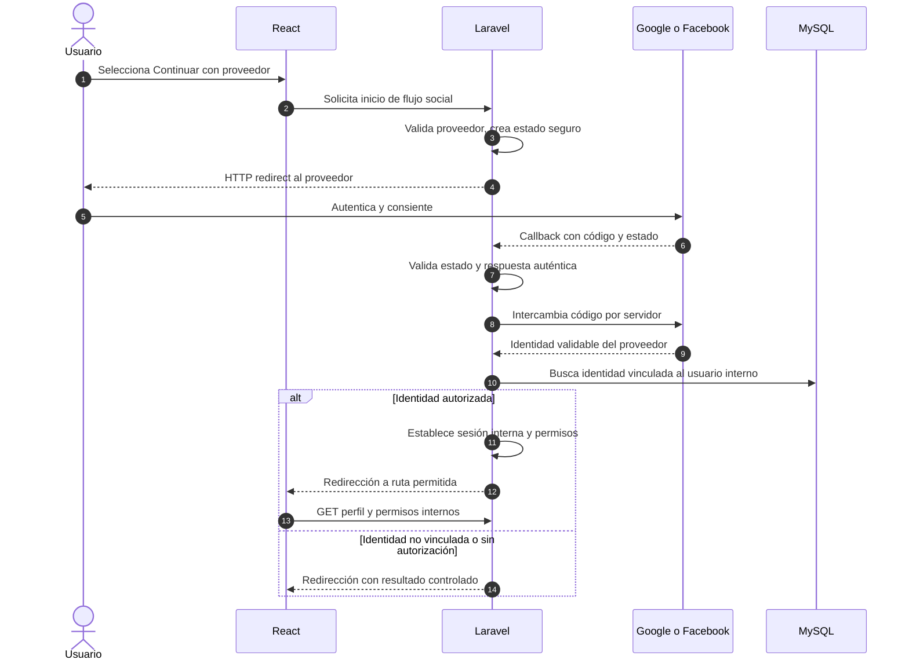

# SDD-05 — DISEÑO DE API REST

## SaaS Inversiones R&P — Gestión de inventarios multiempresa

| Campo | Información |
|---|---|
| Código | `SDD-05` |
| Versión documental | `1.0 — propuesta de actualización` |
| Fecha | 15 de noviembre de 2026 |
| Estado | **Diseño propuesto; pendiente de conciliación con OpenCode** |
| Base documental | SDD-01 Diseño Técnico original; Documento Maestro, Canvas de Datos y Backlog Técnico actualizados |
| Alcance de la actualización | CX/UX/UI, Google y Facebook, compatibilidad con avance reportado hasta Sprint 5 |
| Tecnologías documentadas | React, Laravel, MySQL, API REST, HTTPS/JSON |
| Ubicación recomendada | `SDD/SDD-05_DISENO_API_REST_SAAS_INVERSIONES_RP.md` |

> **Advertencia de trazabilidad.** Este es un **contrato de diseño**, no una prueba de endpoints ya implementados. Las rutas de la sección 4 proceden del SDD-01 original como *ejemplos iniciales de referencia*. Las rutas adicionales están marcadas como **PROPUESTA**. Antes de modificar código, OpenCode debe inspeccionar las rutas Laravel y consumidores React reales, y adaptar este documento para evitar contratos duplicados o incompatibles.

---

## 1. Propósito y alcance

### 1.1. Propósito

Establecer principios, recursos, contratos de entrada/salida, errores, seguridad, versionado, documentación y criterios de prueba de la API del SaaS Inversiones R&P, de modo que frontend React y backend Laravel compartan comportamientos verificables.

### 1.2. Alcance del producto

La API sirve a los módulos del MVP: identidad y usuarios; productos/categorías/marcas/variantes; unidades y conversiones; ubicaciones; entradas/salidas; traslados; proveedores y compras; métricas; alertas; conteos/auditoría; chatbot de solo lectura; y temas estacionales. **No implica que todos los módulos estén implementados**.

En esta revisión se amplía el contrato para:

1. Inicio de sesión mediante **correo/contraseña, Google y Facebook**.
2. Uso seguro de identidad interna, permisos y contexto de empresa/tenant.
3. Respuestas uniformes que permitan interfaces con estados de carga, éxito, error y validación accesibles.
4. Protección de operaciones de inventario ya desarrolladas contra regresiones.
5. Evolución documentada desde los Sprints 0–5 hacia los Sprints 6–9.

### 1.3. Fuera de alcance

No se define una API para facturación electrónica, pagos, contabilidad, POS completo, marketing en Facebook, integración con Google Workspace, compras automáticas ni escritura desde chatbot.

---

## 2. Fuentes y jerarquía de decisiones

- **Fuente original:** `CANVA_1_ DISEÑO TECNICO.pdf`, sección «Diseño de API REST»: principios `/api/v1/`, HTTP/JSON, rutas iniciales de referencia. El propio documento indica que dichas rutas deben ajustarse a los casos de uso.
- **Requisitos:** `01_DOCUMENTO_MAESTRO_ANALISIS_REQUISITOS_SAAS_INVERSIONES_RP.md`.
- **Arquitectura general:** `02_SDD_01_DISENO_TECNICO_SAAS_INVERSIONES_RP.md`.
- **Diseño de datos:** `03_CANVAS_DISENO_DE_DATOS_SAAS_INVERSIONES_RP.md` y el `SDD-04` real del repositorio.
- **Backlog:** `04_BACKLOG_TECNICO_IMPLEMENTACION_SAAS_INVERSIONES_RP.md`.
- **Especializados:** `SEGURIDAD/AUTH-01_AUTENTICACION_SOCIAL.md`, `CX_UX_UI/UX-01_FLUJOS_DE_USUARIO.md`, `CX_UX_UI/UI-01_SISTEMA_DE_DISENO.md`, `TESTING/QA-01_PLAN_DE_PRUEBAS_CX_UX_UI_AUTH.md`.

**Regla de conciliación:** el código existente prueba el comportamiento actual, pero no sustituye una decisión de negocio pendiente. Ante conflicto, documentar situación, impacto y decisión requerida antes de cambiar un contrato público.

---

## 3. Principios generales de diseño

| ID | Principio | Contrato esperado |
|---|---|---|
| API-01 | Transporte seguro | HTTPS en despliegue; JSON para recursos; redirección HTTP en OAuth cuando proceda |
| API-02 | Versionado | Prefijo `/api/v1/` **como referencia original**, sujeto a rutas existentes |
| API-03 | Consistencia | Esquemas documentados para éxitos, fallos y validaciones |
| API-04 | Seguridad por defecto | Autenticación y autorización en backend antes de leer o mutar datos |
| API-05 | Aislamiento multiempresa | Resolver y comprobar el tenant autorizado en servidor, no confiar en IDs del cliente |
| API-06 | Trazabilidad | Correlation/request ID en logs seguros y, cuando aplique, respuestas |
| API-07 | Integridad de inventario | Transacciones, validación de stock y movimientos trazables |
| API-08 | Idempotencia | Evitar duplicaciones por reintentos en operaciones críticas, según estrategia aprobada |
| API-09 | Compatibilidad | No cambiar rutas ni forma de respuestas usadas por React sin revisión de consumidores |
| API-10 | UX | Mensajes y errores estructurados traducibles en feedback claro sin filtrar datos sensibles |

### 3.1. Cabeceras y formato — propuesta

```http
Accept: application/json
Content-Type: application/json
X-Request-ID: <identificador-de-correlacion-opcional>
```

La estrategia exacta de sesión depende del despliegue real: **cookie de sesión segura con CSRF** (preferencia cuando React y Laravel comparten contexto compatible) o un mecanismo de token ya instalado y auditado. No cambiarlo automáticamente ni introducir un segundo mecanismo paralelo sin ADR.

### 3.2. Fechas, importes y números

- Fechas en ISO 8601 con zona horaria clara; visualización según contexto de Perú; no inferir horario local del navegador para reglas de negocio.
- Cantidades y conversiones usan precisión decimal adecuada al dominio, definida por unidades y reglas del proyecto; no usar `float` para cantidades sensibles si causa errores de redondeo.
- Importes monetarios: tipo decimal persistido y moneda documentada; el formato visual es responsabilidad del frontend.
- El backend conserva los identificadores y códigos normalizados. La UI transforma etiquetas, no los valores de negocio.

---

## 4. Inventario de endpoints originales (referenciales)

**ORIGEN:** sección 7 del SDD-01 inicial; **no implica implementación verificada**.

| Método | Ruta original | Finalidad | Estado |
|---|---|---|---|
| `POST` | `/api/v1/auth/login` | Inicio con credenciales | Referencia original |
| `POST` | `/api/v1/auth/logout` | Cerrar sesión | Referencia original |
| `GET` | `/api/v1/products` | Listar productos | Referencia original |
| `POST` | `/api/v1/products` | Registrar producto | Referencia original |
| `GET` | `/api/v1/products/{id}` | Consultar producto | Referencia original |
| `PUT` | `/api/v1/products/{id}` | Actualizar producto | Referencia original |
| `DELETE` | `/api/v1/products/{id}` | Desactivar o eliminar según política | Referencia original |
| `GET` | `/api/v1/inventory` | Consultar existencias | Referencia original |
| `POST` | `/api/v1/movements` | Registrar movimiento | Referencia original |
| `GET` | `/api/v1/suppliers` | Listar proveedores | Referencia original |
| `GET` | `/api/v1/metrics` | Consultar métricas | Referencia original; módulo planificado Sprint 6 |
| `GET` | `/api/v1/alerts` | Consultar alertas | Referencia original; módulo planificado Sprint 6 |

### 4.1. Normalización del inventario real de rutas

OpenCode debe producir la siguiente matriz usando `routes/api.php`, `routes/web.php`, controladores, middlewares y llamadas del frontend:

| Contrato | Ruta implementada | Controlador/método | Middleware | Consumidor React | Prueba | Diferencia |
|---|---|---|---|---|---|---|
| Login | **Por verificar** | Por verificar | Por verificar | Por verificar | Por verificar | Por determinar |
| Productos | **Por verificar** | Por verificar | Por verificar | Por verificar | Por verificar | Por determinar |
| Inventario | **Por verificar** | Por verificar | Por verificar | Por verificar | Por verificar | Por determinar |
| Compras/traslados | **Por verificar** | Por verificar | Por verificar | Por verificar | Por verificar | Por determinar |

**Prohibición:** no reemplazar rutas reales por las de ejemplo sin migración de consumidores y pruebas de regresión.

---

## 5. Contrato de autenticación y sesión

### 5.1. Autenticación tradicional — contrato de referencia

`POST /api/v1/auth/login` — **RUTA ORIGINAL DE REFERENCIA**, no confirmada.

Solicitud ilustrativa:

```json
{
  "email": "usuario@ejemplo.com",
  "password": "********"
}
```

Respuesta conceptual con sesión por cookies (el token de sesión **no** debe entregarse innecesariamente en JSON):

```json
{
  "success": true,
  "message": "Autenticación correcta",
  "data": {
    "user": { "id": 42, "name": "Usuario autorizado" },
    "active_company_id": 7,
    "permissions": ["products.read", "inventory.read"]
  }
}
```

`POST /api/v1/auth/logout` — invalidar la sesión/credencial conforme al mecanismo existente y limpiar la sesión cliente.

**Nota:** Los atributos de usuario y permisos son **esquema propuesto**; adaptarlos a los nombres, autorizaciones y política de privacidad reales.

### 5.2. Autenticación social — EXTENSIÓN PROPUESTA

| Método | Ruta conceptual propuesta | Comportamiento | Requisitos de seguridad |
|---|---|---|---|
| `GET` | `/auth/social/{provider}/redirect` | Iniciar flujo y redirigir a Google/Facebook | Lista permitida `google`, `facebook`; `state` aleatorio vinculado a sesión |
| `GET` | `/auth/social/{provider}/callback` | Recibir callback y validar identidad | Verificar `state`, intercambiar código en servidor, validar proveedor |
| `GET` | `/api/v1/auth/me` | Obtener identidad y permisos internos de sesión | Usuario autenticado, tenant autorizado |
| `GET` | `/api/v1/auth/social/accounts` | Listar proveedores vinculados, sin secretos | Autenticación requerida |
| `POST` | `/api/v1/auth/social/{provider}/link` | Iniciar vínculo desde cuenta interna | Reautenticación cuando corresponda, `state`, prueba de posesión |
| `DELETE` | `/api/v1/auth/social/{provider}/link` | Desvincular proveedor | Confirmación/reautenticación y preservar método alternativo de acceso |

> **Decisión pendiente:** si el stack actual usa rutas `web.php`, sesiones SPA, Sanctum o JWT, elegir el patrón de redirección y retorno correcto antes de aprobar estos nombres. La callback no tiene por qué responder JSON: normalmente termina en una redirección controlada hacia React.

### 5.3. Flujo de autenticación social



### 5.4. Controles críticos

1. **Google:** usar OpenID Connect cuando corresponda; validar firma del ID token, emisor, audiencia, vencimiento y `nonce` según el flujo concreto elegido.
2. **Facebook:** emplear flujo y mecanismos oficiales de Meta; **no asumir que se entrega correo electrónico** ni que el dato es suficiente para vincular usuarios.
3. No aceptar identidad social solo por un JSON recibido desde React con `provider_user_id` o email.
4. No vincular cuentas automáticamente por coincidencia de correo; exigir vínculo seguro, invitación o aprobación según política.
5. No asignar empresa, rol, suscripción ni privilegios por el hecho de autenticar con Google/Facebook.
6. Impedir que el usuario pierda su único método de acceso al desvincular un proveedor.
7. Proteger secretos en backend; no almacenarlos en el bundle React, Git o logs.
8. Restringir URLs de retorno y evitar redirecciones abiertas.
9. Registrar intentos, éxitos, errores y desvinculaciones sin credenciales ni tokens.
10. Gestionar cancelación, proveedor indisponible, identidad vinculada a otro usuario y cuentas desactivadas.

### 5.5. Estados para la experiencia UX

| Resultado del backend | Estado visible en React | Acción |
|---|---|---|
| Autenticado y autorizado | Acceso completado | Navegar al módulo permitido |
| OAuth cancelado | Acceso cancelado | Mantener pantalla de login |
| Proveedor no disponible | No se pudo conectar con el proveedor | Ofrecer reintento o correo/contraseña |
| Identidad sin vínculo | Cuenta no vinculada | Mostrar proceso autorizado de vínculo/invitación |
| Acceso a empresa no permitido | No tienes acceso a esta empresa | No revelar datos del tenant |
| Cuenta desactivada | Cuenta inhabilitada | Remitir al canal de soporte autorizado |
| Conflicto de vínculo | Esta identidad ya está vinculada | Ofrecer procedimiento seguro de recuperación |

Las pantallas nunca deben exponer el código OAuth, secretos, tokens o mensajes internos del proveedor.

---

## 6. Contratos principales del dominio — inventario y productos

### 6.1. Productos

**Referencia original:** `GET|POST /api/v1/products` y `GET|PUT|DELETE /api/v1/products/{id}`.

Propuesta de parámetros para listado, **sujeta al backend real**:

| Parámetro | Ejemplo | Validación propuesta |
|---|---|---|
| `search` | `cinta` | Texto acotado/sanitizado |
| `category_id` | `12` | Debe pertenecer al tenant autorizado |
| `page` | `1` | Entero positivo |
| `per_page` | `20` | Entero positivo con máximo configurado |
| `sort` | `name` | Solo columnas permitidas |
| `direction` | `asc` | `asc` o `desc` |

Respuesta de listado propuesta:

```json
{
  "success": true,
  "data": [
    { "id": 15, "name": "Cinta decorativa", "category_id": 12, "active": true }
  ],
  "meta": { "current_page": 1, "per_page": 20, "total": 1 }
}
```

**Reglas:** respetar variantes, códigos, categorías, marcas, permisos de edición/desactivación y separación empresarial. El verbo `DELETE` **no autoriza borrado físico** si la política vigente exige desactivación.

### 6.2. Inventario y movimientos

**Referencia original:** `GET /api/v1/inventory` y `POST /api/v1/movements`.

Ejemplo de solicitud recuperado de la especificación técnica actualizada:

```json
{
  "variant_id": 15,
  "location_id": 3,
  "movement_type": "OUT",
  "quantity": 2,
  "unit_id": 1,
  "reason": "Salida por venta"
}
```

Ejemplo orientativo de respuesta:

```json
{
  "success": true,
  "message": "Movimiento registrado correctamente",
  "data": { "movement_id": 125, "status": "CONFIRMED" }
}
```

**Condiciones obligatorias de dominio**:

- La variante, unidad y ubicación deben ser compatibles y pertenecer al ámbito autorizado.
- La cantidad debe ser válida y convertida con reglas de precisión aprobadas.
- En salidas, comprobar disponibilidad de stock dentro de la transacción que realiza el descuento; no vender más de lo permitido.
- Evitar condiciones de carrera mediante mecanismo transaccional adecuado.
- Registrar actor, fecha, origen, destino, motivo y detalles auditables.
- Mantener movimientos inmutables si esa es la regla vigente; corregir mediante operación compensatoria, no editar registros históricos.
- No asumir que todos los roles pueden consultar costos o márgenes.
- Si un reintento puede crear movimiento duplicado, establecer un contrato de idempotencia compatible con el sistema real.

### 6.3. Proveedores, compras y traslados — Sprint 5

El SDD original solo proporciona `GET /api/v1/suppliers` como referencia. **No define rutas canónicas de compras ni traslados**; las siguientes operaciones son **capacidades a conciliar con el código real**:

| Recurso/acción | Contrato por verificar | Invariante |
|---|---|---|
| Listar proveedores | Ruta y filtros reales | Datos restringidos al tenant |
| Registrar compra | Ruta real | Detalle, proveedor y costos validados |
| Confirmar recepción | Ruta real | Entrada de stock una sola vez, de forma transaccional |
| Iniciar traslado | Ruta real | Origen/destino válidos y autorizados |
| Confirmar traslado | Ruta real | Consistencia entre ubicaciones, sin pérdida ni duplicidad de stock |
| Consultar historial de precios | Ruta real | Permisos de costos/márgenes respetados |

**Importante:** no inventar endpoints de compras/traslados ni alterar contratos del Sprint 5 hasta inspeccionar `routes`, controladores, servicios y tests existentes.

### 6.4. Módulos futuros — Sprints 6–9

| Módulo | Ruta original / estado | Consideración |
|---|---|---|
| Métricas | `GET /api/v1/metrics` (original) | Filtros, totales y permisos; Sprint 6 |
| Alertas | `GET /api/v1/alerts` (original) | Severidad, estados y reglas; Sprint 6 |
| Conteos y auditoría | Sin ruta original definida | Definir antes de Sprint 7 |
| Chatbot de consulta | Sin ruta original definida | Solo lectura, no habilitar movimientos; Sprint 8 |
| Temas estacionales | Sin ruta original definida | Preferencia/configuración, sin alterar datos de inventario |

---

## 7. Contrato uniforme de respuestas y errores — PROPUESTA

### 7.1. Éxitos

```json
{
  "success": true,
  "message": "Operación completada",
  "data": { "id": 125 },
  "meta": { "request_id": "req_ejemplo" }
}
```

> **Compatibilidad:** si la API actual ya utiliza Laravel Resources, paginación de Laravel u otro envoltorio, conservar el contrato existente y documentarlo. No cambiar todas las respuestas solo por adoptar este ejemplo.

### 7.2. Error de validación (422)

```json
{
  "success": false,
  "code": "VALIDATION_ERROR",
  "message": "Revisa los datos ingresados",
  "errors": {
    "quantity": ["La cantidad debe ser mayor que cero"]
  },
  "request_id": "req_ejemplo"
}
```

### 7.3. Conflicto de negocio (409)

```json
{
  "success": false,
  "code": "INSUFFICIENT_STOCK",
  "message": "No hay existencias suficientes para completar la salida",
  "request_id": "req_ejemplo"
}
```

Los códigos de error son **convenciones propuestas**. Deben seleccionarse y aprobarse según errores realmente disponibles, sin filtrar información de recursos ajenos al tenant.

### 7.4. Códigos HTTP

| HTTP | Significado | UX sugerida |
|---|---|---|
| `200` | Consulta o actualización exitosa | Mostrar resultado |
| `201` | Recurso creado | Confirmar creación |
| `204` | Éxito sin cuerpo | Confirmar operación en UI |
| `400` | Solicitud inválida | Mensaje no técnico |
| `401` | No autenticado | Ofrecer iniciar sesión |
| `403` | Sin permiso | Acceso denegado, sin exponer recurso |
| `404` | No encontrado/oculto por tenant | Estado no encontrado |
| `409` | Conflicto de identidad o inventario | Explicar acción correctiva permitida |
| `419` | Sesión/CSRF caducado, si el stack Laravel lo utiliza | Renovar sesión o volver a entrar |
| `422` | Errores por campo | Mostrar error junto al campo |
| `429` | Límite de solicitudes | Reintento posterior |
| `500` | Fallo interno | Mensaje genérico + ID de seguimiento |
| `503` | Servicio externo no disponible | Reintentar o usar acceso tradicional |

**Nota de seguridad:** un error 403 o 404 no debe permitir enumerar recursos de otra empresa.

---

## 8. Autorización y aislamiento multiempresa

1. Laravel es la autoridad sobre **usuario interno, tenant activo, rol, permisos y suscripción**.
2. El frontend puede ocultar acciones por UX, pero cada endpoint debe repetir la comprobación en backend.
3. No aceptar `empresa_id` enviado en cuerpos o query strings como autorización suficiente.
4. Resolver el tenant según contexto autenticado y membresía comprobada; si el usuario cambia de empresa, validar su pertenencia antes del cambio.
5. Aplicar filtros de empresa en consultas, agregados, conteos, métricas, archivos exportados y auditoría.
6. Aislar también entidades referidas por ID (`product_id`, `variant_id`, `location_id`, `supplier_id`, `purchase_id`, `transfer_id`).
7. Los roles de vendedor no deben recibir márgenes u otros datos restringidos, **ni siquiera ocultos en JSON**.
8. Los proveedores Google y Facebook no pueden alterar privilegios, membresías ni límites de suscripción.

### 8.1. Matriz ilustrativa de permisos (pendiente de verificar)

| Acción | Permiso lógico propuesto | Observación |
|---|---|---|
| Ver productos | `products.read` | Scope por empresa |
| Crear/editar productos | `products.write` | Validar rol |
| Ver existencias | `inventory.read` | No incluye necesariamente costos |
| Registrar movimientos | `inventory.move` | Reglas de stock y auditoría |
| Gestionar proveedores | `suppliers.write` | Restringir acceso sensible |
| Ver métricas sensibles | `metrics.financial.read` | No todos los perfiles |
| Gestionar vínculos sociales | Sesión propia + reautenticación | Nunca por rol administrativo sobre otra identidad sin flujo específico |

Los nombres exactos de permisos deben copiarse del proyecto, **no crearse como duplicados**.

---

## 9. Interacción API ↔ CX/UX/UI

| Pantalla/flujo | Necesidad de API | Requisito de experiencia |
|---|---|---|
| Login | Sesión, errores y callback social | Sin pérdida de contexto ni estados ambiguos |
| Catálogo | Listado con búsqueda/filtros y detalle | Respuestas paginadas y estados vacíos claros |
| Entradas y salidas | Validación y registro transaccional | Evitar doble envío y mostrar confirmación |
| Traslados | Validación de ubicaciones y existencias | Mostrar errores específicos sin comprometer stock |
| Métricas | Agregados consistentes y permisos | Respetar orden de indicadores definido por negocio |
| Alertas | Severidad, estado, filtros | Mensajes accesibles y actualización clara |

- El frontend debe distinguir **carga**, **vacío**, **error**, **sin permisos** y **éxito**.
- Evitar spinners permanentes: estado de carga temporal, skeleton si procede y aviso ante fallo/timeout.
- Los mensajes públicos deben ser comprensibles y sin exposición de trazas ni SQL.
- Para accesibilidad, mostrar errores por campo y anuncios de estado compatibles con tecnologías de asistencia.
- El backend debe devolver **datos consistentes**; la UI no debe recalcular stock como fuente autoritativa.

---

## 10. Paginación, filtros, ordenación y límites

**PROPUESTA sujeta a compatibilidad**:

- Paginación estable para listas potencialmente grandes: `page`, `per_page` o la convención real.
- Máximo por página configurable; no exponer todo el catálogo si compromete desempeño.
- Lista blanca de campos ordenables; nunca interpolar SQL desde `sort`.
- Filtros de negocio y empresa aplicados **antes** de agregar/paginar.
- Límite de solicitudes en login, callbacks y operaciones de riesgo; métricas diferenciadas para lectura.
- Tiempo de espera, tamaño de payload y estrategias de reintento definidas por tipo de operación.
- Reintentar consultas idempotentes es distinto a repetir una salida, compra o traslado; evitar dobles movimientos.

---

## 11. Versionado, cambios compatibles y documentación OpenAPI

- Mantener la ruta pública actual si se encuentra en producción o utilizada por React.
- Añadir campos opcionales sin eliminar los anteriores suele ser compatible; renombrar campos, códigos o rutas requiere análisis.
- Evitar cambios de `DELETE` lógico a físico, o de movimientos compensatorios a edición directa.
- Documentar el contrato real con **OpenAPI 3.x**, generado o mantenido a partir del proyecto, una vez verificadas rutas.
- Documentar ejemplos de errores, políticas de autorización, paginación, límites y versiones.
- No publicar en Swagger ejemplos con contraseñas, secretos, tokens o datos reales.

### 11.1. Boceto OpenAPI mínimo — ilustrativo, NO especificación final

```yaml
openapi: 3.0.3
info:
  title: SaaS Inversiones R&P API
  version: 0.1.0-proposal
  description: Boceto de referencia. Conciliar con rutas Laravel reales.
servers:
  - url: https://api.example.invalid/api/v1
paths:
  /inventory:
    get:
      summary: Consultar existencias autorizadas
      responses:
        '200':
          description: Existencias disponibles según permisos
        '401':
          description: No autenticado
        '403':
          description: Acceso denegado
  /movements:
    post:
      summary: Registrar movimiento con validación transaccional
      responses:
        '201':
          description: Movimiento confirmado
        '409':
          description: Conflicto por regla de inventario
        '422':
          description: Datos inválidos
```

La ubicación `example.invalid` indica explícitamente un **placeholder no operativo**.

---

## 12. Pruebas del contrato y criterios de aceptación

### 12.1. Matriz mínima de pruebas

| ID | Caso | Resultado esperado |
|---|---|---|
| API-T01 | Login tradicional válido | Sesión interna y permisos correctos |
| API-T02 | Login tradicional inválido | Rechazo sin filtrar datos sensibles |
| API-T03 | Google vinculado y válido | Sesión interna correcta |
| API-T04 | Facebook vinculado y válido | Sesión interna correcta |
| API-T05 | OAuth callback con `state` inválido | Rechazado; no crea sesión |
| API-T06 | Proveedor devuelve identidad no vinculada | No accede a inventario sin autorización |
| API-T07 | Mismo correo en cuentas no vinculadas | No fusiona automáticamente identidades |
| API-T08 | Intento acceso producto de otro tenant | Rechazado sin fuga de existencia |
| API-T09 | Vendedor solicita márgenes | JSON no revela dato restringido |
| API-T10 | Salida superior al stock disponible | Rechazo y stock inalterado |
| API-T11 | Dos salidas simultáneas con stock limitado | Sin stock negativo ni inconsistencia |
| API-T12 | Reintento de movimiento confirmado | No se duplica si existe mecanismo de idempotencia aprobado |
| API-T13 | Compra y traslado preexistentes | Regresión sin alteración del contrato vigente |
| API-T14 | Campo inválido | 422 u otro error real documentado, legible para UX |
| API-T15 | Sesión vencida | Respuesta controlada y redirección segura |
| API-T16 | Endpoints de métricas/alertas | Se mantienen como pendientes hasta implementación verificada |

### 12.2. Tipos de prueba

- **Laravel:** PHPUnit/Pest según proyecto; Feature Tests de rutas, políticas, controladores y servicios.
- **MySQL:** integridad referencial, aislamiento por empresa, transacciones y migraciones aditivas.
- **React:** Vitest/React Testing Library según dependencias reales; manejo de errores y permisos.
- **Integración:** proveedores OAuth simulados; pruebas reales de proveedor cuando existan credenciales oficiales.
- **Contrato:** comparación entre OpenAPI efectivo y llamadas frontend; cambios incompatibles detectados antes de despliegue.
- **Seguridad:** CSRF/state, cookies/credenciales, redirecciones, rate limiting y autorización por recurso.

### 12.3. Definition of Done específico de API

- [ ] Ruta y controlador reales documentados.
- [ ] Validación del request y serialización de response.
- [ ] Middleware y permisos verificados.
- [ ] Aislamiento entre tenants probado.
- [ ] Manejo de errores accesible desde React.
- [ ] Pruebas automatizadas ejecutadas con evidencias.
- [ ] Sin secretos en repositorio, logs o respuestas.
- [ ] OpenAPI y ejemplos ajustados al código.
- [ ] Backlog, ADR y changelog actualizados.

---

## 13. Gestión de cambios desde Sprint 5

### 13.1. Estado de avance

El usuario **reporta haber avanzado hasta Sprint 5**. Esta información no demuestra cuáles rutas fueron implementadas o probadas. OpenCode debe conciliar el avance real antes de ejecutar migraciones o modificar contratos.

### 13.2. Solicitudes de cambio propuestas

| Cambio | Módulos/archivos afectados | Prioridad | Tratamiento |
|---|---|---|---|
| CR-API-01 | Autenticación Google | Alta | Extensión de Sprint 1, ejecución posterior al Sprint 5 |
| CR-API-02 | Autenticación Facebook | Alta | Compatibilizar con login previo/documentado |
| CR-API-03 | Sesión y permisos unificados | Alta | Reutilizar estrategia existente |
| CR-API-04 | Estandarización de errores UX | Media | Refactor incremental compatible |
| CR-API-05 | Paginación/filtros y estados de listas | Media | Solo donde falte y sin romper consumidores |
| CR-API-06 | Contrato real OpenAPI | Alta | Generar tras inventario de rutas |
| CR-API-07 | Regresión entradas/salidas/compras/traslados | Alta | Precondición para liberar cambios |

### 13.3. Secuencia de implementación para OpenCode

1. **Inspeccionar** `php artisan route:list`, archivos de rutas, middlewares, controladores, FormRequests, Resources, servicios y llamadas React (sin alterar código).
2. **Crear matriz** ruta propuesta vs. ruta real y recopilar pruebas actuales.
3. **Seleccionar patrón OAuth** conforme a Laravel/autenticación existente y registrar ADR.
4. **Planificar tablas** de identidades sociales tras contrastar migraciones MySQL existentes.
5. **Implementar** proveedor Google y Facebook con integración real del servidor y estados UX de React.
6. **Probar** aislamiento, permisos, callback, sesiones y regresión de Sprints 0–5.
7. **Actualizar** OpenAPI, SDD-05, SDD-01, SDD-04, AUTH-01, QA-01, backlog y changelog.
8. **Continuar** con Sprint 6 (métricas y alertas) solo después de superar los controles de regresión establecidos.

---

## 14. Decisiones pendientes / preguntas técnicas que OpenCode debe resolver con evidencia

| ID | Decisión | Criterio |
|---|---|---|
| DP-API-01 | Rutas finales implementadas | Inspección de Laravel y React |
| DP-API-02 | Sesión cookie/Sanctum/JWT | Mantener patrón existente auditado |
| DP-API-03 | Estrategia de vinculación social | Autorización explícita; evitar toma de cuenta |
| DP-API-04 | Política de alta social | Invitación, aprobación o cuenta pendiente; no asignación automática |
| DP-API-05 | Identificación de tenant activo | Resolver y autorizar en backend |
| DP-API-06 | Contrato de errores y paginación | Compatibilidad con consumidores existentes |
| DP-API-07 | Clave de idempotencia/reintento | Evitar movimientos de stock duplicados |
| DP-API-08 | Manejo de desactivación | No borrado físico si existen relaciones auditables |
| DP-API-09 | Convención temporal y moneda | Alinear reglas de negocio y persistencia |
| DP-API-10 | Rutas de compras/traslados | Extraer del repositorio del Sprint 5 |

---

## 15. Trazabilidad documental

| Requisito / origen | Este documento | Documento relacionado | Prueba esperada |
|---|---|---|---|
| Login tradicional (original) | §5.1 | Documento Maestro, AUTH-01 | API-T01, API-T02 |
| Google (nuevo) | §5.2–5.5 | AUTH-01, ADR-01 | API-T03, API-T05, API-T06 |
| Facebook (original/ampliado) | §5.2–5.5 | AUTH-01, ADR-01 | API-T04, API-T05, API-T07 |
| Multiempresa | §8 | SDD-01, SDD-04 | API-T08, API-T09 |
| Productos | §6.1 | Backlog Sprint 2 | Pruebas de catálogo |
| Inventario | §6.2 | Backlog Sprint 4 | API-T10–T12 |
| Compras/traslados | §6.3 | Backlog Sprint 5 | API-T13 |
| CX/UX/UI | §7, §9 | UX-01, UI-01, CX-01 | API-T14, API-T15 |
| Métricas y alertas | §6.4 | Backlog Sprint 6 | API-T16 |

---

## 16. Registro de modificaciones

| Versión | Fecha | Cambio | Estado |
|---|---|---|---|
| `1.0` | 15/11/2026 | Formalización independiente del SDD-05 a partir del SDD-01 original; incorporación de contratos propuestos para Google/Facebook, CX/UX/UI, seguridad y trazabilidad hasta Sprint 5 | Propuesta sin verificación del código |

### Aprobaciones requeridas

- [ ] Revisión por responsable técnico/arquitectura.
- [ ] Conciliación con rutas existentes Laravel.
- [ ] Conciliación con servicios y componentes React.
- [ ] Confirmación de estrategia de sesión y tenant.
- [ ] Validación de datos reales/migraciones.
- [ ] Aprobación del alcance de implementación y criterios de aceptación.

---

## Anexo A. Instrucción de conciliación para OpenCode

```text
Lee SDD/SDD-05_DISENO_API_REST_SAAS_INVERSIONES_RP.md y los documentos
maestros del proyecto. Inspecciona primero todas las rutas Laravel,
controladores, middlewares, validadores, servicios, Resources, llamadas
React y pruebas. Construye una tabla de contratos reales contra contratos
propuestos; no inventes endpoints, no rompas los consumidores actuales,
no cambies datos productivos. Implementa Google/Facebook de manera segura
con la autenticación existente, añade pruebas de permisos y aislamiento
multiempresa, verifica regresión hasta Sprint 5 y actualiza este SDD-05
con evidencias (archivos, rutas y resultados de pruebas). Registra las
incertidumbres y decisiones pendientes antes de modificaciones críticas.
```

**Fin del documento SDD-05.**
