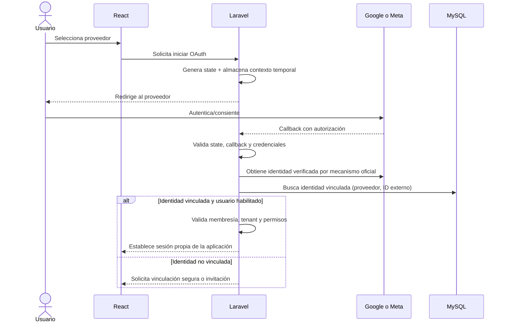

# AUTH-01 — Diseño de autenticación social

**Proyecto:** SaaS Inversiones R&P  
**Versión:** 1.0 (propuesta posterior al Sprint 5)  
**Estado:** Diseño por contrastar con el repositorio de OpenCode  
**Responsables:** Arquitectura, backend, frontend, seguridad y QA  
**Relacionados:** Documento Maestro v1.1, SDD-01, Canvas de Diseño de Datos v1.1, Backlog v1.1; US-0111 a US-0115.

## 1. Objetivo y alcance

Ofrecer **tres formas de acceso** al mismo usuario interno: correo/contraseña, Google y Facebook. La identidad externa prueba el control de una cuenta del proveedor; **no otorga por sí misma pertenencia a una empresa, rol ni permisos**. No incluye Google Workspace, acceso con Microsoft ni integración con ventas por redes sociales.

La fuente original del proyecto contempla correo y Facebook; **Google se incorpora como ampliación aprobada por el solicitante**. Implementación y configuración **no verificadas**.

## 2. Requisitos funcionales

| ID | Requisito | Prioridad | Referencia |
|---|---|---|---|
| AUTH-RF-01 | Mantener login local | Alta | RF-AUTH-01 |
| AUTH-RF-02 | Iniciar sesión con Google (OIDC) | Alta | US-0111 |
| AUTH-RF-03 | Iniciar sesión con Facebook (mecanismo oficial Meta) | Alta | US-0112 |
| AUTH-RF-04 | Permitir vincular identidades a usuario autenticado de forma verificada | Alta | US-0113 |
| AUTH-RF-05 | Impedir vinculación por simple igualdad de correo | Crítica | US-0113 |
| AUTH-RF-06 | Proteger OAuth, sesiones y credenciales | Crítica | US-0114 |
| AUTH-RF-07 | Presentar estados claros, cancelaciones y errores accesibles | Alta | US-0115 |
| AUTH-RF-08 | Desvincular sin perder el último método de acceso válido | Alta | US-0113 |
| AUTH-RF-09 | Aplicar tenant/roles/permisos internos tras cada login | Crítica | RF-AUTH-08 |

## 3. Actores y precondiciones

- **Usuario existente:** cuenta interna activa; pertenencia a empresa otorgada por el sistema.
- **Usuario nuevo:** requiere política explícita de invitación/alta, **pendiente de decidir**.
- **Administrador de empresa:** administra invitaciones y permisos, según autorización real del repositorio.
- **Proveedor externo:** Google o Meta/Facebook, encargado exclusivamente de autenticar una identidad externa.

## 4. Arquitectura conceptual

**Nota:** La estrategia exacta (redirección completa, cookie de sesión, Sanctum u otra) debe ajustarse a la autenticación que realmente exista; el diagrama es conceptual.

## 5. Contrato de integración propuesto, NO implementado

| Método | Ruta de referencia | Propósito | Control mínimo |
|---|---|---|---|
| GET | `/api/auth/{provider}/redirect` | Iniciar autenticación | Lista blanca `google`, `facebook`; `state` |
| GET | `/api/auth/{provider}/callback` | Validar retorno | `state`, código, origen, validación del proveedor |
| GET | `/api/me/auth-methods` | Ver métodos vinculados | Sesión y autorización |
| POST | `/api/me/auth-methods/{provider}/link` | Solicitar vinculación | Reautenticación/confirmación y token antifalsificación |
| DELETE | `/api/me/auth-methods/{provider}` | Desvincular | Reautenticación y método alterno |

**La forma de estas rutas es ilustrativa.** Confirmar prefijos, versión `/api/v1`, sesión CSRF y contratos reales antes de crear endpoints.

## 6. Modelo de datos mínimo propuesto

`social_identities`: `id`, `user_id` (FK), `provider`, `provider_user_id`, `created_at`, `updated_at`, `last_used_at` (opcional). Índice único **(`provider`, `provider_user_id`)**. Puede requerirse `provider_email` solo si existe necesidad justificada y política de minimización; no almacenar contraseñas del proveedor. No guardar tokens persistentes por defecto. La relación usuario↔empresa y sus permisos **no cambian** por usar login social.

Antes de migrar: comparar con tablas `usuario` / `users`, suscripciones y pivotes efectivamente existentes. Definir unicidad del email, usuario suspendido, bajas y concurrencia.

## 7. Seguridad obligatoria

1. Registrar clientes OAuth por ambiente; secretos y llaves únicamente en gestores seguros/variables de servidor.
2. Usar HTTPS en producción, callbacks registrados explícitamente y evitar redirecciones abiertas.
3. Generar, conservar y validar `state` de un solo uso; aplicar **PKCE cuando sea compatible y corresponda al flujo escogido**.
4. Para Google: validar el token de identidad cuando se emplee OIDC (emisor, audiencia, firma, expiración y nonce si aplica), o usar un SDK oficial/contrastado con las mismas garantías.
5. Para Facebook: validar la respuesta y recuperar el **ID estable del proveedor** mediante su API; no presuponer correo ni verificación.
6. No crear vínculos por coincidencia de email. Para asociar una cuenta externa a una interna: sesión válida más prueba de control del proveedor y comprobación de identidad suficiente.
7. Regenerar identificador de sesión tras autenticación; cookies `HttpOnly`, `Secure` y `SameSite` adecuados a la arquitectura; expiración y cierre de sesión.
8. Aplicar rate limiting al login local y endpoints susceptibles de abuso; registrar eventos sin tokens, credenciales ni datos personales innecesarios.
9. Evitar que un usuario sin empresa asignada acceda a productos, existencias o movimientos; aplicar autorización backend en **cada** operación.
10. Manejar suspensiones, revocación del proveedor y desconexiones, y conservar una vía de recuperación aprobada.

## 8. Flujos alternos y errores

| Escenario | Comportamiento requerido |
|---|---|
| Usuario cancela en Google/Facebook | Regresar a login con mensaje neutro; sin sesión nueva |
| `state` inválido o expirado | Rechazar; registrar evento seguro |
| No llega correo desde Facebook | Continuar por ID externo y política de vinculación/invitación, no inventar email |
| Email coincide con usuario existente | Solicitar vinculación verificada; nunca fusionar automáticamente |
| Identidad ya vinculada a otro usuario | Bloquear colisión y reportar conflicto sin revelar cuenta ajena |
| Usuario sin membresía a empresa | No dar acceso al inventario; mostrar flujo de invitación o estado pendiente |
| Proveedor no disponible | Permitir acceso local donde corresponda; mensaje recuperable |
| Usuario intenta quitar último método | Rechazar hasta registrar alternativa válida |

## 9. Criterios de aceptación y pruebas

- **AUTH-AC-01:** los tres métodos son visibles y navegables mediante teclado.
- **AUTH-AC-02:** Google autentica al usuario interno previamente vinculado y conserva su empresa/rol.
- **AUTH-AC-03:** Facebook autentica al usuario vinculado incluso si el proveedor no devuelve correo.
- **AUTH-AC-04:** callback manipulado, `state` inválido y redirección no autorizada son rechazados.
- **AUTH-AC-05:** ninguna combinación de proveedor permite acceder a otra empresa.
- **AUTH-AC-06:** vincular una identidad ya usada no duplica usuarios ni viola índice único.
- **AUTH-AC-07:** la desvinculación no deja al usuario sin acceso.
- **AUTH-AC-08:** los tests no dependen de credenciales reales (usar mocks del proveedor); pruebas integrales autorizadas se hacen en ambiente controlado.

## 10. Decisiones pendientes

- ¿Autoregistro por Google/Facebook o acceso únicamente mediante invitación empresarial?
- ¿Qué solución de sesiones ya utiliza Laravel? ¿Sanctum, sesiones web u otra?
- ¿Qué restricciones y nombres de tablas corresponden al esquema real?
- ¿Qué tratamiento legal y de privacidad requieren los datos recabados por cada proveedor?
- ¿En qué sprint de ajuste se implementará sin reabrir falsamente el Sprint 1?

## 11. Entregables y trazabilidad

**Código previsto:** configuración de proveedor, servicio de identidad, rutas/callback, UI React, migración incremental, tests. **Documentos:** SDD-01, SDD-04, SDD-05, SEGURIDAD, BACKLOG y ADR. **Evidencia:** commits, pruebas, revisión de seguridad y configuración por ambiente (sin secretos).

## 12. Checklist de OpenCode

- [ ] Inventariar login y sesión actual.
- [ ] Confirmar proveedor social si ya existe.
- [ ] Revisar usuarios, empresas, permisos y migrations.
- [ ] Aprobar decisiones pendientes.
- [ ] Implementar en rama nueva con migración reversible.
- [ ] Probar regresión Sprint 1 y aislamiento multiempresa.
- [ ] Actualizar trazabilidad y registrar resultados.
