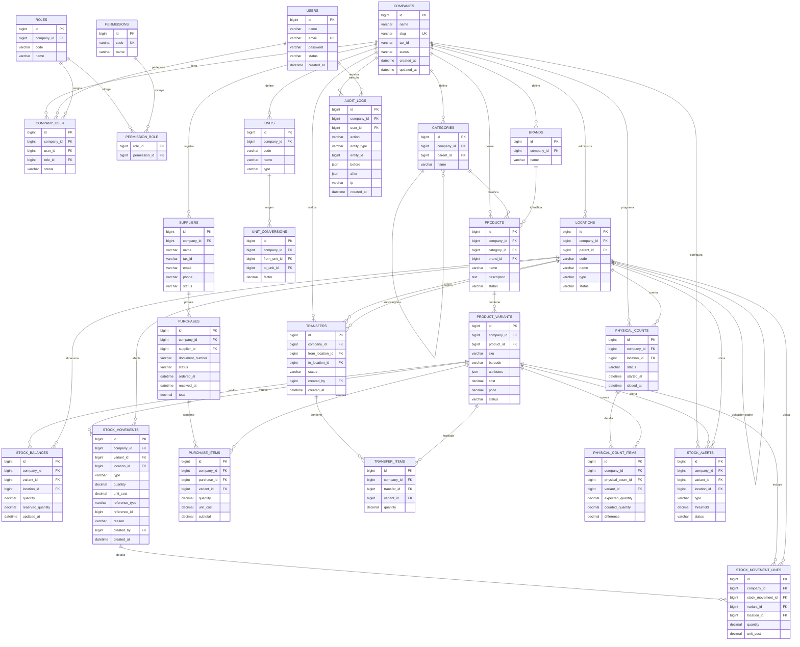

# DER lógico — SaaS Inversiones R&P

**Proyecto:** SaaS Inversiones R&P
**Documento:** Diagrama entidad-relación lógico (US-0002)
**Versión:** 1.0 — Sprint 0
**Fecha:** 2026-11-12
**Estado:** Propuesta para revisión del Product Owner

---

## 1. Convenciones del modelo

- **Idioma interno:** tablas y columnas en inglés (`company_id`, no `empresa_id`),
  conforme a `Reglas/ESTANDAR.md`, Anexo A.
- **Idioma visible:** la interfaz muestra «Empresa», «Producto», «Existencia», etc.
- **Identificadores:** `BIGINT UNSIGNED` autoincremental.
- **Cantidades:** `DECIMAL(14,3)`; **dinero:** `DECIMAL(14,4)`.
- **Fechas:** `DATETIME` en UTC; la presentación se convierte a la zona local.
- **Borrado:** lógico (`deleted_at`) en maestros y catálogo (DD-05 propuesta).
- **Tenant:** `company_id` obligatorio en tablas de dominio, con FK a `companies`.

> La decisión del backlog de representar `empresa_id` se implementa con el nombre
> interno `company_id`, tal como exige el estándar bilingüe del proyecto.

## 2. Diagrama entidad-relación

## 3. Clasificación de tablas

| Clasificación | Tablas | Observación |
| --- | --- | --- |
| Globales | `permissions`, `plans` (futuro) | Catálogos compartidos entre empresas |
| Raíz del tenant | `companies` | Define la empresa/tenant |
| Identidad global | `users` | Un usuario puede pertenecer a varias empresas (DD-01) |
| Dependientes del tenant | `categories`, `brands`, `products`, `product_variants`, `units`, `unit_conversions`, `locations`, `stock_balances`, `stock_movements`, `stock_movement_lines`, `suppliers`, `purchases`, `purchase_items`, `transfers`, `transfer_items`, `physical_counts`, `physical_count_items`, `stock_alerts`, `audit_logs` | `company_id` obligatorio |
| Pivotes | `company_user`, `permission_role` | Relaciones muchos a muchos |
| Asociativa | `stock_balances` | Variante + ubicación con saldo propio |

## 4. Reglas de integridad

| Regla | Implementación |
| --- | --- |
| Una existencia por variante y ubicación | `UNIQUE (company_id, variant_id, location_id)` |
| SKU único por empresa | `UNIQUE (company_id, sku)` |
| Sin stock negativo | `CHECK (quantity >= 0)` + validación transaccional |
| Movimientos inmutables | Sin `DELETE` físico; reversión con movimiento compensatorio |
| Referencias cruzadas prohibidas | Validación de `company_id` en entidades relacionadas |
| Borrado lógico | `deleted_at` en maestros y catálogo |
| Trazabilidad | `created_by` + `audit_logs` |

## 5. Tablas fuera del MVP

Las tablas de ventas (`sales`, `sale_items`) **no se crean en el MVP**. Las
salidas por venta se registran con `stock_movements.type = 'sale_exit'` y
`reference_type`/`reference_id`, según se apruebe DP-01. Las tablas de planes y
suscripciones se reservan para la fase comercial (DP-08).

## 6. Documentos relacionados

- `database/dictionaries/DICCIONARIO_DATOS.md` — detalle de columnas y tipos.
- `DOCUMENTACION/SDD/SDD-04_DISENO_BASE_DATOS.md` — estrategia multiempresa.
- `DOCUMENTACION/SDD/ADR/REGISTRO_DECISIONES_SPRINT_0.md` — DP/DD pendientes.
